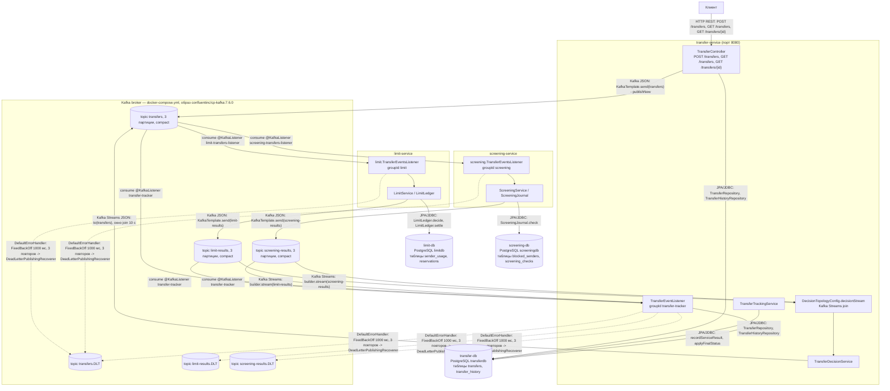
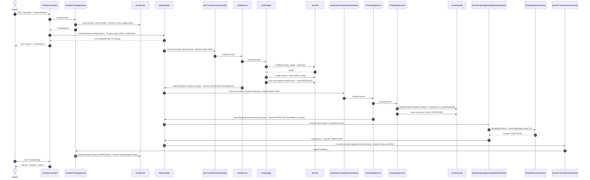
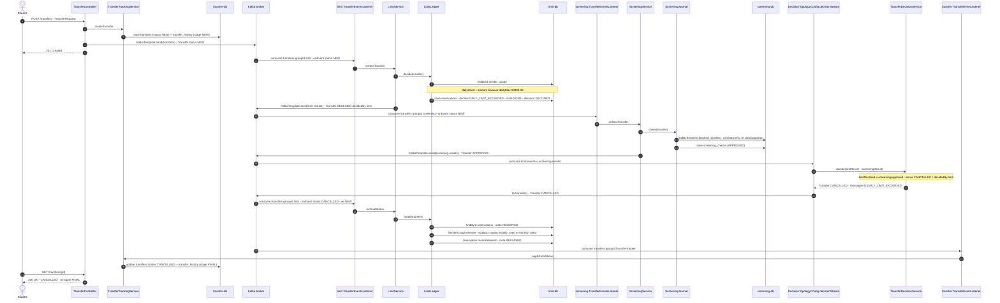
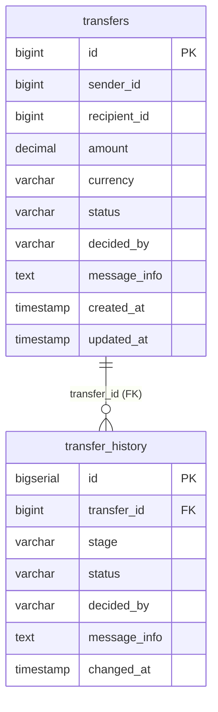
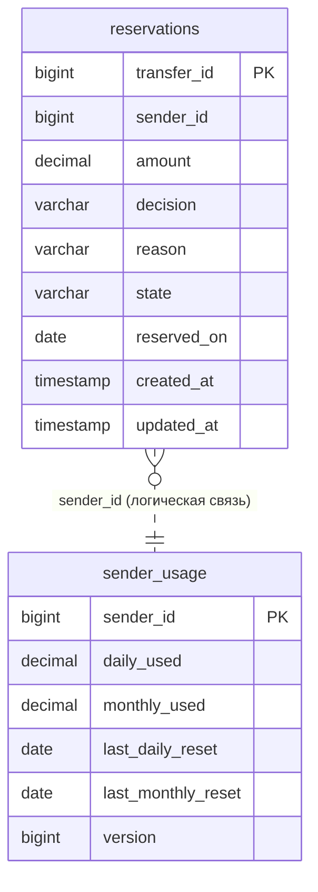
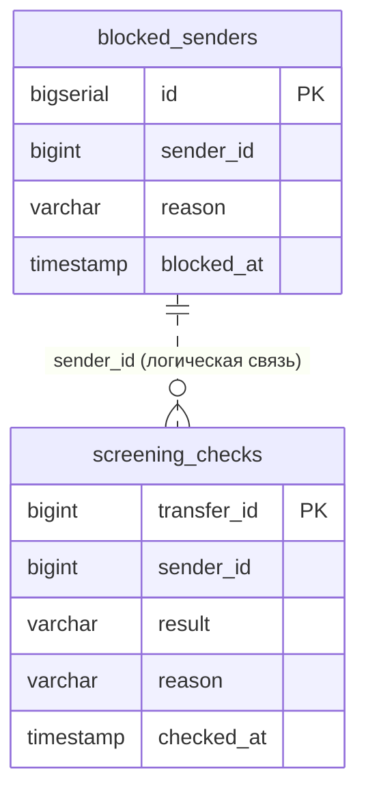
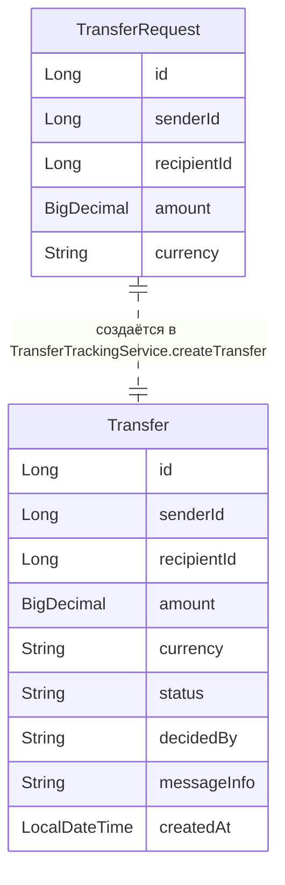
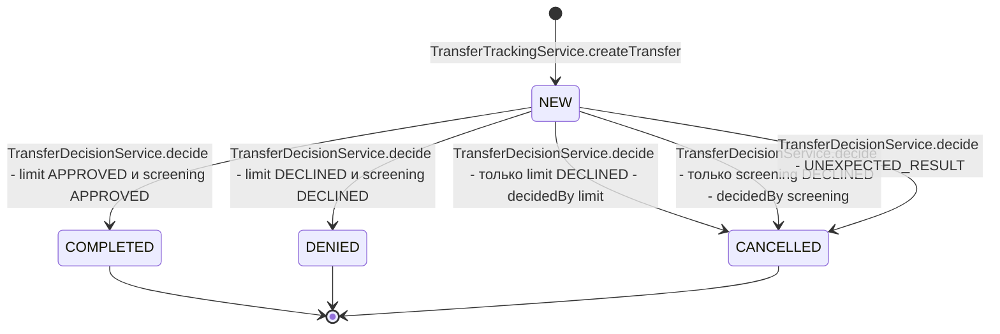

## Диаграмма 1: Component diagram (C4)

Система transfer-limit-system состоит из трёх Spring Boot сервисов (transfer-service, limit-service, screening-service), трёх отдельных баз PostgreSQL и брокера Kafka с топиками transfers, limit-results, screening-results и их DLT-топиками.

Внешние системы, кроме клиента и брокера Kafka, в коде не найдены. Обработка сбоев Kafka Streams внутри decisionStream (конфигурация exception handler для Streams) в коде не найдена — требует уточнения.

## Диаграмма 2: Sequence diagram — happy path

Основной успешный сценарий: клиент создаёт перевод через POST /transfers, две проверки выносят APPROVED, Kafka Streams соединяет результаты и публикует финальный статус COMPLETED в transfers.

## Диаграмма 3: Sequence diagram — сценарий отказа

Показательный отказ: проверка лимита отклоняет перевод (DAILY_LIMIT_EXCEEDED), резерв уже создан и учтён в дневном расходе, поэтому после финального статуса CANCELLED LimitLedger.settle снимает резерв и возвращает сумму в счётчике отправителя.

Дополнительно из кода: при неуспешной обработке любого сообщенияlistener'ы после 3 повторов (FixedBackOff 1000 мс) публикуют его в DLT-топик (DeadLetterPublishingRecoverer, KafkaErrorHandlingConfig); если Kafka недоступна при publishNew, TransferController выбрасывает ResponseStatusException 503 с текстом «Kafka недоступна, перевод сохранён — повторите запрос с тем же id», при этом перевод уже сохранён в transfer-db со статусом NEW.

## Диаграмма 4а: ER — transfer-db (PostgreSQL transferdb)

Схема из limit-… точнее из transfer-service: `transfer-service/src/main/resources/db/changelog/001-create-tables.sql`.

Уникальность transfer_history: CONSTRAINT uq_transfer_history_stage UNIQUE (transfer_id, stage) — stage перечисления HistoryStage: NEW, LIMIT, SCREENING, FINAL.

## Диаграмма 4б: ER — limit-db (PostgreSQL limitdb)

Схема из `limit-service/src/main/resources/db/changelog/001-create-tables.sql`; связь sender_id внешним ключом не оформлена.

## Диаграмма 4в: ER — screening-db (PostgreSQL screeningdb)

Схема из `screening-service/src/main/resources/db/changelog/001-create-tables.sql` (включая тестовые данные 002-insert-test-data.sql для blocked_senders).

## Диаграмма 4г: ER — объекты, не хранящиеся в БД (сообщения и запросы)

Поля из transfer-common `Transfer.java` и transfer-service `TransferRequest.java`.

**Логические связи между сущностями разных диаграмм (без FK в коде):**
- transfers.id ↔ Transfer.id (сообщение Kafka) ↔ reservations.transfer_id ↔ screening_checks.transfer_id;
- transfers.sender_id ↔ reservations.sender_id ↔ sender_usage.sender_id ↔ blocked_senders.sender_id ↔ screening_checks.sender_id ↔ Transfer.senderId;
- Transfer.id ↔ TransferRequest.id (один и тот же идентификатор перевода, задаваемый клиентом).

## Диаграмма 5: Диаграмма состояний — Transfer (статусы)

Ключевая бизнес-сущность со жизненным циклом — статус перевода (TransferStatus в openapi/transfer-api.yaml, поля TransferEntity.status); переходы выполняет TransferDecisionService.decide через Kafka Streams, а применяет TransferTrackingService.applyFinalStatus.

Ограничение из кода: решение издаётся только если результаты limit-results и screening-results попали в окно Kafka Streams 10 секунд (JoinWindows.ofTimeDifferenceWithNoGrace в DecisionTopologyConfig); при выходе результата за окно перевод остаётся в NEW, явной обработки этого случая в коде не найдено — требует уточнения.

Другие сущности с жизненным циклом: Reservation в limit-service (`limit/domain/Reservation.java`) — состояния NONE (отказ решением decline), RESERVED (approve), COMMITTED (markCommitted по статусу COMPLETED), RELEASED (markReleased по CANCELLED/DENIED в LimitLedger.settle). У ScreeningCheck жизненного цикла в коде не найдено — она создаётся один раз с результатом APPROVED или DECLINED.