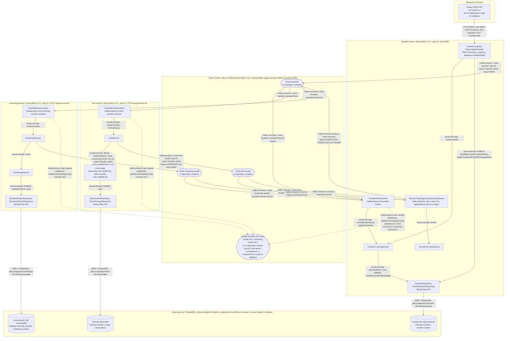
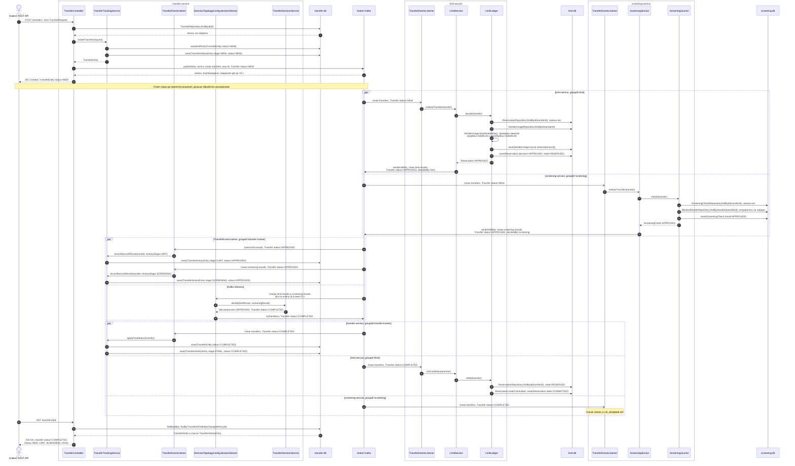
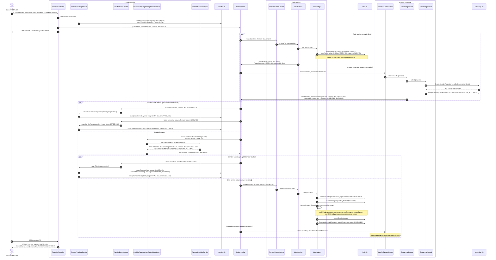
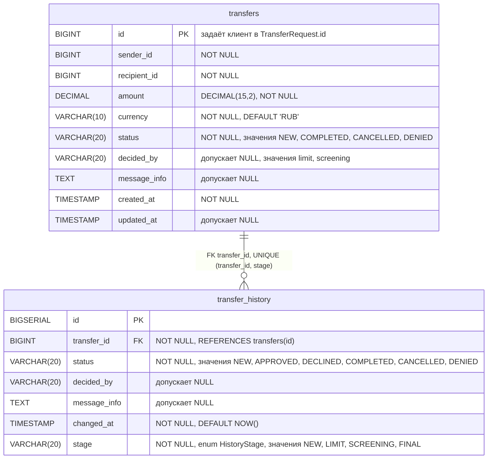
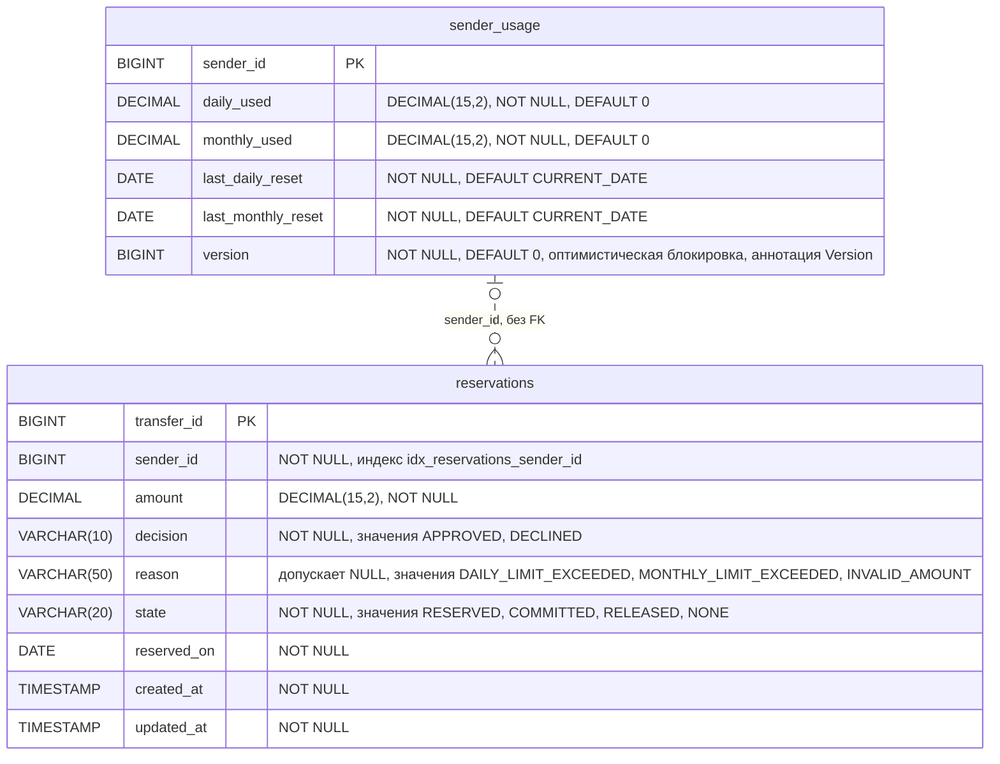
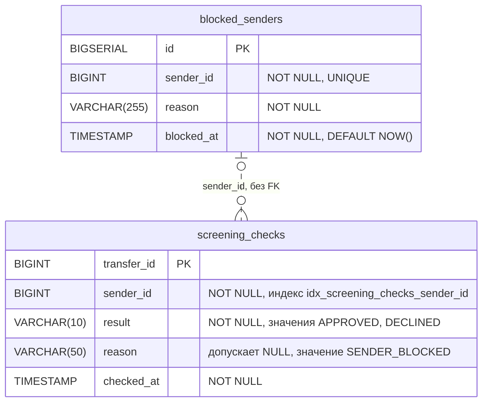
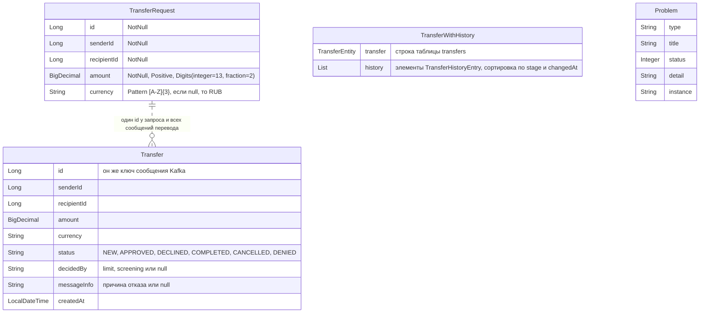
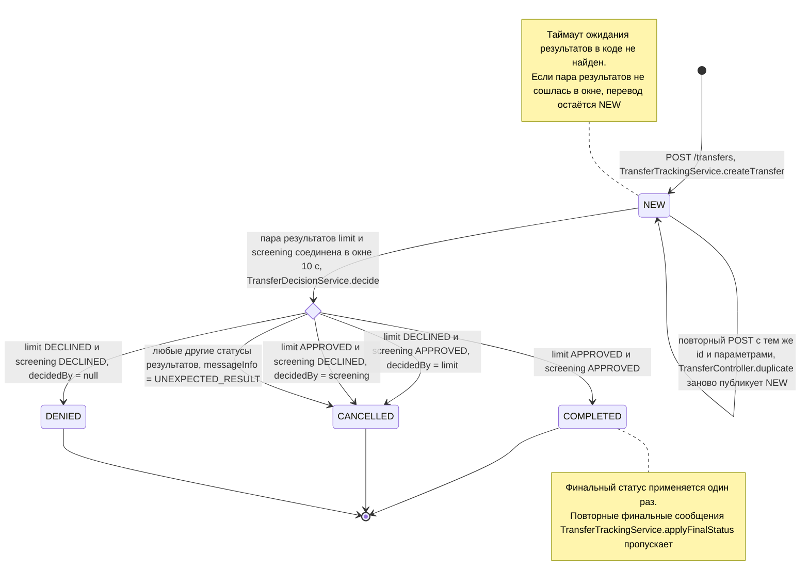

## Диаграмма 1. Component diagram (C4)

Контейнеры из `docker-compose.yml` и их основные компоненты: три Spring Boot-сервиса, брокер Kafka и три базы PostgreSQL; между собой сервисы общаются только через топики Kafka, REST API есть только у `transfer-service` (`TransferController.java`). Внешних систем, кроме клиента REST API, и потребителей DLT-топиков в коде не найдено; модуль `transfer-common` (record `Transfer`) — общая библиотека формата сообщений, а не контейнер.

## Диаграмма 2. Sequence diagram — успешный сценарий

Отправитель не числится в `blocked_senders`, сумма укладывается в лимиты из `limit-service/src/main/resources/application.yml`: обе проверки возвращают APPROVED, и `TransferDecisionService.decide` (`TransferDecisionService.java`) выставляет COMPLETED. Ответ 201 уходит сразу после публикации NEW, итог клиент читает через `GET /transfers/{id}`; движение денег по счетам в коде не найдено.

## Диаграмма 3. Sequence diagram — сценарий отказа

Отправитель найден в `blocked_senders` (тестовые строки — `screening-service/src/main/resources/db/changelog/002-insert-test-data.sql`), а `limit-service` к этому моменту уже зарезервировал лимит, поэтому итог — CANCELLED с `decidedBy=screening`. Уже сделанный резерв откатывается в `LimitLedger.settle` (`LimitLedger.java`) через `SenderUsage.release` и `Reservation.markReleased`; запись перевода и история в `transfer-service` не удаляются, а получают финальный статус.

## Диаграмма 4. ER-диаграммы

У каждого сервиса своя база, схемы взяты из `db/changelog/001-create-tables.sql` соответствующего модуля; объекты, которые не хранятся в БД, вынесены в 4г. `DECIMAL(15,2)` записан как `DECIMAL` с уточнением в комментарии, потому что запятая в типе ломает разбор Mermaid.

### 4а. База transferdb (transfer-service)

Таблицы классов `TransferEntity` и `TransferHistoryEntry`.

### 4б. База limitdb (limit-service)

Таблицы классов `SenderUsage` и `Reservation`; внешних ключей в схеме нет.

### 4в. База screeningdb (screening-service)

Таблицы классов `BlockedSender` и `ScreeningCheck`; внешних ключей в схеме нет.

### 4г. Объекты, которые не хранятся в БД

Record `Transfer` (`transfer-common`, сообщение во всех трёх топиках) и record `TransferRequest` (тело `POST /transfers`). `TransferWithHistory` и `Problem` — имена схем из `openapi/transfer-api.yaml`; в Java это `Map` в `TransferController.getById` и `ProblemDetail`.

Логические связи между сущностями разных диаграмм (без FK, по значению идентификатора):

- `transfers.id` (4а) — `reservations.transfer_id` (4б): 1 к 0..1, резерв создаёт `LimitLedger.decide`.
- `transfers.id` (4а) — `screening_checks.transfer_id` (4в): 1 к 0..1, запись создаёт `ScreeningJournal.check`.
- `transfers.sender_id` (4а) — `sender_usage.sender_id` (4б): N к 0..1.
- `transfers.sender_id` (4а) — `blocked_senders.sender_id` (4в): N к 0..1.
- `Transfer.id` (4г) — `transfers.id` (4а), `reservations.transfer_id` (4б), `screening_checks.transfer_id` (4в): N к 1, id перевода служит и ключом сообщения Kafka.
- `Transfer.senderId` (4г) — `sender_usage.sender_id` (4б), `blocked_senders.sender_id` (4в): N к 0..1.
- `Transfer` (4г) — `transfer_history` (4а): сообщения из `limit-results`, `screening-results` и итоговое из `transfers` сохраняются строками со stage LIMIT, SCREENING, FINAL, не более одной на stage (`TransferTrackingService.recordServiceResult`, `applyFinalStatus`).
- `TransferRequest.id` (4г) — `transfers.id` (4а): N к 1, повтор запроса с тем же id возвращает существующую запись (`TransferController.duplicate`).
- `TransferWithHistory` (4г) — `transfers` и `transfer_history` (4а): один перевод и до 4 записей истории, собирает `TransferController.getById`.
- Ответы `POST /transfers` и `GET /transfers` — сериализованный `TransferEntity` (схема `Transfer` в `transfer-api.yaml`); отдельного DTO в коде не найдено.
- Справочники отправителей и получателей, на которые указывают `sender_id` и `recipient_id`, в коде не найдены.

## Диаграмма 5. Диаграмма состояний

Ключевая сущность — перевод: поле `status` класса `TransferEntity` (таблица `transfers`). Финальный статус вычисляет `TransferDecisionService.decide` и записывает `TransferTrackingService.applyFinalStatus` (`TransferTrackingService.java`).

Другие сущности со статусами:

- `Reservation.state` (`limit-service`, `Reservation.java`, переходы в `LimitLedger.settle`): RESERVED → COMMITTED при итоге COMPLETED, RESERVED → RELEASED при CANCELLED или DENIED; NONE — лимит отклонён, переходов нет.
- `Reservation.decision` и `ScreeningCheck.result`: APPROVED или DECLINED, задаются один раз, переходов нет.
- `TransferHistoryEntry.stage` (NEW, LIMIT, SCREENING, FINAL) — журнал этапов, не более одной записи на этап; жизненным циклом не является.