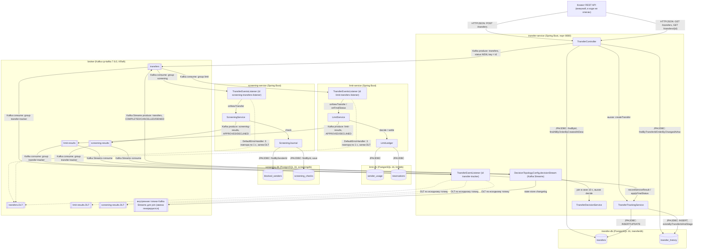
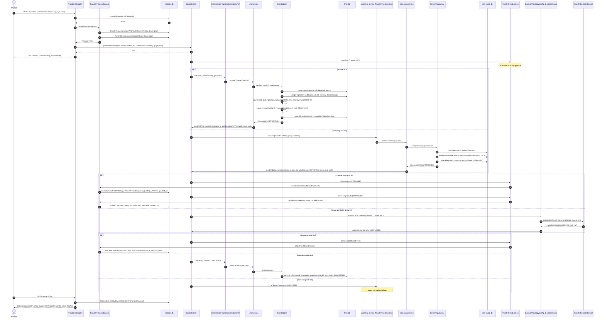
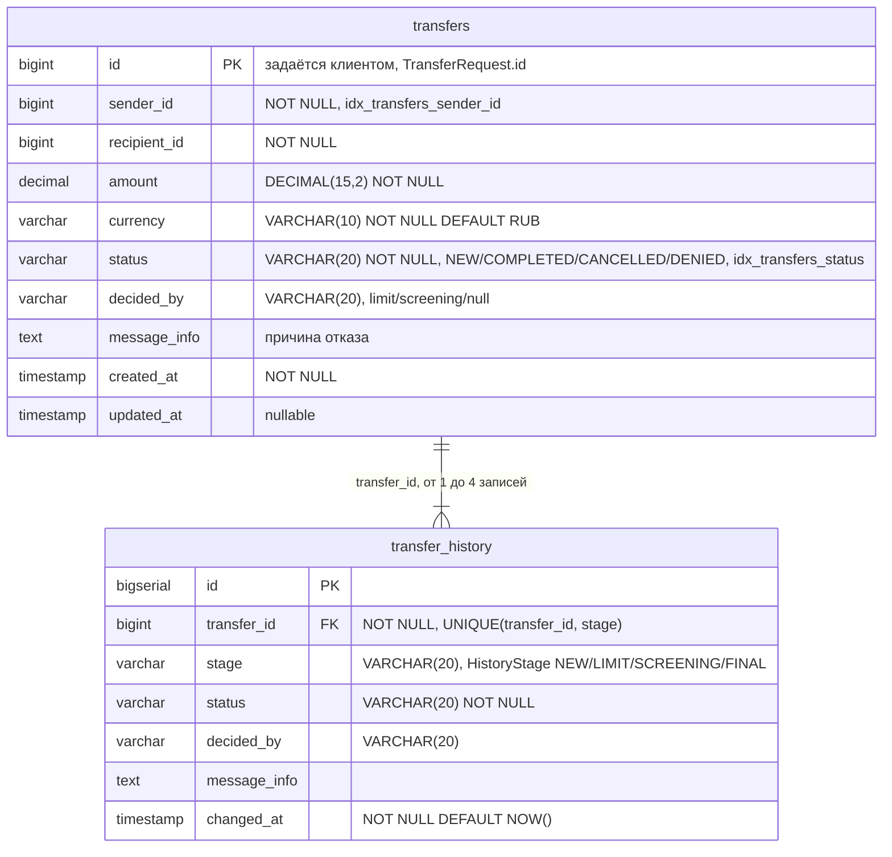
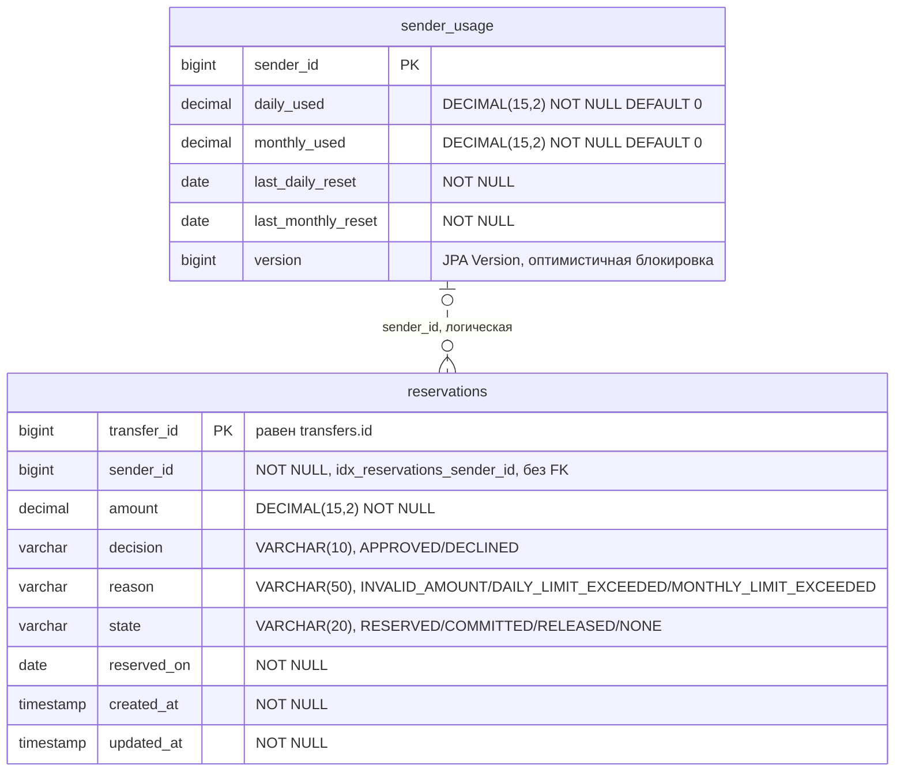
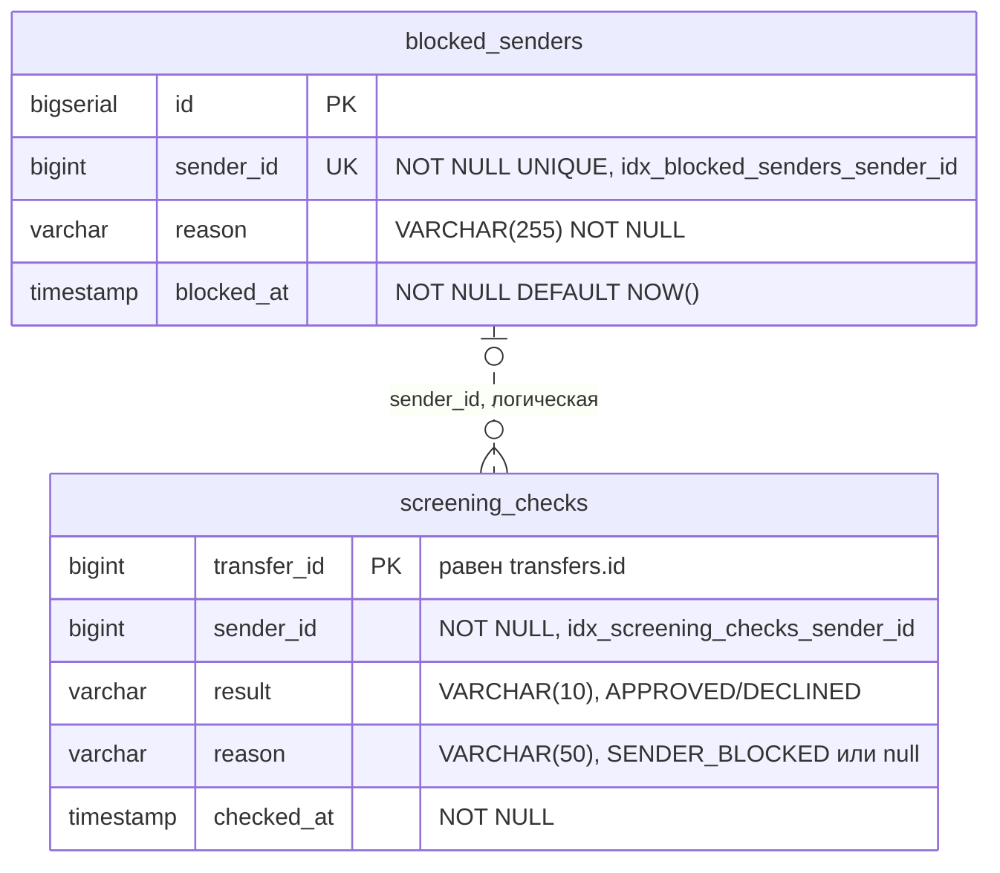
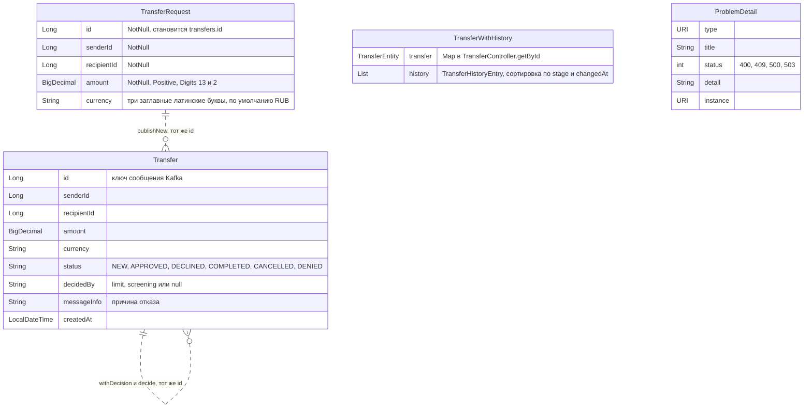
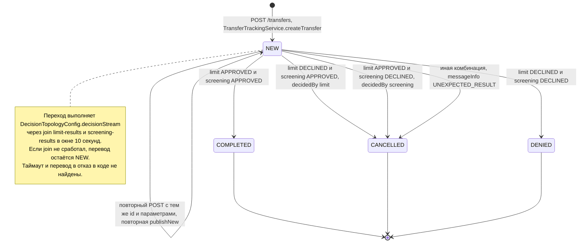

## Диаграмма 1. Component diagram (C4)

Диаграмма показывает три Spring Boot сервиса, их базы PostgreSQL, брокер Kafka с рабочими и DLT-топиками и связи между ними. Взаимодействие сервисов асинхронное, через топики `transfers`, `limit-results` и `screening-results`; синхронный вход один: REST в `transfer-service`.

## Диаграмма 2. Sequence diagram: успешный сценарий (happy path)

Перевод проходит проверку лимитов и скрининг. После join результатов он получает статус `COMPLETED`, а резерв лимита фиксируется (`COMMITTED`).

## Диаграмма 3. Sequence diagram: основной сценарий отказа

Отправитель из `blocked_senders` (например, `senderId` 13 из `002-insert-test-data.sql`) проходит проверку лимитов, и сумма уже зарезервирована. Скрининг отклоняет перевод, перевод получает статус `CANCELLED`, а резерв компенсируется в `LimitLedger.settle` (состояние `RELEASED`).

```mermaid
sequenceDiagram
    autonumber
    actor Client as Клиент
    participant TC as TransferController
    participant TTS as TransferTrackingService
    participant TDB as transfer-db
    participant K as Kafka broker
    participant LTL as limit-service TransferEventsListener
    participant LS as LimitService
    participant LG as LimitLedger
    participant LDB as limit-db
    participant STL as screening-service TransferEventsListener
    participant SS as ScreeningService
    participant SJ as ScreeningJournal
    participant SDB as screening-db
    participant DS as DecisionTopologyConfig.decisionStream
    participant TDS as TransferDecisionService
    participant TEL as TransferEventListener

    Client->>TC: POST /transfers (senderId из blocked_senders)
    TC->>TTS: createTransfer(request)
    TTS->>TDB: INSERT transfers (NEW), INSERT transfer_history (stage NEW)
    TC->>K: publishNew, send(transfers, id, Transfer NEW)
    TC-->>Client: 201 Created (status NEW)

    par limit-service
        K->>LTL: onEvent(Transfer NEW)
        LTL->>LS: onNewTransfer(transfer)
        LS->>LG: decide(transfer)
        LG->>LDB: reservationRepository.findById, пусто, usageRepository.findById(senderId)
        LG->>LG: lazyReset, лимиты не превышены, usage.reserve(amount), reservation.approve()
        LG->>LDB: save sender_usage, save reservations (state RESERVED)
        Note over LDB: Уже выполнено, сумма добавлена в daily_used и monthly_used
        LS->>K: send(limit-results, withDecision(APPROVED, limit, null))
    and screening-service
        K->>STL: onEvent(Transfer NEW)
        STL->>SS: onNewTransfer(transfer)
        SS->>SJ: check(transfer)
        SJ->>SDB: blockedSenderRepository.findBySenderId(senderId), найден
        SJ->>SDB: checkRepository.save(ScreeningCheck DECLINED, SENDER_BLOCKED)
        SS->>K: send(screening-results, withDecision(DECLINED, screening, SENDER_BLOCKED))
    end

    par трекинг результатов
        K->>TEL: limit-results (APPROVED), screening-results (DECLINED)
        TEL->>TTS: recordServiceResult(LIMIT), recordServiceResult(SCREENING)
        TTS->>TDB: INSERT transfer_history (LIMIT APPROVED), (SCREENING DECLINED)
    and решение Kafka Streams
        K->>DS: join limit-results и screening-results по key id в окне 10 с
        DS->>TDS: decide(limitResult, screeningResult)
        TDS-->>DS: limitApproved и screeningDeclined, withDecision(CANCELLED, screening, SENDER_BLOCKED)
        DS->>K: to(transfers), Transfer CANCELLED
    end

    par компенсация резерва в limit-service
        K->>LTL: onEvent(Transfer CANCELLED)
        LTL->>LS: onFinalStatus(transfer)
        LS->>LG: settle(transfer)
        LG->>LDB: reservationRepository.findById, isReserved = true
        LG->>LDB: usageRepository.findById(senderId), SenderUsage.release(amount, reservedOn, today), save
        LG->>LDB: reservation.markReleased(), save (state RELEASED)
    and фиксация статуса
        K->>TEL: transfers (CANCELLED)
        TEL->>TTS: applyFinalStatus(transfer)
        TTS->>TDB: UPDATE transfers status CANCELLED, decided_by screening, message_info SENDER_BLOCKED
        TTS->>TDB: INSERT transfer_history (FINAL CANCELLED)
    and screening-service
        K->>STL: onEvent(Transfer CANCELLED)
        Note over STL: только лог, screening не держит резервов
    end

    Client->>TC: GET /transfers/{id}
    TC-->>Client: 200 (transfer CANCELLED, history NEW, LIMIT, SCREENING, FINAL)

    Note over LG,LDB: release уменьшает daily_used только если reservedOn = today, monthly_used только в том же месяце, не ниже 0
    Note over DS,K: Если результат не пришёл в окно 10 с или ушёл в DLT после 3 повторов, join не срабатывает. Перевод остаётся NEW, резерв остаётся RESERVED. Обработка таймаута и компенсация в коде не найдены
```

## Диаграмма 4а. ER: transferdb (transfer-service)

Сущности `TransferEntity` и `TransferHistoryEntry`. Связь по внешнему ключу `transfer_history.transfer_id REFERENCES transfers(id)`, ограничение `uq_transfer_history_stage` допускает не больше одной записи на этап.

## Диаграмма 4б. ER: limitdb (limit-service)

Сущности `SenderUsage` и `Reservation`. Внешних ключей нет, связь по `sender_id` логическая.

## Диаграмма 4в. ER: screeningdb (screening-service)

Сущности `BlockedSender` и `ScreeningCheck`. Внешних ключей нет, связь по `sender_id` логическая.

## Диаграмма 4г. Объекты, не хранящиеся в БД

Это REST-модели и сообщение Kafka `Transfer` из `transfer-common`. `Transfer` передаётся во всех топиках с ключом `Long id`, а ответ `GET /transfers/{id}` собирается как `Map` в `TransferController.getById` (в OpenAPI это `TransferWithHistory`).

Логические связи между сущностями разных диаграмм (все без FK, через идентификатор):

- `TransferRequest.id` → `transfers.id`: создаётся в `TransferTrackingService.createTransfer`.
- `Transfer.id` ↔ `transfers.id`: сообщения во всех топиках относятся к переводу по id.
- `reservations.transfer_id` → `transfers.id` (limitdb → transferdb).
- `screening_checks.transfer_id` → `transfers.id` (screeningdb → transferdb).
- `sender_usage.sender_id`, `reservations.sender_id`, `blocked_senders.sender_id` и `screening_checks.sender_id` → `transfers.sender_id`.
- `reservations.decision` и `reason` → `Transfer.status` и `messageInfo` в топике `limit-results` (`LimitService.onNewTransfer`).
- `screening_checks.result` и `reason` → `Transfer.status` и `messageInfo` в топике `screening-results` (`ScreeningService.onNewTransfer`).
- `Transfer` из `limit-results`, `screening-results` и `transfers` (финальный статус) → строки `transfer_history` с `stage` LIMIT, SCREENING и FINAL, а также поля `transfers.status`, `decided_by`, `message_info`.
- `TransferWithHistory.transfer` → `transfers` (TransferEntity), `TransferWithHistory.history` → `transfer_history` (TransferHistoryEntry).
- Справочника отправителей и получателей (`senderId`, `recipientId`) в коде не найдено.

## Диаграмма 5. Диаграмма состояний: перевод (TransferEntity.status)

Главная бизнес-сущность — перевод в таблице `transfers`. Финальный статус вычисляет `TransferDecisionService.decide`, а применяет `TransferTrackingService.applyFinalStatus`; повторное применение отсекается проверкой этапа FINAL.

Другие сущности с жизненным циклом:

- **Reservation.state** (limitdb). При одобрении в `decide` резерв получает `RESERVED`, при отказе `NONE`. Из `RESERVED` он переходит в `COMMITTED` в `settle` при `COMPLETED` или в `RELEASED` в `settle` при `CANCELLED` и `DENIED`. Отдельно хранится поле `Reservation.decision`: APPROVED или DECLINED.
- **transfer_history.stage** (transferdb). Этапы NEW, затем LIMIT и SCREENING в любом порядке, затем FINAL; на каждый этап одна запись.
- **ScreeningCheck.result** (screeningdb). Значение задаётся один раз (APPROVED или DECLINED), переходов в коде не найдено.