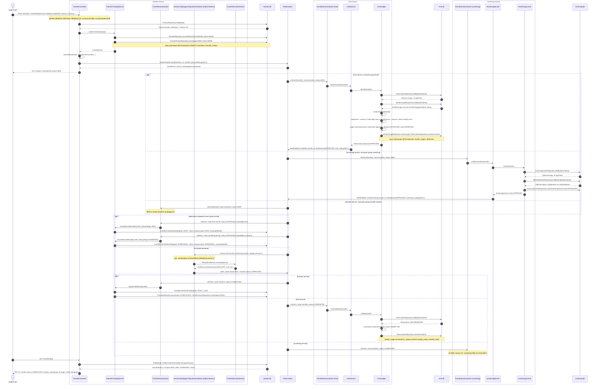
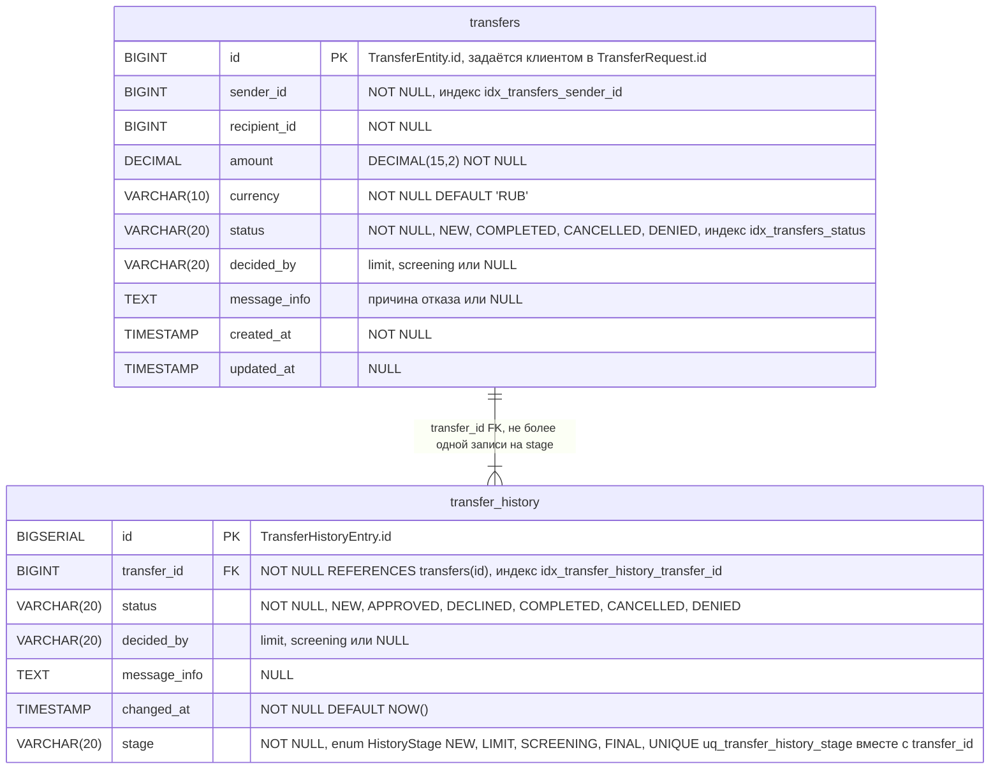
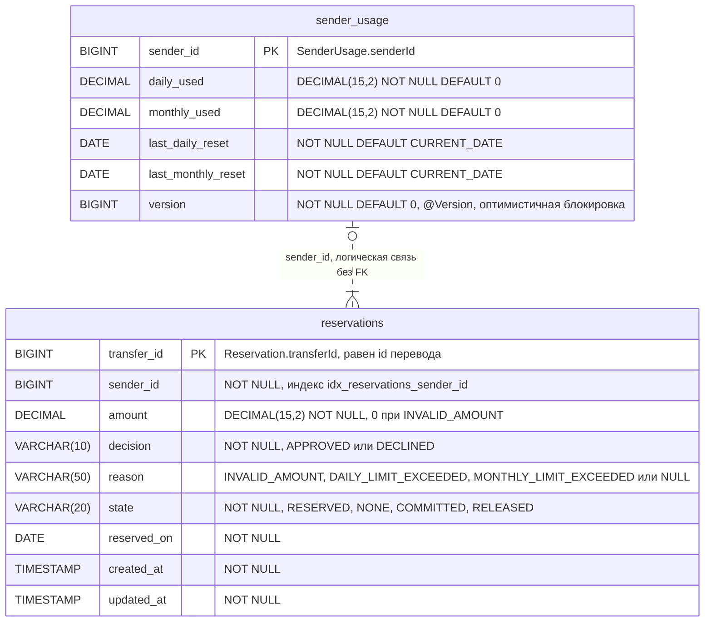
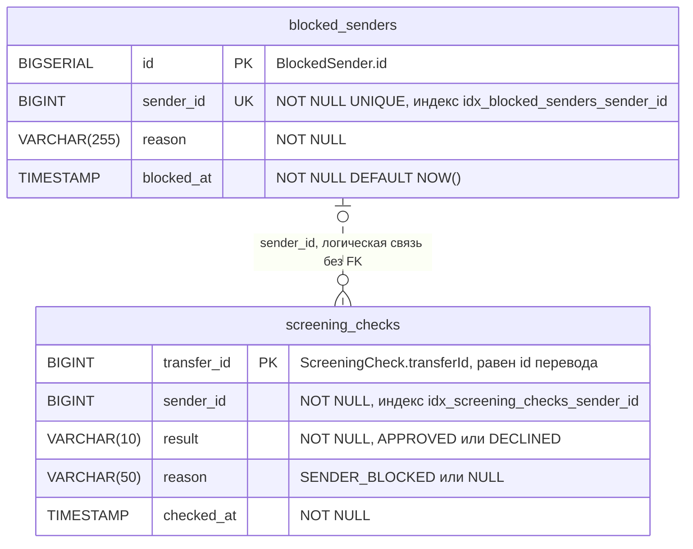
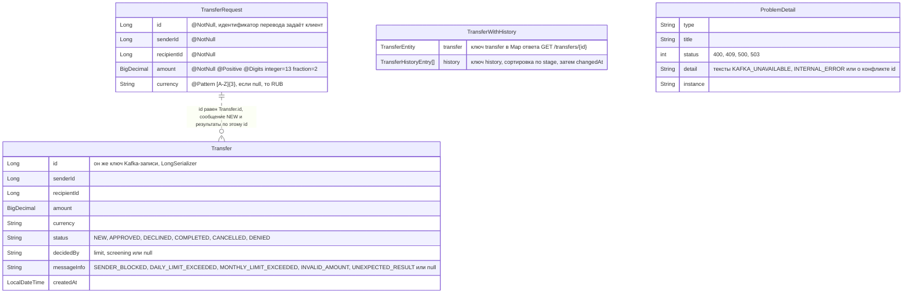
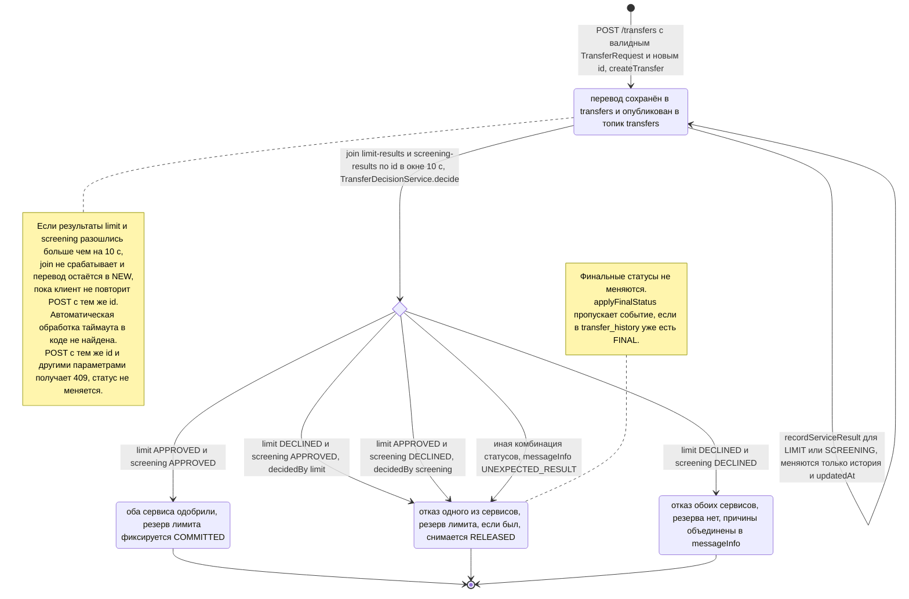

# Диаграммы системы transfer-limit-system

## Диаграмма 1. Component diagram (C4)

Компоненты трёх Spring Boot-сервисов (transfer-service, limit-service, screening-service), их базы PostgreSQL, Kafka-брокер с рабочими топиками и DLT и внешний клиент REST API. Сплошные стрелки — синхронные вызовы (HTTP, Java, JDBC), пунктирные — асинхронный обмен через Kafka (ключ Long = Transfer.id, значение — Transfer в JSON).

```mermaid
flowchart TB
    client(["Клиент REST API — внешняя система, в коде не определена, требует уточнения"])
    common[["transfer-common — общая библиотека: record com.example.common.Transfer, формат значения во всех топиках"]]

    subgraph SYS["Система transfer-limit-system — docker-compose.yml"]

        subgraph TS["transfer-service — Spring Boot 3.4.1, HTTP :8080"]
            t_ctrl["TransferController — REST /transfers"]
            t_exh["ApiExceptionHandler — ProblemDetail HTTP 500"]
            t_track["TransferTrackingService"]
            t_listener["TransferEventListener — @KafkaListener transfer-tracker"]
            t_topology["DecisionTopologyConfig.decisionStream — Kafka Streams join, LogAndContinueExceptionHandler"]
            t_decision["TransferDecisionService"]
            t_repo_tr["TransferRepository"]
            t_repo_hist["TransferHistoryRepository"]
            t_state[("Kafka Streams state-dir /tmp/transfer-service-streams")]
        end

        subgraph TDB["transfer-db — PostgreSQL 16, jdbc:postgresql://transfer-db:5432/transferdb, с хоста :5434"]
            tdb_transfers[("transfers")]
            tdb_history[("transfer_history")]
        end

        subgraph KAFKA["broker — Kafka confluentinc/cp-kafka:7.6.0, KRaft, broker:29092, с хоста localhost:9092"]
            k_transfers[/"transfers — 3 партиции, compact"/]
            k_limit[/"limit-results — 3 партиции, compact"/]
            k_screen[/"screening-results — 3 партиции, compact"/]
            k_tdlt[/"transfers.DLT — потребитель в коде не найден"/]
            k_ldlt[/"limit-results.DLT — потребитель в коде не найден"/]
            k_sdlt[/"screening-results.DLT — потребитель в коде не найден"/]
            k_note["Топики объявлены бинами NewTopic в TopicsConfig и KafkaErrorHandlingConfig сервисов, автосоздание топиков отключено"]
        end

        subgraph LS["limit-service — Spring Boot 3.4.1, без HTTP API"]
            l_listener["TransferEventsListener — @KafkaListener limit-transfers-listener"]
            l_service["LimitService"]
            l_ledger["LimitLedger — limits.daily-max 50000.00, limits.monthly-max 200000.00"]
            l_repo_usage["SenderUsageRepository"]
            l_repo_res["ReservationRepository"]
        end

        subgraph LDB["limit-db — PostgreSQL 16, jdbc:postgresql://limit-db:5432/limitdb, с хоста :5432"]
            ldb_usage[("sender_usage")]
            ldb_res[("reservations")]
        end

        subgraph SS["screening-service — Spring Boot 3.4.1, без HTTP API"]
            s_listener["TransferEventsListener — @KafkaListener screening-transfers-listener"]
            s_service["ScreeningService"]
            s_journal["ScreeningJournal"]
            s_repo_blocked["BlockedSenderRepository"]
            s_repo_check["ScreeningCheckRepository"]
        end

        subgraph SDB["screening-db — PostgreSQL 16, jdbc:postgresql://screening-db:5432/screeningdb, с хоста :5433"]
            sdb_blocked[("blocked_senders")]
            sdb_checks[("screening_checks")]
        end
    end

    client -->|"HTTP/JSON: POST /transfers, GET /transfers, GET /transfers/{id}"| t_ctrl
    t_ctrl -->|"Java: createTransfer"| t_track
    t_ctrl -->|"Java: findById, findAllByOrderByCreatedAtDesc"| t_repo_tr
    t_ctrl -->|"Java: findByTransferIdOrderByChangedAtAsc"| t_repo_hist
    t_ctrl -->|"Java: необработанные исключения, ответ HTTP 500"| t_exh
    t_ctrl -.->|"Kafka: топик transfers, Transfer NEW"| k_transfers
    t_track -->|"Java: saveAndFlush, findById, save"| t_repo_tr
    t_track -->|"Java: save, existsByTransferIdAndStage"| t_repo_hist
    t_repo_tr -->|"JDBC: таблица transfers"| tdb_transfers
    t_repo_hist -->|"JDBC: таблица transfer_history"| tdb_history
    k_transfers -.->|"Kafka: transfers, group transfer-tracker"| t_listener
    k_limit -.->|"Kafka: limit-results, group transfer-tracker"| t_listener
    k_screen -.->|"Kafka: screening-results, group transfer-tracker"| t_listener
    t_listener -->|"Java: recordServiceResult, applyFinalStatus"| t_track
    k_limit -.->|"Kafka Streams: stream limit-results"| t_topology
    k_screen -.->|"Kafka Streams: stream screening-results"| t_topology
    t_topology -->|"Java: decide в join, окно 10 с"| t_decision
    t_topology -->|"файловая система: состояние окон join"| t_state
    t_topology -.->|"Kafka Streams: to transfers, COMPLETED, CANCELLED, DENIED"| k_transfers
    t_listener -.->|"Kafka: transfers.DLT, DefaultErrorHandler после 3 повторов через 1 с"| k_tdlt
    t_listener -.->|"Kafka: limit-results.DLT"| k_ldlt
    t_listener -.->|"Kafka: screening-results.DLT"| k_sdlt

    k_transfers -.->|"Kafka: transfers, group limit"| l_listener
    l_listener -->|"Java: onNewTransfer, onFinalStatus"| l_service
    l_service -->|"Java: decide, settle"| l_ledger
    l_service -.->|"Kafka: топик limit-results, APPROVED или DECLINED"| k_limit
    l_ledger -->|"Java: findById, save"| l_repo_usage
    l_ledger -->|"Java: findById, save"| l_repo_res
    l_repo_usage -->|"JDBC: таблица sender_usage"| ldb_usage
    l_repo_res -->|"JDBC: таблица reservations"| ldb_res
    l_listener -.->|"Kafka: transfers.DLT, DefaultErrorHandler после 3 повторов через 1 с"| k_tdlt

    k_transfers -.->|"Kafka: transfers, group screening"| s_listener
    s_listener -->|"Java: onNewTransfer"| s_service
    s_service -->|"Java: check"| s_journal
    s_service -.->|"Kafka: топик screening-results, APPROVED или DECLINED"| k_screen
    s_journal -->|"Java: findBySenderId"| s_repo_blocked
    s_journal -->|"Java: findById, save"| s_repo_check
    s_repo_blocked -->|"JDBC: таблица blocked_senders"| sdb_blocked
    s_repo_check -->|"JDBC: таблица screening_checks"| sdb_checks
    s_listener -.->|"Kafka: transfers.DLT, DefaultErrorHandler после 3 повторов через 1 с"| k_tdlt

    classDef dlt stroke-dasharray: 5 5
    class k_tdlt,k_ldlt,k_sdlt dlt
```

## Диаграмма 2. Sequence diagram — основной успешный сценарий (happy path)

Создание перевода через POST /transfers, параллельные проверки в limit-service и screening-service, итоговое решение COMPLETED в Kafka Streams и фиксация резерва лимита. Клиент получает 201 Created сразу со статусом NEW, итоговый статус виден через GET /transfers/{id}.

## Диаграмма 3. Sequence diagram — основной сценарий отказа

Отправитель есть в blocked_senders: screening-service отклоняет перевод с причиной SENDER_BLOCKED, когда limit-service уже зарезервировал сумму. Итоговый статус — CANCELLED, а уже выполненный резерв компенсируется в LimitLedger.settle (RESERVED → RELEASED).

```mermaid
sequenceDiagram
    autonumber
    actor Client as Клиент API
    box transfer-service
        participant TC as TransferController
        participant TTS as TransferTrackingService
        participant TEL as TransferEventListener
        participant DTC as DecisionTopologyConfig.decisionStream (Kafka Streams)
        participant TDS as TransferDecisionService
    end
    participant TDB as transfer-db
    participant K as Kafka broker
    box limit-service
        participant LEL as TransferEventsListener (limit)
        participant LS as LimitService
        participant LL as LimitLedger
    end
    participant LDB as limit-db
    box screening-service
        participant SEL as TransferEventsListener (screening)
        participant SS as ScreeningService
        participant SJ as ScreeningJournal
    end
    participant SDB as screening-db

    Client->>TC: POST /transfers, TransferRequest senderId=5
    Note over Client,TC: senderId=5 есть в blocked_senders, тестовые данные 002-insert-test-data.sql
    TC->>TTS: createTransfer(request)
    TTS->>TDB: INSERT transfers status=NEW и transfer_history stage=NEW
    TC-)K: publishNew: send(transfers, id, Transfer status=NEW).get(10 s)
    TC-->>Client: 201 Created, TransferEntity status=NEW

    par limit-service: лимит не превышен, сумма резервируется
        K-)LEL: onEvent, топик transfers, status=NEW
        LEL->>LS: onNewTransfer(transfer)
        LS->>LL: decide(transfer)
        LL->>LDB: ReservationRepository.findById(transferId) = empty, SenderUsageRepository.findById(senderId)
        LL->>LL: usage.lazyReset(today), проверки limits.daily-max и limits.monthly-max пройдены
        LL->>LL: usage.reserve(amount): dailyUsed и monthlyUsed увеличены на amount
        LL->>LL: reservation.approve(): decision=APPROVED, state=RESERVED
        LL->>LDB: SenderUsageRepository.save(usage), ReservationRepository.save(reservation)
        Note over LL,LDB: уже выполненное действие: сумма зарезервирована в sender_usage, reservations.state=RESERVED
        LS-)K: send(limit-results, id, withDecision(APPROVED, limit, null))
    and screening-service: отправитель заблокирован
        K-)SEL: onEvent, топик transfers, status=NEW
        SEL->>SS: onNewTransfer(transfer)
        SS->>SJ: check(transfer)
        SJ->>SDB: ScreeningCheckRepository.findById(transferId) = empty
        SJ->>SDB: BlockedSenderRepository.findBySenderId(5)
        SDB-->>SJ: BlockedSender reason=Fraud detected
        SJ->>SDB: ScreeningCheckRepository.save(result=DECLINED, reason=SENDER_BLOCKED)
        SJ-->>SS: ScreeningCheck result=DECLINED
        SS-)K: send(screening-results, id, withDecision(DECLINED, screening, SENDER_BLOCKED))
    end

    K-)TEL: топики limit-results и screening-results, group transfer-tracker
    TEL->>TTS: recordServiceResult(LIMIT), recordServiceResult(SCREENING)
    TTS->>TDB: transfer_history: LIMIT APPROVED и SCREENING DECLINED с messageInfo=SENDER_BLOCKED

    K-)DTC: join limit-results и screening-results по id в окне 10 с
    DTC->>TDS: decide(limitResult, screeningResult)
    Note over TDS: ветка limitApproved и screeningDeclined. Другие ветки: оба DECLINED → DENIED, limit DECLINED → CANCELLED с decidedBy=limit, тогда резерва нет и settle ничего не снимает
    TDS-->>DTC: withDecision(CANCELLED, screening, SENDER_BLOCKED)
    DTC-)K: to(transfers): Transfer status=CANCELLED, decidedBy=screening, messageInfo=SENDER_BLOCKED

    par transfer-service: фиксация отказа
        K-)TEL: onEvent, топик transfers, status=CANCELLED
        TEL->>TTS: applyFinalStatus(transfer)
        TTS->>TDB: existsByTransferIdAndStage(id, FINAL) = false
        TTS->>TDB: UPDATE transfers status=CANCELLED, decided_by=screening, message_info=SENDER_BLOCKED
        TTS->>TDB: TransferHistoryRepository.save(stage=FINAL, status=CANCELLED)
    and limit-service: компенсация уже выполненного резерва
        K-)LEL: onEvent, топик transfers, status=CANCELLED
        LEL->>LS: onFinalStatus(transfer)
        LS->>LL: settle(transfer)
        LL->>LDB: ReservationRepository.findById(transferId)
        LDB-->>LL: Reservation state=RESERVED, isReserved() = true
        alt settle выполнен, ветка CANCELLED, DENIED
            LL->>LDB: SenderUsageRepository.findById(senderId).orElseThrow()
            LL->>LL: usage.release(amount, reservedOn, LocalDate.now())
            Note over LL: lazyReset(today), dailyUsed уменьшается, если reservedOn сегодня, monthlyUsed, если тот же месяц, не ниже нуля
            LL->>LDB: SenderUsageRepository.save(usage)
            LL->>LL: reservation.markReleased(): state=RELEASED
            LL->>LDB: ReservationRepository.save(reservation)
        else исключение в settle, например конфликт @Version в SenderUsage или недоступна limit-db
            Note over LEL,LDB: откат транзакции, DefaultErrorHandler: 3 повтора через 1 с, затем запись в transfers.DLT, резерв остаётся RESERVED, потребитель DLT в коде не найден
        end
    and screening-service
        K-)SEL: onEvent, топик transfers, status=CANCELLED
        Note over SEL: только лог, компенсировать нечего: ScreeningCheck DECLINED остаётся в screening_checks
    end

    Client->>TC: GET /transfers/{id}
    TC->>TDB: findById(id), findByTransferIdOrderByChangedAtAsc(id)
    TC-->>Client: 200 OK, status=CANCELLED, decidedBy=screening, messageInfo=SENDER_BLOCKED, history NEW, LIMIT, SCREENING, FINAL
```

## Диаграмма 4. ER-диаграммы

Сущности хранятся в трёх отдельных базах PostgreSQL (4а–4в), сообщения и DTO, которые не хранятся в БД, вынесены на диаграмму 4г. Сплошная линия — внешний ключ, пунктир — логическая связь по идентификатору без FK; типы полей БД взяты из Liquibase-скриптов 001-create-tables.sql.

### 4а. transferdb (transfer-service)

Перевод и журнал его этапов; единственный внешний ключ в системе — transfer_history.transfer_id → transfers.id.

### 4б. limitdb (limit-service)

Накопленное использование лимитов по отправителю и резерв суммы по каждому переводу; связь по sender_id логическая, FK в схеме нет.

### 4в. screeningdb (screening-service)

Список заблокированных отправителей (заполняется только тестовыми данными 002-insert-test-data.sql, кода изменения списка не найдено) и журнал проверок по переводам.

### 4г. Объекты, которые не хранятся в БД (сообщения Kafka и DTO REST API)

Transfer — значение Kafka-сообщения во всех топиках, TransferRequest, TransferWithHistory и ProblemDetail — тело запроса и ответов REST API transfer-service; типы — Java-типы из кода.

### Логические связи между сущностями разных диаграмм (все без FK)

- `transfers.id` (4а) = `reservations.transfer_id` (4б) = `screening_checks.transfer_id` (4в) = `Transfer.id` и `TransferRequest.id` (4г) — единый идентификатор перевода, его задаёт клиент, он же ключ Kafka-записи; `transfers` 1 : 0..1 `reservations`, 1 : 0..1 `screening_checks`, 1 : 0..N сообщений `Transfer`.
- `transfers.sender_id` (4а) = `sender_usage.sender_id` и `reservations.sender_id` (4б) = `blocked_senders.sender_id` и `screening_checks.sender_id` (4в) = `Transfer.senderId` и `TransferRequest.senderId` (4г); справочник отправителей в коде не найден.
- `transfers.recipient_id` (4а) = `Transfer.recipientId` и `TransferRequest.recipientId` (4г); получатель нигде не проверяется, сущность получателя в коде не найдена.
- `TransferRequest` (4г) → `transfers` и `transfer_history` со stage NEW (4а) — `TransferTrackingService.createTransfer`.
- `Transfer` из топиков `limit-results` и `screening-results` (4г) → `transfer_history` со stage LIMIT и SCREENING (4а) — `TransferTrackingService.recordServiceResult`; итоговый `Transfer` из топика `transfers` → `transfers.status`, `decided_by`, `message_info` и `transfer_history` со stage FINAL — `TransferTrackingService.applyFinalStatus`.
- `reservations.decision` и `reason` (4б) → `Transfer.status` и `messageInfo` в топике `limit-results`, decidedBy=limit — `LimitService.onNewTransfer`; `screening_checks.result` и `reason` (4в) → `Transfer.status` и `messageInfo` в топике `screening-results`, decidedBy=screening — `ScreeningService.onNewTransfer`.
- `TransferWithHistory.transfer` (4г) → `transfers` (4а), `TransferWithHistory.history` → `transfer_history` (4а) — `TransferController.getById`; ответы POST /transfers и GET /transfers — сериализованный `TransferEntity` (в transfer-api.yaml это схема `Transfer`, не путать с record `com.example.common.Transfer`).
- Топики `transfers.DLT`, `limit-results.DLT`, `screening-results.DLT` получают исходную запись (`Transfer` в JSON или сырые byte[]), потребители этих топиков в коде не найдены.

## Диаграмма 5. Диаграмма состояний перевода (TransferEntity, transfers.status)

Жизненный цикл главной бизнес-сущности — перевода. Статус выставляют TransferTrackingService.createTransfer и applyFinalStatus по решению, которое TransferDecisionService.decide принимает внутри join в DecisionTopologyConfig.

### Другие сущности с жизненным циклом

- `Reservation` (limit-service, таблица reservations, поле state): после `LimitLedger.decide` — RESERVED (`approve`, лимит не превышен) или NONE (`decline`: INVALID_AMOUNT, DAILY_LIMIT_EXCEEDED, MONTHLY_LIMIT_EXCEEDED); RESERVED → COMMITTED (`settle` при COMPLETED, `markCommitted`); RESERVED → RELEASED (`settle` при CANCELLED или DENIED, `SenderUsage.release` и `markReleased`); NONE, COMMITTED и RELEASED — конечные, `settle` их пропускает.
- Сообщение `Transfer` (transfer-common, поле status): NEW в топике transfers → APPROVED или DECLINED в limit-results и screening-results → COMPLETED, CANCELLED или DENIED в transfers.
- `TransferHistoryEntry` (transfer_history, поле stage): журнал этапов NEW → LIMIT и SCREENING → FINAL, по одной записи на этап; это лог, а не статус.
- `ScreeningCheck` (screening_checks, поле result): APPROVED или DECLINED задаётся один раз в `ScreeningJournal.check`, переходов нет.
- `SenderUsage` (sender_usage): статусов нет, только счётчики daily_used и monthly_used с ленивым сбросом в `lazyReset`.
