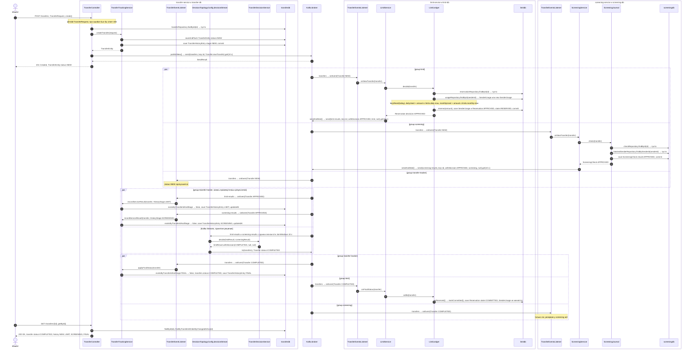
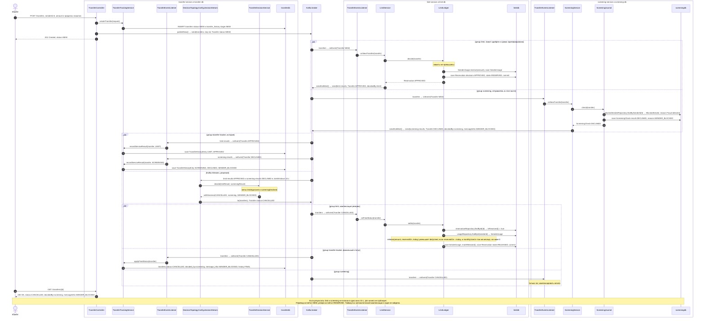
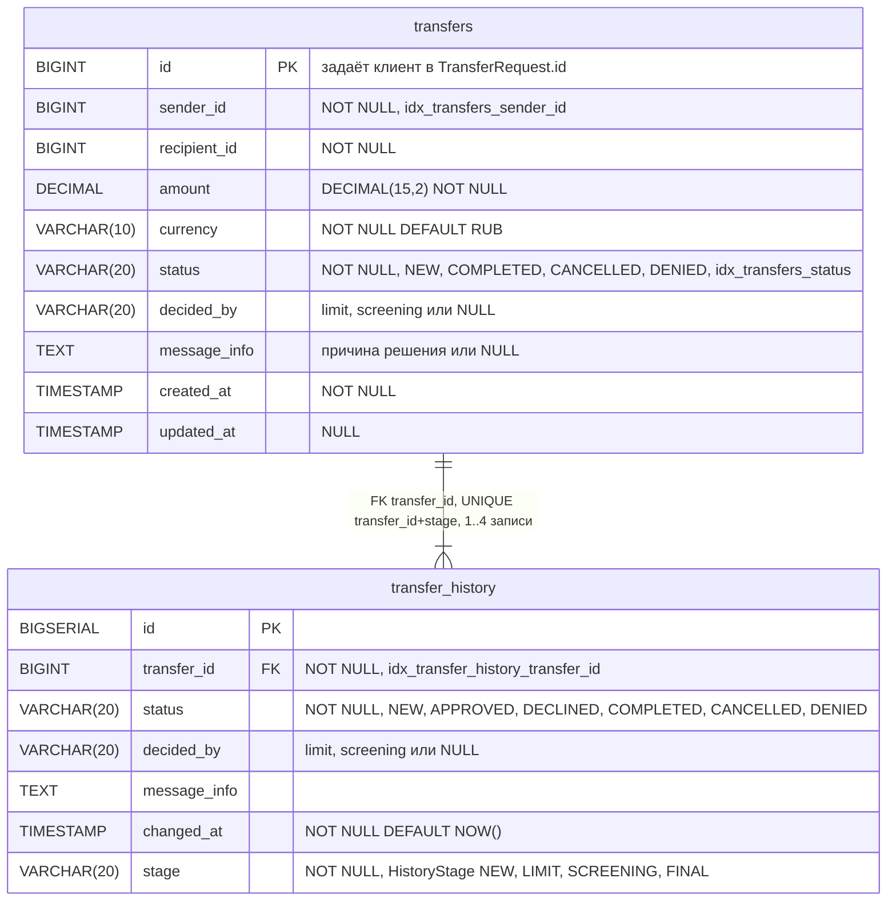
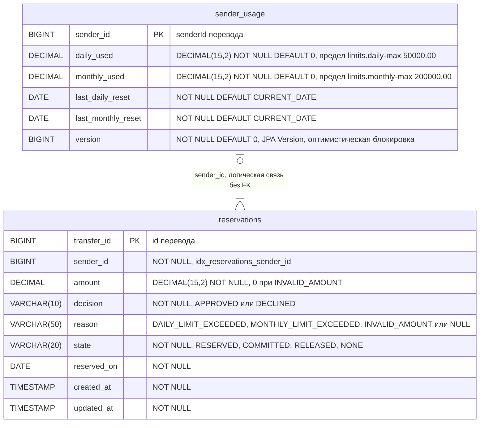
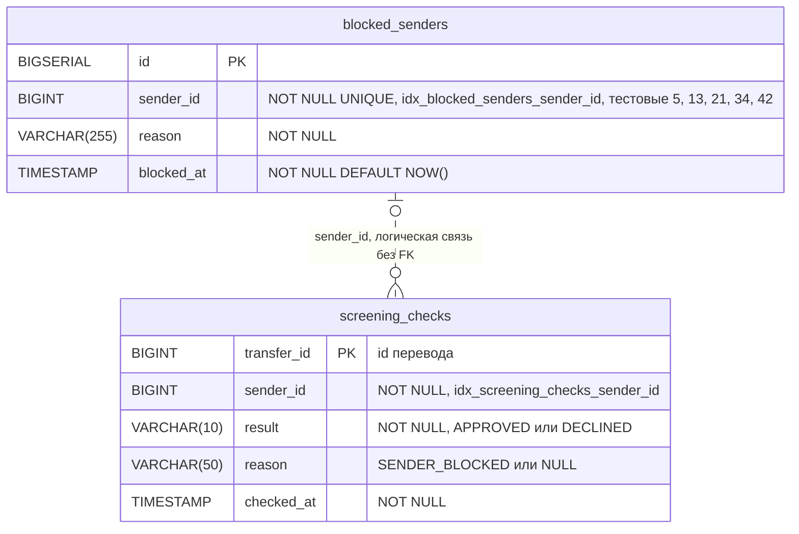
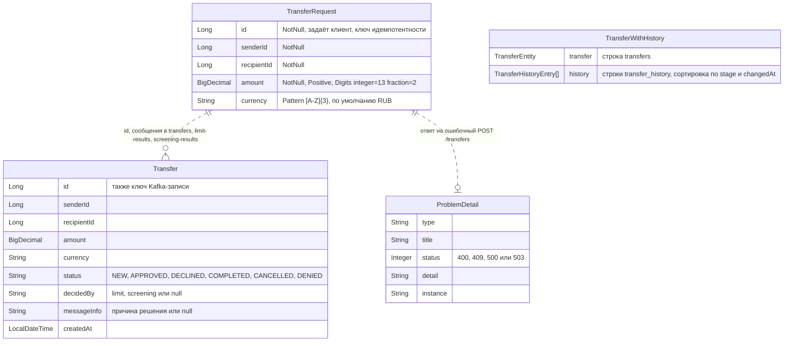
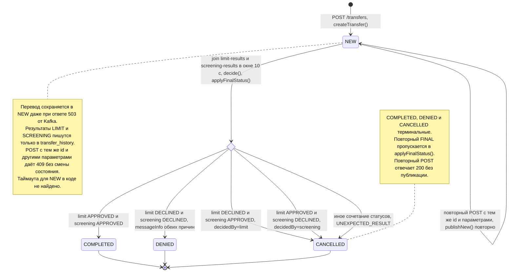

### Диаграмма 1. Component diagram (C4)

Контейнеры из docker-compose.yml и компоненты внутри сервисов. Сервисы не вызывают друг друга напрямую: они обмениваются сообщением Transfer из transfer-common через топики Kafka, а единственная синхронная точка входа — REST API TransferController. Других внешних систем (аутентификации, платёжного ядра, уведомлений клиента) в коде не найдено.

```mermaid
flowchart TB
    CLIENT(["Внешний REST-клиент<br/>в коде не определён"])

    subgraph TS["Контейнер transfer-service: Spring Boot 3.4.1, порт 8080"]
        TC["TransferController<br/>REST /transfers"]
        AEH["ApiExceptionHandler<br/>ProblemDetail"]
        TTS["TransferTrackingService"]
        TEL["TransferEventListener<br/>@KafkaListener id=transfer-tracker"]
        KS["DecisionTopologyConfig.decisionStream<br/>Kafka Streams join, окно 10 с<br/>LogAndContinueExceptionHandler"]
        TDS["TransferDecisionService"]
        TEH["KafkaErrorHandlingConfig<br/>DefaultErrorHandler, 3 повтора через 1 с"]
        KSS[("Состояние Kafka Streams<br/>/tmp/transfer-service-streams")]
    end

    subgraph LSVC["Контейнер limit-service: Spring Boot 3.4.1"]
        LEL["TransferEventsListener<br/>@KafkaListener id=limit-transfers-listener"]
        LS["LimitService"]
        LL["LimitLedger<br/>limits.daily-max=50000.00<br/>limits.monthly-max=200000.00"]
        LEH["KafkaErrorHandlingConfig<br/>DefaultErrorHandler, 3 повтора через 1 с"]
    end

    subgraph SSVC["Контейнер screening-service: Spring Boot 3.4.1"]
        SEL["TransferEventsListener<br/>@KafkaListener id=screening-transfers-listener"]
        SS["ScreeningService"]
        SJ["ScreeningJournal"]
        SEH["KafkaErrorHandlingConfig<br/>DefaultErrorHandler, 3 повтора через 1 с"]
    end

    subgraph BROKER["Контейнер broker: cp-kafka 7.6.0, KRaft, broker:29092, auto-create выключен"]
        T_TR[/"transfers<br/>key Long, value Transfer JSON<br/>3 партиции, compact"/]
        T_LR[/"limit-results<br/>key Long, value Transfer JSON<br/>3 партиции, compact"/]
        T_SR[/"screening-results<br/>key Long, value Transfer JSON<br/>3 партиции, compact"/]
        D_TR[/"transfers.DLT<br/>потребитель в коде не найден"/]
        D_LR[/"limit-results.DLT<br/>потребитель в коде не найден"/]
        D_SR[/"screening-results.DLT<br/>потребитель в коде не найден"/]
    end

    subgraph TDBC["Контейнер transfer-db: postgres:16-alpine, порт 5434:5432"]
        TDB[("transferdb<br/>transfers, transfer_history")]
    end

    subgraph LDBC["Контейнер limit-db: postgres:16-alpine, порт 5432:5432"]
        LDB[("limitdb<br/>sender_usage, reservations")]
    end

    subgraph SDBC["Контейнер screening-db: postgres:16-alpine, порт 5433:5432"]
        SDB[("screeningdb<br/>blocked_senders, screening_checks")]
    end

    CLIENT -->|"HTTP/JSON :8080, POST /transfers, GET /transfers, GET /transfers/{id}"| TC
    TC -->|"in-process: createTransfer()"| TTS
    TC -.->|"in-process: исключения, ответы 400, 409, 500, 503"| AEH
    TC -->|"JDBC: чтение через TransferRepository, TransferHistoryRepository"| TDB
    TTS -->|"JDBC: jdbc:postgresql://transfer-db:5432/transferdb, запись"| TDB
    TC -->|"Kafka produce: transfers, key=id, Transfer status=NEW"| T_TR

    T_TR -->|"Kafka consume: transfers, group=limit"| LEL
    T_TR -->|"Kafka consume: transfers, group=screening"| SEL
    T_TR -->|"Kafka consume: transfers, group=transfer-tracker, только не NEW"| TEL
    T_LR -->|"Kafka consume: limit-results, group=transfer-tracker"| TEL
    T_SR -->|"Kafka consume: screening-results, group=transfer-tracker"| TEL
    TEL -->|"in-process: recordServiceResult(), applyFinalStatus()"| TTS

    LEL -->|"in-process: onNewTransfer() для NEW, onFinalStatus() для остальных"| LS
    LS -->|"in-process: decide(), settle()"| LL
    LL -->|"JDBC: jdbc:postgresql://limit-db:5432/limitdb"| LDB
    LS -->|"Kafka produce: limit-results, key=id, APPROVED или DECLINED"| T_LR

    SEL -->|"in-process: onNewTransfer() только для NEW"| SS
    SS -->|"in-process: check()"| SJ
    SJ -->|"JDBC: jdbc:postgresql://screening-db:5432/screeningdb"| SDB
    SS -->|"Kafka produce: screening-results, key=id, APPROVED или DECLINED"| T_SR

    T_LR -->|"Kafka Streams consume: limit-results"| KS
    T_SR -->|"Kafka Streams consume: screening-results"| KS
    KS -->|"in-process: decide(limitResult, screeningResult)"| TDS
    KS -->|"локальный диск: оконные хранилища join"| KSS
    KS -->|"Kafka Streams produce: transfers, COMPLETED, CANCELLED или DENIED"| T_TR

    TEL -.->|"in-process: исключение обработчика"| TEH
    LEL -.->|"in-process: исключение обработчика"| LEH
    SEL -.->|"in-process: исключение обработчика"| SEH
    TEH -.->|"Kafka produce: transfers.DLT"| D_TR
    TEH -.->|"Kafka produce: limit-results.DLT"| D_LR
    TEH -.->|"Kafka produce: screening-results.DLT"| D_SR
    LEH -.->|"Kafka produce: transfers.DLT"| D_TR
    SEH -.->|"Kafka produce: transfers.DLT"| D_TR

    classDef ext fill:#eeeeee,stroke:#666666,color:#000000
    classDef store fill:#dae8fc,stroke:#6c8ebf,color:#000000
    classDef topic fill:#fff2cc,stroke:#d6b656,color:#000000
    class CLIENT ext
    class TDB,LDB,SDB,KSS store
    class T_TR,T_LR,T_SR,D_TR,D_LR,D_SR topic
```

### Диаграмма 2. Sequence diagram — основной успешный сценарий

Перевод в пределах лимитов от отправителя, которого нет в blocked_senders. limit-service резервирует сумму, screening-service одобряет перевод, join в DecisionTopologyConfig.decisionStream даёт статус COMPLETED, после чего LimitLedger.settle фиксирует резерв. Клиент получает 201 со статусом NEW сразу после публикации; финальный статус виден только через GET /transfers/{id}.

### Диаграмма 3. Sequence diagram — основной сценарий отказа

Отправитель из стоп-листа (senderId=5 из 002-insert-test-data.sql) переводит сумму в пределах лимитов. limit-service уже успел зарезервировать сумму, screening-service отклоняет перевод с причиной SENDER_BLOCKED, и TransferDecisionService.decide возвращает CANCELLED. Выполненный резерв компенсируется в LimitLedger.settle (SenderUsage.release, Reservation переходит в RELEASED), а перевод, его история и ScreeningCheck сохраняются.

### Диаграмма 4. ER-диаграммы

Сущности хранятся в трёх независимых БД, поэтому диаграмма разбита на 4а–4в по базам и 4г для объектов вне БД. Сплошная линия обозначает FK, пунктир — логическую связь по идентификатору без FK.

#### 4а. БД transferdb (transfer-service)

Таблицы из 001-create-tables.sql, JPA-классы TransferEntity и TransferHistoryEntry; это единственная связь по FK во всём проекте.

#### 4б. БД limitdb (limit-service)

JPA-классы SenderUsage и Reservation. FK между таблицами нет, лимиты задаются в application.yml.

#### 4в. БД screeningdb (screening-service)

JPA-классы BlockedSender и ScreeningCheck. Стоп-лист заполняется только миграцией 002-insert-test-data.sql; API для его ведения в коде не найдено.

#### 4г. Объекты вне БД

Объекты, которые передаются между компонентами, но не хранятся в БД:

- сообщение Transfer из transfer-common — значение во всех топиках, включая *.DLT;
- тело запроса TransferRequest;
- ответ GET /transfers/{id} — в коде это LinkedHashMap, в transfer-api.yaml ему соответствует схема TransferWithHistory;
- ProblemDetail — тело ответа при ошибках.

Логические связи между диаграммами 4а–4г:

- `TransferRequest.id` (4г) ↔ `transfers.id` (4а). Клиентский id становится PK перевода в TransferTrackingService.createTransfer; повторный запрос с тем же id новую строку не создаёт.
- `transfers.id` (4а) ↔ `Transfer.id` (4г). Это ключ Kafka-записи во всех топиках; на один перевод приходится NEW (возможны повторы), по одному результату от limit и screening и финальное сообщение.
- `transfers.id` (4а) ↔ `reservations.transfer_id` (4б), 1 : 0..1. Резерв создаёт LimitLedger.decide по сообщению NEW.
- `transfers.id` (4а) ↔ `screening_checks.transfer_id` (4в), 1 : 0..1. Запись создаёт ScreeningJournal.check.
- `transfers.sender_id` (4а) и `Transfer.senderId` (4г) ↔ `sender_usage.sender_id`, `reservations.sender_id` (4б) ↔ `blocked_senders.sender_id`, `screening_checks.sender_id` (4в). Это общий идентификатор отправителя; справочник отправителей в коде не найден.
- `transfers.recipient_id` (4а) и `Transfer.recipientId` (4г). Справочник получателей и какие-либо проверки получателя в коде не найдены, назначение поля требует уточнения.
- `reservations.decision` и `reservations.reason` (4б) → `Transfer.status` и `Transfer.messageInfo` в limit-results (4г) → `transfer_history` со stage=LIMIT (4а).
- `screening_checks.result` и `screening_checks.reason` (4в) → `Transfer` в screening-results (4г) → `transfer_history` со stage=SCREENING (4а).
- Финальный `Transfer` в transfers (4г) → `transfers.status`, `decided_by`, `message_info` и `transfer_history` со stage=FINAL (4а), а также `reservations.state` COMMITTED или RELEASED (4б).
- `TransferWithHistory.transfer` и `TransferWithHistory.history` (4г) → строки `transfers` и `transfer_history` (4а).

### Диаграмма 5. Диаграмма состояний перевода

Главная сущность — перевод: TransferEntity, поле transfers.status, значения совпадают с TransferStatus из transfer-api.yaml. Статус меняется только в TransferTrackingService.createTransfer и applyFinalStatus.

Другие сущности с жизненным циклом:

- **`Reservation.state`** (limit-service, reservations).
  - LimitLedger.decide создаёт резерв в состоянии RESERVED (decision=APPROVED) или NONE (decision=DECLINED с причиной DAILY_LIMIT_EXCEEDED, MONTHLY_LIMIT_EXCEEDED или INVALID_AMOUNT).
  - settle переводит RESERVED → COMMITTED при COMPLETED и RESERVED → RELEASED при CANCELLED или DENIED, возвращая сумму в SenderUsage.
  - NONE, COMMITTED и RELEASED — конечные состояния.
- **`ScreeningCheck.result`** (screening-service, screening_checks). Значение APPROVED или DECLINED (SENDER_BLOCKED) задаётся один раз в ScreeningJournal.check, переходов нет.
- **`TransferHistoryEntry.stage`** (transfer-service, transfer_history). Этапы NEW, LIMIT, SCREENING, FINAL — по одной записи на этап (ограничение uq_transfer_history_stage). При выдаче в TransferController.getById записи сортируются по stage.
- **`SenderUsage`** (limit-service, sender_usage). Статусов нет, но lazyReset сбрасывает счётчики dailyUsed и monthlyUsed при смене дня и месяца.