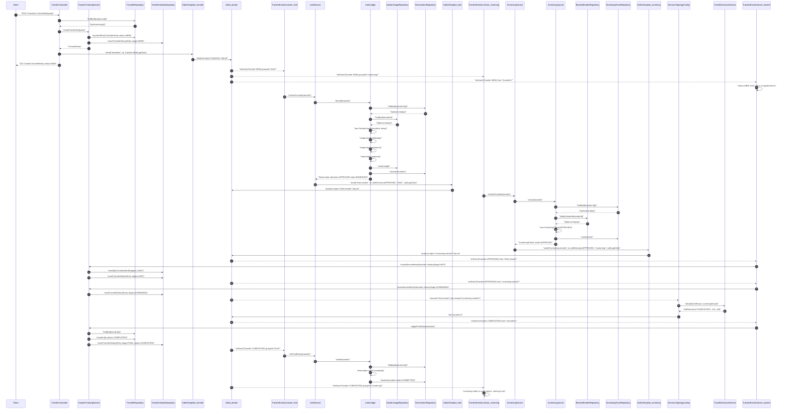
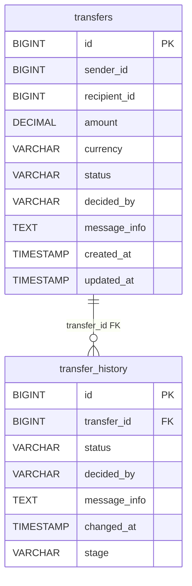
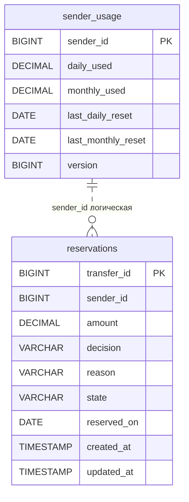
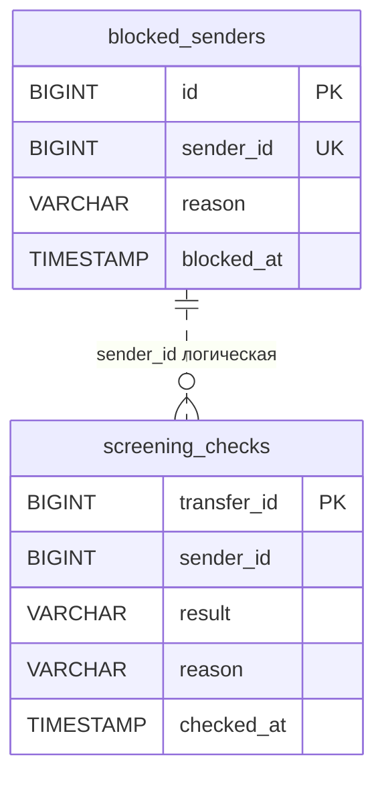
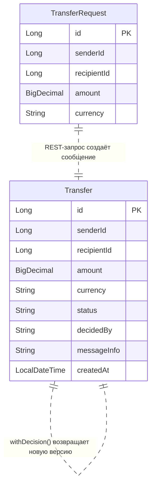
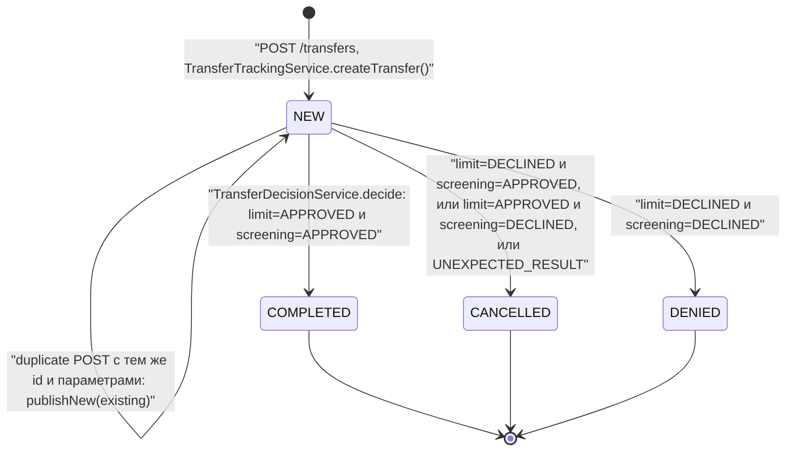

## Диаграмма 1: Component diagram (C4)
Показаны контейнеры системы, Kafka-топики, PostgreSQL-базы и основные каналы взаимодействия между ними.

```mermaid
flowchart TB
    subgraph Client["Внешняя система / клиент"]
        User["API client"]
    end

    subgraph TransferService["transfer-service"]
        TransferController["TransferController"]
        TransferTrackingService["TransferTrackingService"]
        TransferEventListener["TransferEventListener"]
        DecisionTopologyConfig["DecisionTopologyConfig"]
        TransferDecisionService["TransferDecisionService"]
        TransferKafkaErrorHandlingConfig["KafkaErrorHandlingConfig"]
    end

    subgraph LimitService["limit-service"]
        LimitTransferEventsListener["TransferEventsListener"]
        LimitServiceClass["LimitService"]
        LimitLedger["LimitLedger"]
        LimitKafkaErrorHandlingConfig["KafkaErrorHandlingConfig"]
    end

    subgraph ScreeningService["screening-service"]
        ScreeningTransferEventsListener["TransferEventsListener"]
        ScreeningServiceClass["ScreeningService"]
        ScreeningJournal["ScreeningJournal"]
        ScreeningKafkaErrorHandlingConfig["KafkaErrorHandlingConfig"]
    end

    subgraph Kafka["Kafka broker"]
        Broker["broker: confluentinc/cp-kafka:7.6.0"]
        TopicTransfers["Topic: transfers (3 partitions, compact)"]
        TopicLimitResults["Topic: limit-results (3 partitions, compact)"]
        TopicScreeningResults["Topic: screening-results (3 partitions, compact)"]
        TopicTransfersDLT["Topic: transfers.DLT (3 partitions)"]
        TopicLimitResultsDLT["Topic: limit-results.DLT (3 partitions)"]
        TopicScreeningResultsDLT["Topic: screening-results.DLT (3 partitions)"]
    end

    subgraph Databases["PostgreSQL"]
        TransferDb[("transfer-db: transferdb")]
        LimitDb[("limit-db: limitdb")]
        ScreeningDb[("screening-db: screeningdb")]
    end

    User -->|"HTTP POST /transfers, GET /transfers/{id}"| TransferController
    TransferController -->|"createTransfer / duplicate"| TransferTrackingService
    TransferTrackingService -->|"JDBC"| TransferDb
    TransferController -->|"Kafka produce key=id"| TopicTransfers
    DecisionTopologyConfig -->|"Kafka Streams consume"| TopicLimitResults
    DecisionTopologyConfig -->|"Kafka Streams consume"| TopicScreeningResults
    DecisionTopologyConfig -->|"decide"| TransferDecisionService
    DecisionTopologyConfig -->|"Kafka Streams produce topic=transfers"| TopicTransfers
    TransferEventListener -->|"Kafka consume groupId=transfer-tracker"| TopicTransfers
    TransferEventListener -->|"Kafka consume groupId=transfer-tracker"| TopicLimitResults
    TransferEventListener -->|"Kafka consume groupId=transfer-tracker"| TopicScreeningResults
    TransferEventListener -->|"recordServiceResult / applyFinalStatus"| TransferTrackingService
    TopicTransfers -->|"Kafka consume groupId=limit (NEW и final)"| LimitTransferEventsListener
    TopicTransfers -->|"Kafka consume groupId=screening (NEW и final)"| ScreeningTransferEventsListener
    LimitTransferEventsListener -->|"onNewTransfer / onFinalStatus"| LimitServiceClass
    LimitServiceClass -->|"decide / settle"| LimitLedger
    LimitLedger -->|"JDBC"| LimitDb
    LimitServiceClass -->|"Kafka produce key=id"| TopicLimitResults
    ScreeningTransferEventsListener -->|"onNewTransfer"| ScreeningServiceClass
    ScreeningServiceClass -->|"check"| ScreeningJournal
    ScreeningJournal -->|"JDBC"| ScreeningDb
    ScreeningServiceClass -->|"Kafka produce key=id"| TopicScreeningResults
    LimitKafkaErrorHandlingConfig -.->|"DLT publish on error"| TopicTransfersDLT
    ScreeningKafkaErrorHandlingConfig -.->|"DLT publish on error"| TopicTransfersDLT
    TransferKafkaErrorHandlingConfig -.->|"DLT publish on error"| TopicTransfersDLT
    TransferKafkaErrorHandlingConfig -.->|"DLT publish on error"| TopicLimitResultsDLT
    TransferKafkaErrorHandlingConfig -.->|"DLT publish on error"| TopicScreeningResultsDLT
```



## Диаграмма 2: Sequence diagram — основной успешный сценарий (happy path)
Показан путь перевода от REST-запроса до финального статуса `COMPLETED` и коммита резерва лимита.



## Диаграмма 3: Sequence diagram — основной сценарий отказа
Показан отказ публикации в Kafka после сохранения перевода: запись остаётся в БД со статусом `NEW`, клиент получает `503`.

```mermaid
sequenceDiagram
    autonumber
    participant Client as Client
    participant TC as TransferController
    participant TTS as TransferTrackingService
    participant TR as TransferRepository
    participant THR as TransferHistoryRepository
    participant TTK as KafkaTemplate_transfer
    participant K as Kafka_broker

    Client->>TC: "POST /transfers (TransferRequest)"
    TC->>TR: "findById(request.id())"
    TR-->>TC: "Optional.empty()"
    TC->>TTS: "createTransfer(request)"
    TTS->>TR: "saveAndFlush(TransferEntity status=NEW)"
    TTS->>THR: "save(TransferHistoryEntry stage=NEW)"
    TTS-->>TC: "TransferEntity"
    TC->>TTK: "send(\"transfers\", id, Transfer NEW).get(10s)"
    TTK--x K: "produce fail: timeout/unavailable"
    TC->>TC: "catch ExecutionException / TimeoutException / KafkaException"
    TC-->>Client: "503 ProblemDetail detail=\"Kafka недоступна, перевод сохранён — повторите запрос с тем же id\""
    Note over TR,THR: "Уже выполнено: transfers и transfer_history сохранены со статусом NEW"
    Note over TC: "Повторный POST с тем же id: duplicate() найдёт запись; при совпадении параметров и status=NEW вызовет publishNew(existing), иначе 409 CONFLICT"
```

## Диаграмма 4а: ER-диаграмма — transfer-db
Сущности базы `transferdb`, между `transfers` и `transfer_history` есть FK-связь.



## Диаграмма 4б: ER-диаграмма — limit-db
Сущности базы `limitdb`; связь `sender_usage` и `reservations` логическая по `sender_id`, без FK.



## Диаграмма 4в: ER-диаграмма — screening-db
Сущности базы `screeningdb`; связь `blocked_senders` и `screening_checks` логическая по `sender_id`, без FK.



## Диаграмма 4г: ER-диаграмма — объекты, не хранящиеся в БД
Показаны `TransferRequest` и `Transfer` — REST-запрос и Kafka-сообщение/ответ.



Логические связи между сущностями разных диаграмм:
- `transfer-db.transfers.id` ↔ `limit-db.reservations.transfer_id` — логическая, без FK.
- `transfer-db.transfers.sender_id` ↔ `limit-db.sender_usage.sender_id` — логическая, без FK.
- `transfer-db.transfers.sender_id` ↔ `limit-db.reservations.sender_id` — логическая, без FK.
- `transfer-db.transfers.id` ↔ `screening-db.screening_checks.transfer_id` — логическая, без FK.
- `transfer-db.transfers.sender_id` ↔ `screening-db.screening_checks.sender_id` — логическая, без FK.
- `transfer-db.transfers.sender_id` ↔ `screening-db.blocked_senders.sender_id` — логическая, без FK.
- `Transfer.id` ↔ `transfer-db.transfers.id`, `limit-db.reservations.transfer_id`, `screening-db.screening_checks.transfer_id` — через Kafka key/message.
- `Transfer.senderId` ↔ `limit-db.sender_usage.sender_id`, `limit-db.reservations.sender_id`, `screening-db.screening_checks.sender_id`, `screening-db.blocked_senders.sender_id` — логическая.
- `TransferRequest.id` ↔ `Transfer.id` — логическая связь REST-запроса и сообщения.

## Диаграмма 5: Диаграмма состояний — Transfer
Главная бизнес-сущность — перевод; статусы взяты из `TransferEntity`, `TransferDecisionService` и OpenAPI.



Дополнительно у `Reservation` есть жизненный цикл: `NONE` → `RESERVED` при `approve()`, `RESERVED` → `COMMITTED` при `settle()` для `COMPLETED`, `RESERVED` → `RELEASED` при `settle()` для `CANCELLED` или `DENIED`. В коде также есть состояния `STATE_NONE`, `STATE_RESERVED`, `STATE_COMMITTED`, `STATE_RELEASED` в `limit-service/domain/Reservation.java`.