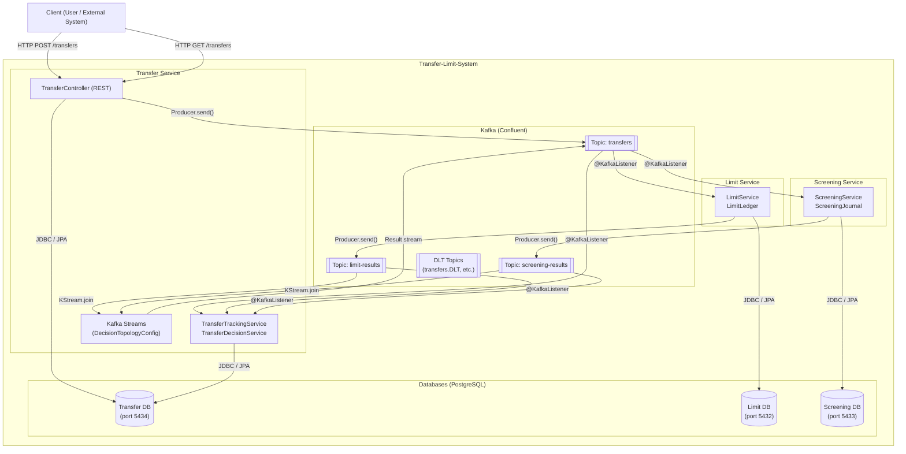
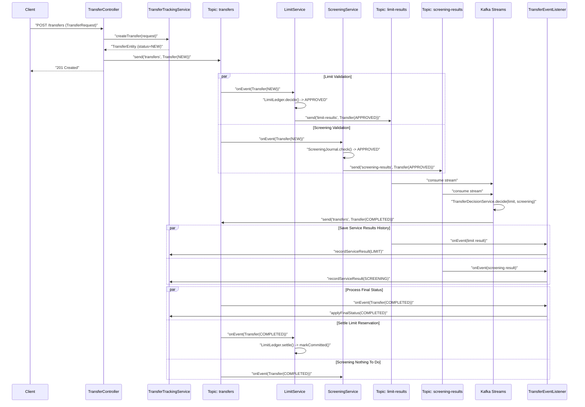
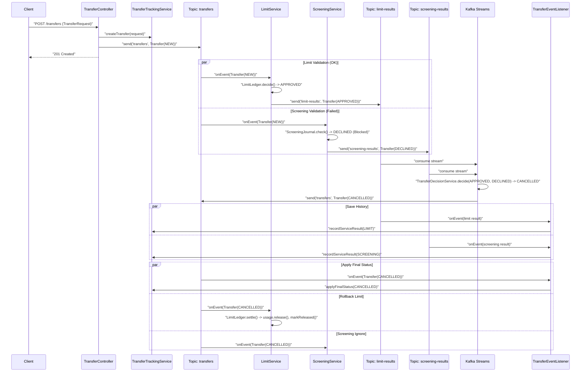
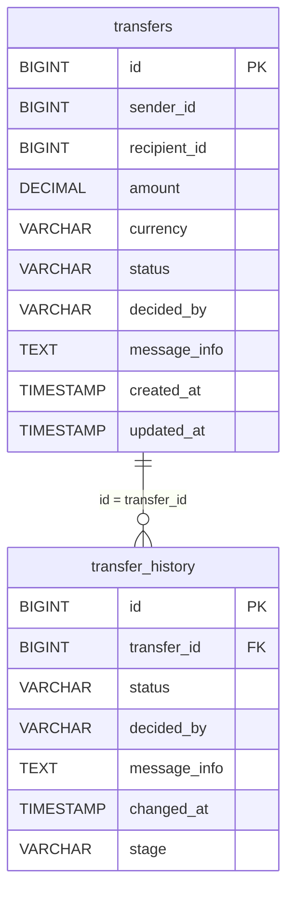
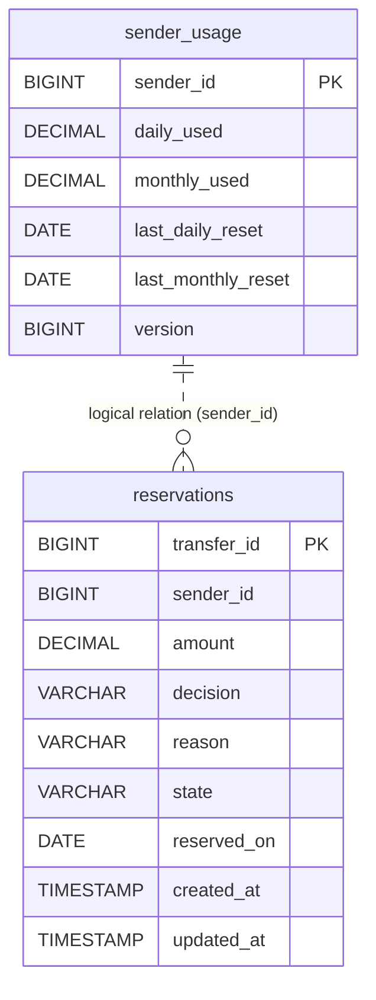
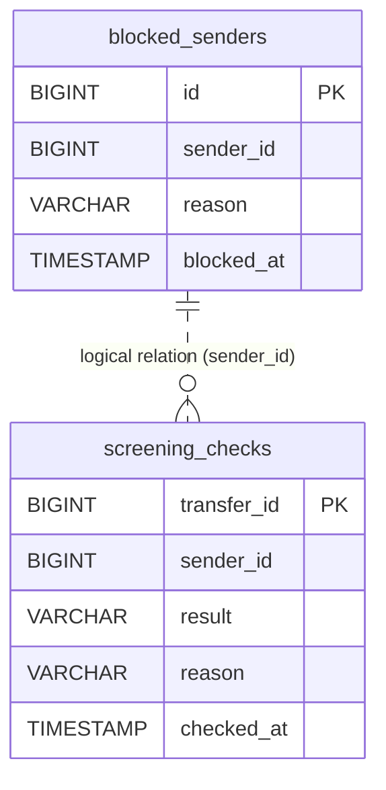
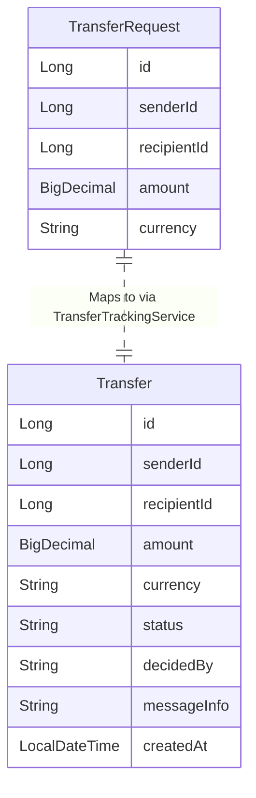
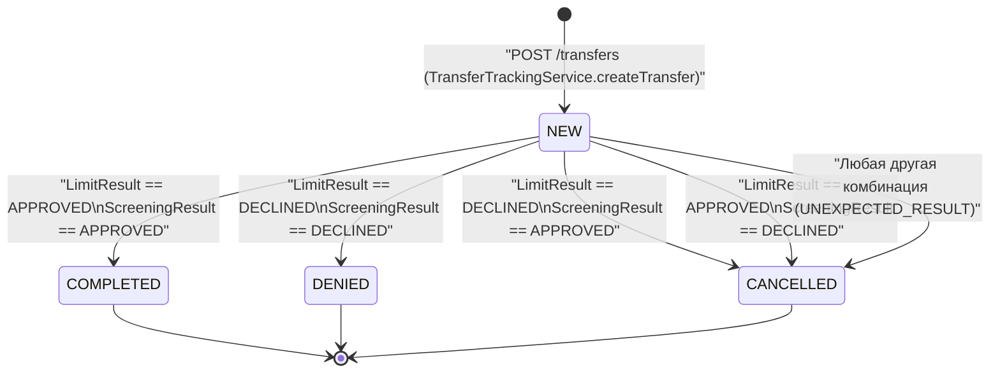

### ДИАГРАММА 1: Component diagram (C4)
Отображает основные компоненты системы (микросервисы, базы данных, брокер Kafka) и связи между ними, включая протоколы и названия топиков/эндпоинтов.

### ДИАГРАММА 2: Sequence diagram — основной успешный сценарий (happy path)
Сценарий успешного создания перевода: запрос сохраняется, отправляется в Kafka, сервисы лимитов и скрининга одобряют перевод, Kafka Streams агрегирует результаты, перевод переводится в статус `COMPLETED`.

### ДИАГРАММА 3: Sequence diagram — основной сценарий отказа
Сценарий отказа по вине скрининга: сервис скрининга находит отправителя в черном списке и отклоняет перевод (`DECLINED`), сервис лимитов при этом одобряет (`APPROVED`). Итоговый статус перевода становится `CANCELLED`, а сервис лимитов возвращает зарезервированные средства.

### ДИАГРАММА 4: ER-диаграмма
ER-модель разбита на 4 отдельные диаграммы (по одной на каждую базу данных + объекты в памяти/Kafka).

#### 4а. Transfer DB (transfer-db)
Отражает таблицы сервиса переводов и их физические связи (внешний ключ).

#### 4б. Limit DB (limit-db)
Отражает таблицы сервиса лимитов. В коде нет физических внешних ключей, но есть логическая связь.

#### 4в. Screening DB (screening-db)
Отражает таблицы сервиса проверок (скрининга). Физических внешних ключей нет, связь логическая по `sender_id`.

#### 4г. Объекты передачи данных (Kafka Messages / DTOs)
Отражает записи (records), не хранящиеся в БД, передаваемые между сервисами.

**Логические связи между сущностями разных БД и объектов (по идентификаторам):**
*   `TransferRequest.id` == `Transfer.id` == `transfers.id` (Transfer DB)
*   `Transfer.id` == `reservations.transfer_id` (Limit DB) == `screening_checks.transfer_id` (Screening DB) == `transfer_history.transfer_id` (Transfer DB).
*   `TransferRequest.senderId` == `Transfer.senderId` == `transfers.sender_id` (Transfer DB) == `sender_usage.sender_id` (Limit DB) == `reservations.sender_id` (Limit DB) == `blocked_senders.sender_id` (Screening DB) == `screening_checks.sender_id` (Screening DB).

### ДИАГРАММА 5: Диаграмма состояний
Отображает жизненный цикл сущности `Transfer` (поле `status`), включая её создание, проверку и итоговые состояния (агрегация которых происходит в `TransferDecisionService.decide()`).

*(Сущность `Reservation` из сервиса лимитов также имеет свой внутренний жизненный цикл: `NONE` / `RESERVED` -> `COMMITTED` / `RELEASED` — в зависимости от финального статуса `Transfer`).*