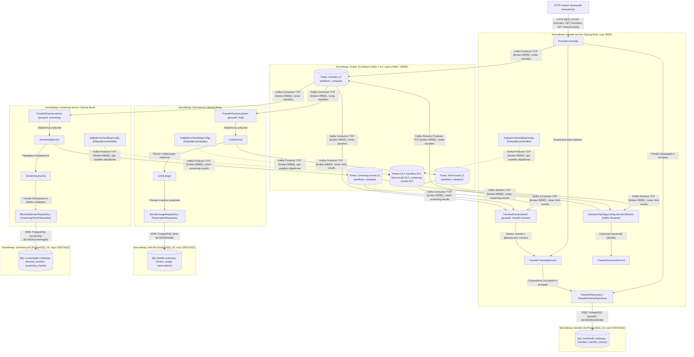
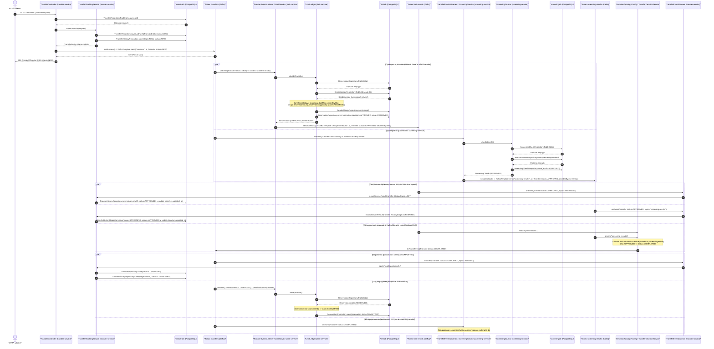
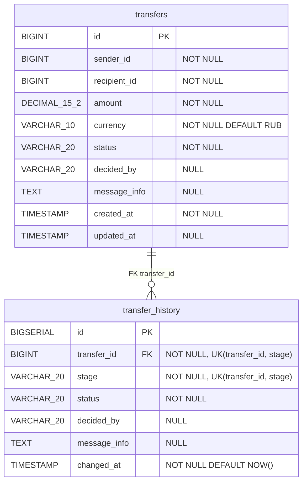
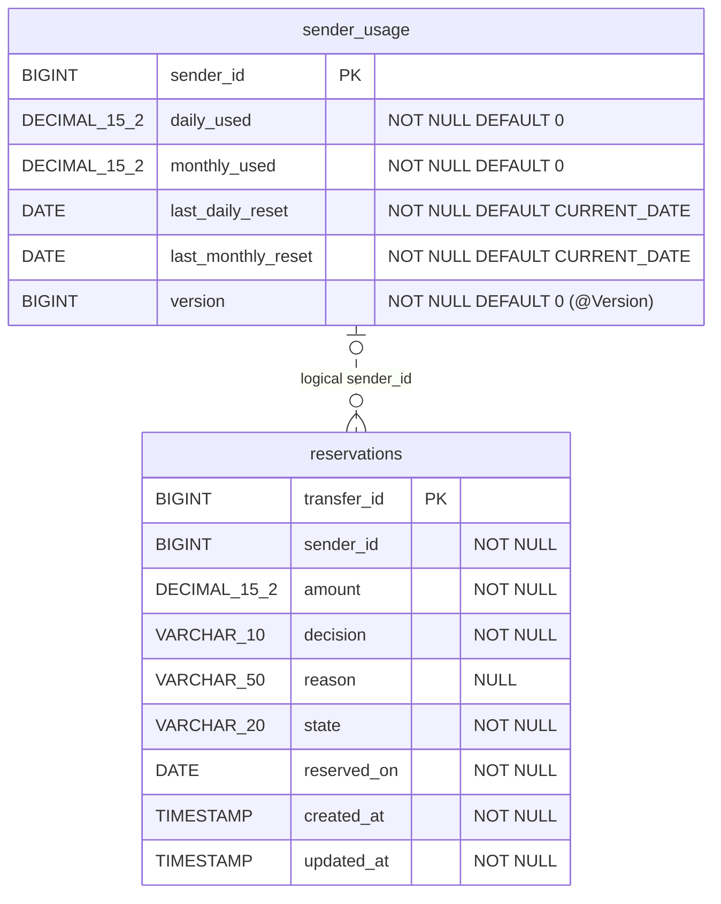
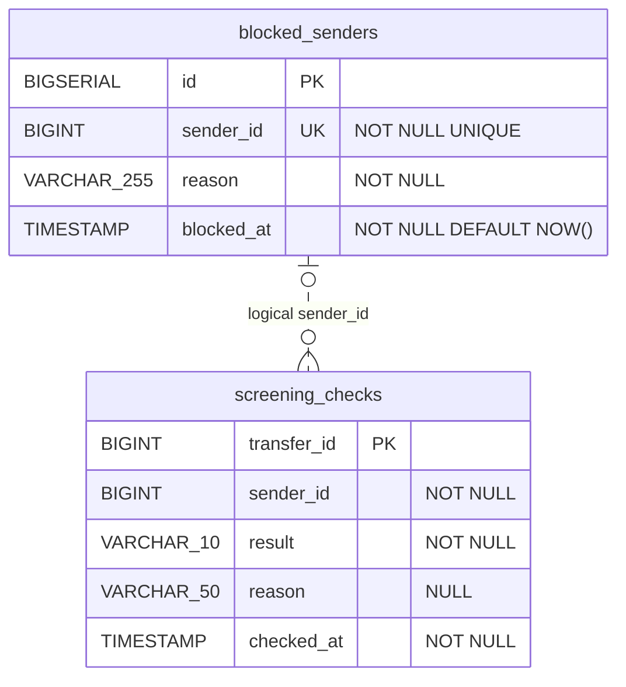
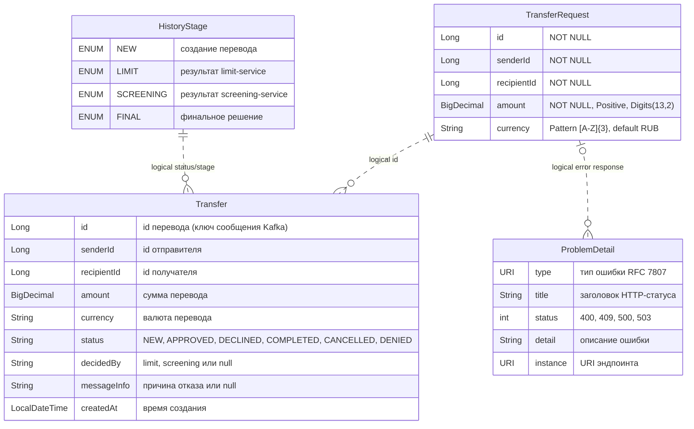
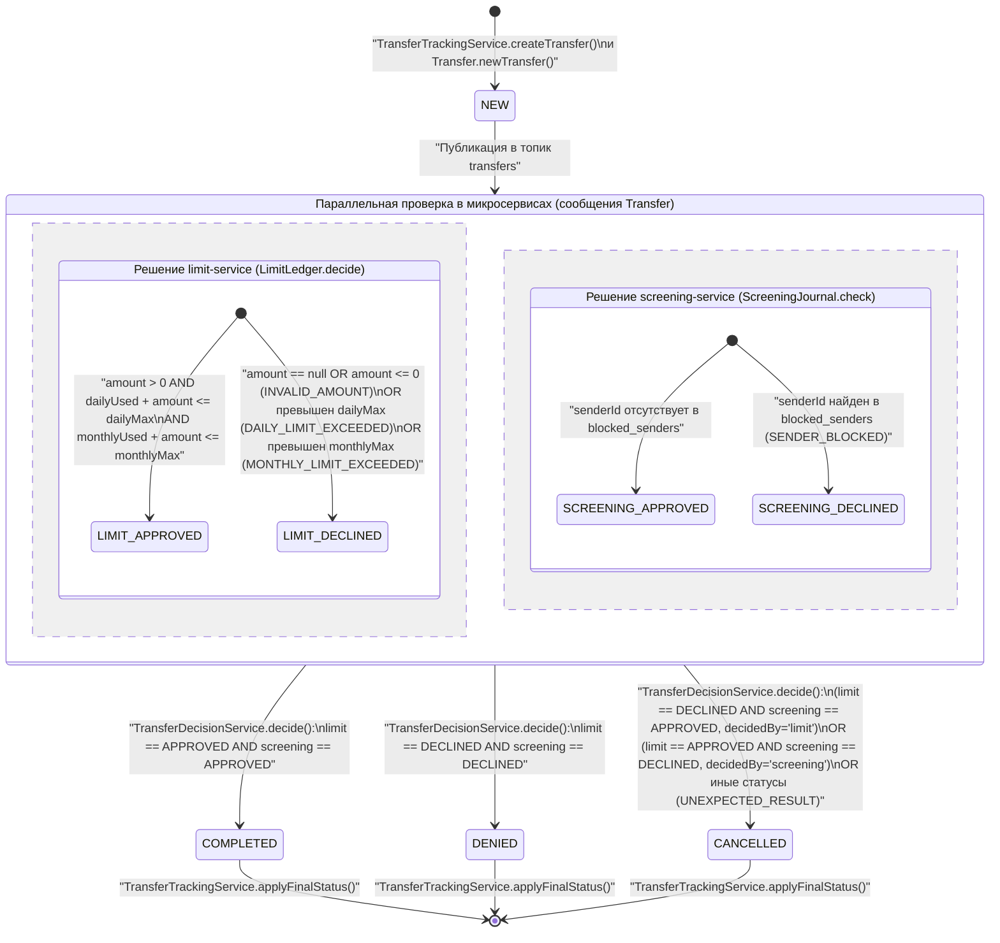

### ДИАГРАММА 1: Component diagram (C4)

Диаграмма отображает контейнеры системы (`transfer-service`, `limit-service`, `screening-service`, брокер Kafka и три базы данных PostgreSQL из `docker-compose.yml`), их внутренние компоненты и каналы взаимодействия с указанием протоколов, портов, эндпоинтов и топиков. Внешние по отношению к проекту сторонние системы в коде не найдены, источником запросов выступает HTTP-клиент.

### ДИАГРАММА 2: Sequence diagram — основной успешный сценарий (happy path)

Диаграмма показывает успешный сквозной сценарий создания перевода через `TransferController.create`, параллельное резервирование лимита в `limit-service` и проверку отправителя в `screening-service`, объединение результатов в Kafka Streams (`DecisionTopologyConfig.decisionStream`) со статусом `COMPLETED` и фиксацию резерва (`COMMITTED`).

### ДИАГРАММА 3: Sequence diagram — основной сценарий отказа

Диаграмма иллюстрирует сценарий отказа с компенсацией: `limit-service` одобряет перевод и резервирует средства отправителя (`state=RESERVED`), однако `screening-service` отклоняет перевод из-за нахождения отправителя в списке заблокированных (`SENDER_BLOCKED`), после чего `TransferDecisionService.decide` формирует статус `CANCELLED`, а `limit-service` в методе `LimitLedger.settle` освобождает ранее зарезервированный лимит (`SenderUsage.release`, `state=RELEASED`).

```mermaid
sequenceDiagram
    autonumber
    actor Client as "HTTP-клиент"
    participant TC as "TransferController (transfer-service)"
    participant TTS as "TransferTrackingService (transfer-service)"
    participant TDB as "transferdb (PostgreSQL)"
    participant KT as "Топик: transfers (Kafka)"
    participant LEL as "TransferEventsListener / LimitService (limit-service)"
    participant LL as "LimitLedger (limit-service)"
    participant LDB as "limitdb (PostgreSQL)"
    participant KLR as "Топик: limit-results (Kafka)"
    participant SEL as "TransferEventsListener / ScreeningService (screening-service)"
    participant SJ as "ScreeningJournal (screening-service)"
    participant SDB as "screeningdb (PostgreSQL)"
    participant KSR as "Топик: screening-results (Kafka)"
    participant DS as "DecisionTopologyConfig / TransferDecisionService"
    participant TEL as "TransferEventListener (transfer-service)"

    Client->>TC: POST /transfers (TransferRequest с заблокированным senderId)
    TC->>TTS: createTransfer(request)
    TTS->>TDB: Сохранение TransferEntity (status=NEW) и TransferHistoryEntry (stage=NEW)
    TTS-->>TC: TransferEntity (status=NEW)
    TC->>KT: publishNew() -> KafkaTemplate.send("transfers", id, Transfer status=NEW)
    TC-->>Client: 201 Created (TransferEntity status=NEW)

    par Успешное резервирование лимита в limit-service
        KT->>LEL: onEvent(Transfer status=NEW) -> onNewTransfer(transfer)
        LEL->>LL: decide(transfer)
        Note over LL: Лимит не превышен:<br/>usage.reserve(amount) увеличивает dailyUsed и monthlyUsed,<br/>reservation.approve() устанавливает state=RESERVED
        LL->>LDB: SenderUsageRepository.save(usage)
        LL->>LDB: ReservationRepository.save(decision=APPROVED, state=RESERVED)
        LEL->>KLR: sendAndWait("limit-results", Transfer status=APPROVED, decidedBy=limit)
    and Отказ при проверке отправителя в screening-service
        KT->>SEL: onEvent(Transfer status=NEW) -> onNewTransfer(transfer)
        SEL->>SJ: check(transfer)
        SJ->>SDB: BlockedSenderRepository.findBySenderId(senderId)
        SDB-->>SJ: Optional.of(BlockedSender)
        SJ->>SDB: ScreeningCheckRepository.save(result=DECLINED, reason="SENDER_BLOCKED")
        SJ-->>SEL: ScreeningCheck (DECLINED, SENDER_BLOCKED)
        SEL->>KSR: sendAndWait("screening-results", Transfer status=DECLINED, decidedBy=screening, messageInfo="SENDER_BLOCKED")
    end

    par Запись промежуточных результатов в transferdb
        KLR->>TEL: onEvent(status=APPROVED, topic="limit-results")
        TEL->>TTS: recordServiceResult(transfer, HistoryStage.LIMIT)
        TTS->>TDB: TransferHistoryRepository.save(stage=LIMIT, status=APPROVED)
    and
        KSR->>TEL: onEvent(status=DECLINED, topic="screening-results")
        TEL->>TTS: recordServiceResult(transfer, HistoryStage.SCREENING)
        TTS->>TDB: TransferHistoryRepository.save(stage=SCREENING, status=DECLINED, messageInfo="SENDER_BLOCKED")
    and Принятие решения об отмене в Kafka Streams
        KLR->>DS: stream("limit-results") (status=APPROVED)
        KSR->>DS: stream("screening-results") (status=DECLINED)
        Note over DS: TransferDecisionService.decide:<br/>limitApproved && screeningDeclined -> status=CANCELLED, decidedBy=screening
        DS->>KT: to("transfers") (Transfer status=CANCELLED, decidedBy=screening, messageInfo="SENDER_BLOCKED")
    end

    par Фиксация статуса CANCELLED в transfer-service
        KT->>TEL: onEvent(Transfer status=CANCELLED, topic="transfers")
        TEL->>TTS: applyFinalStatus(transfer)
        TTS->>TDB: TransferRepository.save(status=CANCELLED, decidedBy=screening, messageInfo="SENDER_BLOCKED")
        TTS->>TDB: TransferHistoryRepository.save(stage=FINAL, status=CANCELLED)
    and Компенсация (возврат) зарезервированного лимита в limit-service
        KT->>LEL: onEvent(Transfer status=CANCELLED) -> onFinalStatus(transfer)
        LEL->>LL: settle(transfer)
        LL->>LDB: ReservationRepository.findById(id)
        LDB-->>LL: Reservation (state=RESERVED)
        LL->>LDB: SenderUsageRepository.findById(senderId)
        LDB-->>LL: SenderUsage
        Note over LL: Компенсирующее действие:<br/>usage.release(amount, reservedOn, today) вычитает сумму из dailyUsed и monthlyUsed,<br/>reservation.markReleased() переводит резерв в state=RELEASED
        LL->>LDB: SenderUsageRepository.save(usage)
        LL->>LDB: ReservationRepository.save(reservation state=RELEASED)
    end
```

### ДИАГРАММА 4а: ER-диаграмма базы данных `transferdb` (`transfer-service`)

Диаграмма показывает структуру таблиц `transfers` (класс `TransferEntity`) и `transfer_history` (класс `TransferHistoryEntry`) в базе `transferdb`, связанных внешним ключом `transfer_id`.

### ДИАГРАММА 4б: ER-диаграмма базы данных `limitdb` (`limit-service`)

Диаграмма показывает таблицы `sender_usage` (класс `SenderUsage`) и `reservations` (класс `Reservation`) в базе `limitdb`, между которыми в SQL-схеме (`limit-service/src/main/resources/db/changelog/001-create-tables.sql`) нет внешнего ключа, но имеется логическая связь по полю `sender_id`.

### ДИАГРАММА 4в: ER-диаграмма базы данных `screeningdb` (`screening-service`)

Диаграмма показывает таблицы `blocked_senders` (класс `BlockedSender`) и `screening_checks` (класс `ScreeningCheck`) в базе `screeningdb`, связанные логически через идентификатор отправителя `sender_id` без ограничения внешнего ключа.

### ДИАГРАММА 4г: ER-диаграмма объектов, не хранящихся в БД (DTO и сообщения)

Диаграмма показывает структуры данных, передаваемые по HTTP и через топики Kafka (`TransferRequest`, `Transfer`, `HistoryStage`, `ProblemDetail`), и логические связи между ними.

**Логические связи между сущностями разных диаграмм:**
- `TransferRequest.id` (4г) ↔ `transfers.id` (4а, `1:1`): HTTP-запрос создаёт запись перевода в `transferdb` с тем же `id`.
- `transfers.id` (4а) ↔ `Transfer.id` (4г, `1:N`): по одному переводу в Kafka публикуется цепочка сообщений `Transfer` с одинаковым `id` (сначала `NEW`, затем ответы в `limit-results` и `screening-results`, затем финальный статус в `transfers`).
- `Transfer.id` (4г) / `transfers.id` (4а) ↔ `reservations.transfer_id` (4б, `1:0..1`): идентификатор перевода используется как первичный ключ резерва в `limitdb`.
- `Transfer.id` (4г) / `transfers.id` (4а) ↔ `screening_checks.transfer_id` (4в, `1:0..1`): идентификатор перевода используется как первичный ключ проверки в `screeningdb`.
- `transfers.sender_id` (4а) / `Transfer.senderId` (4г) ↔ `sender_usage.sender_id` (4б, `N:0..1`), `reservations.sender_id` (4б, `1:N`), `blocked_senders.sender_id` (4в, `N:0..1`), `screening_checks.sender_id` (4в, `1:N`): сквозной идентификатор отправителя во всех сервисах.
- `HistoryStage` (4г) ↔ `transfer_history.stage` (4а, `1:N`): значения перечисления `HistoryStage` сохраняются в виде строки в колонку `stage`.

### ДИАГРАММА 5: Диаграмма состояний

Диаграмма отображает жизненный цикл ключевой бизнес-сущности системы — перевода (`TransferEntity` в `transfer-service` и сообщение `Transfer` в `transfer-common`), включая промежуточные состояния проверки в сервисах и условия перехода к терминальным статусам в `TransferDecisionService.decide`.

**Остальные сущности с жизненным циклом (статусами), присутствующие в коде:**
1. **`Reservation` (`limit-service`, класс `com.example.limit.domain.Reservation`, таблица `reservations`)**:
   - Поле `state`: при создании через `LimitLedger.decide` переходит либо в `NONE` (метод `decline()`, если сумма некорректна или превышен лимит — терминальное состояние), либо в `RESERVED` (метод `approve()`, сумма зарезервирована). Из состояния `RESERVED` в методе `LimitLedger.settle` при получении финального статуса перевода переходит в `COMMITTED` (метод `markCommitted()`, если статус перевода `COMPLETED`) или в `RELEASED` (метод `markReleased()`, если статус перевода `CANCELLED` или `DENIED`, с возвратом лимита в `SenderUsage.release`).
   - Поле `decision`: принимает значения `APPROVED` или `DECLINED`.
2. **`TransferHistoryEntry` (`transfer-service`, класс `com.example.transfer.domain.TransferHistoryEntry`, таблица `transfer_history`)**:
   - Фиксирует прохождение перевода по этапам `HistoryStage` (`NEW`, `LIMIT`, `SCREENING`, `FINAL`) со значениями поля `status` (`NEW`, `APPROVED`, `DECLINED`, `COMPLETED`, `CANCELLED`, `DENIED`).
3. **`ScreeningCheck` (`screening-service`, класс `com.example.screening.domain.ScreeningCheck`, таблица `screening_checks`)**:
   - Поле `result`: одношаговый статус результата проверки отправителя в `ScreeningJournal.check` — принимает значение `APPROVED` или `DECLINED`.