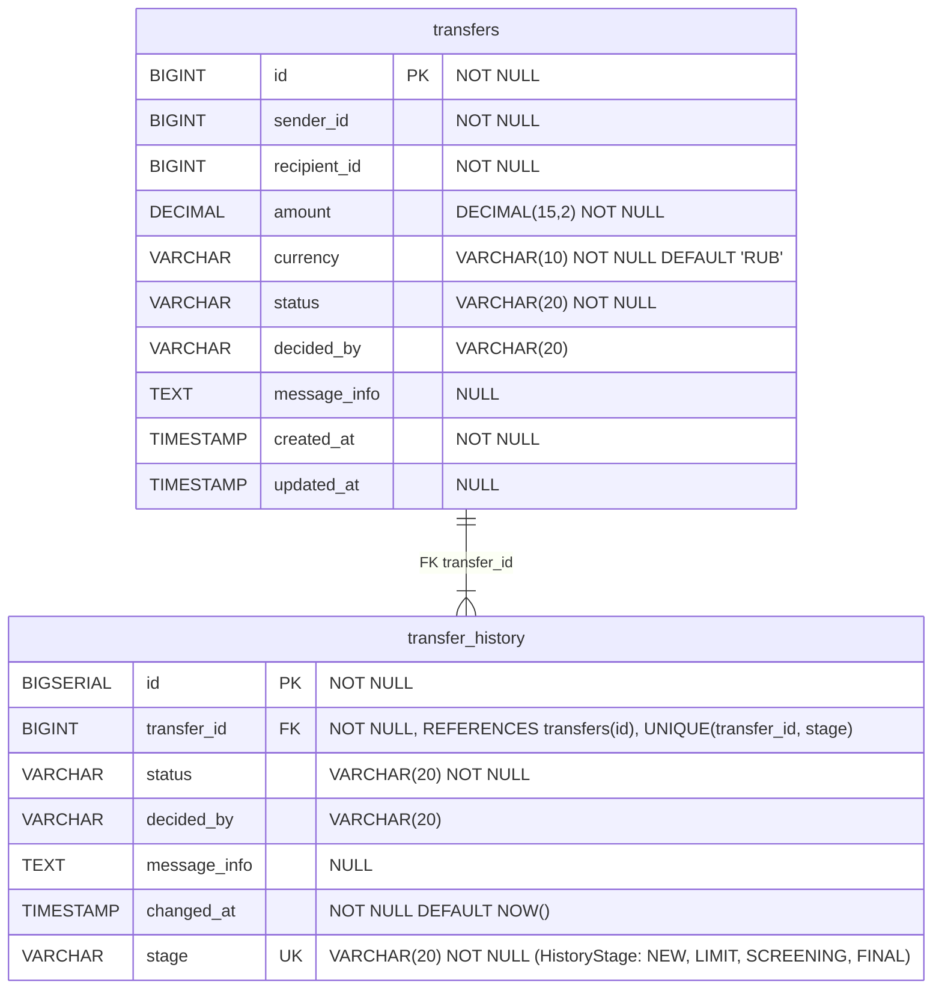
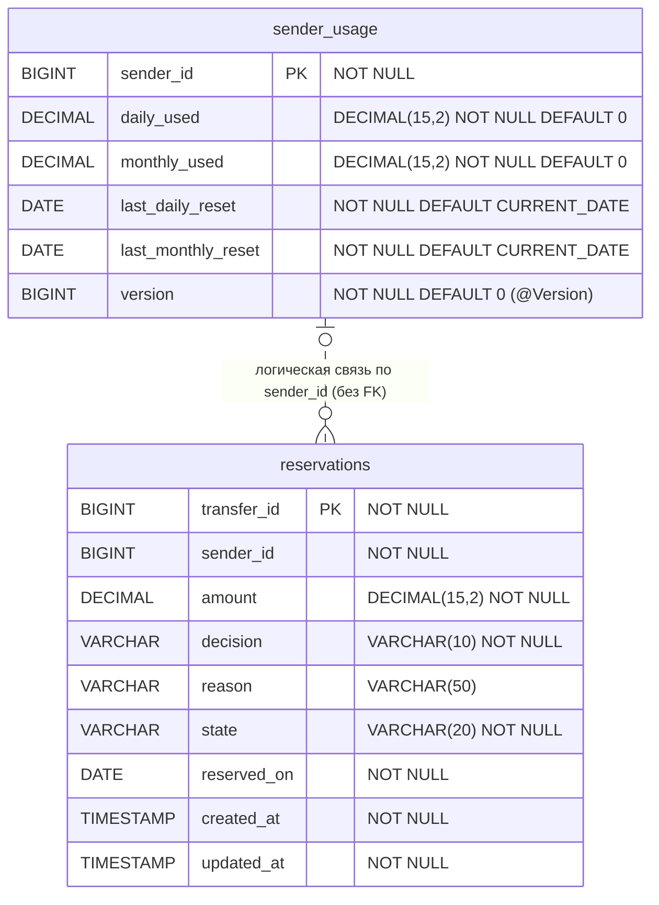
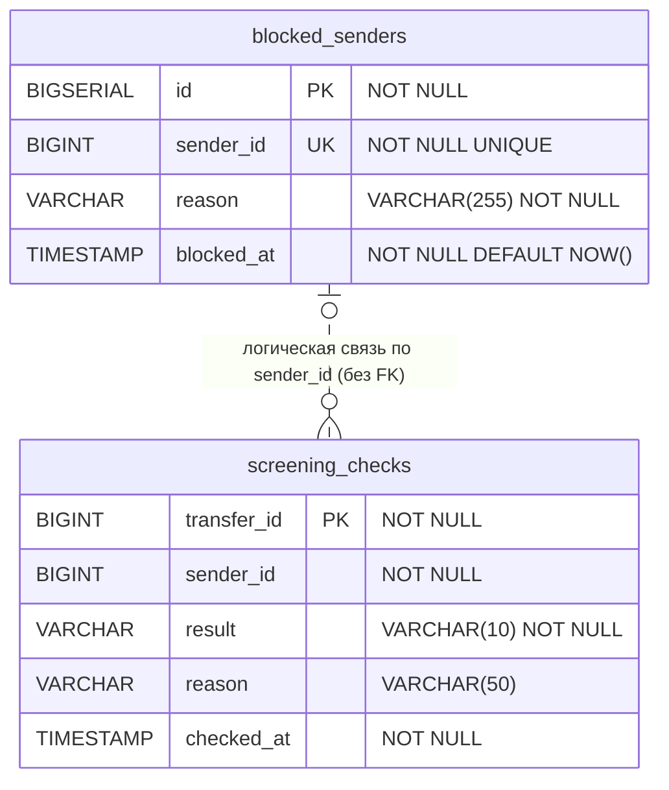
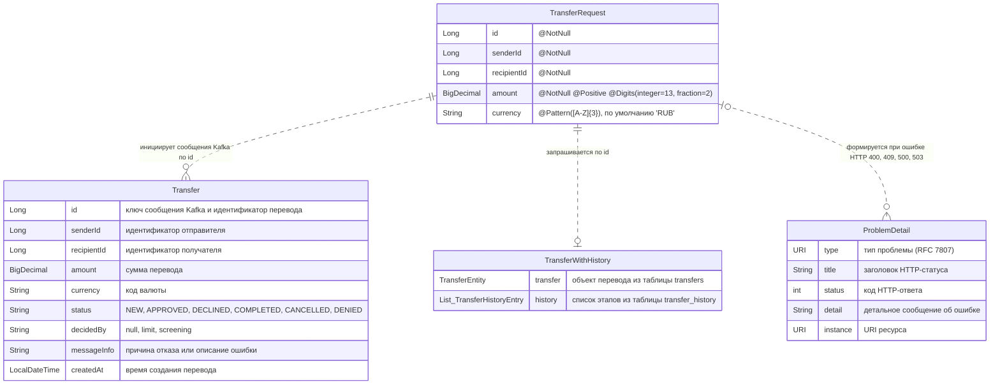
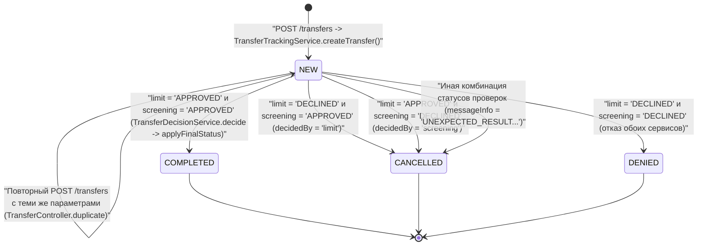

### ДИАГРАММА 1: Component diagram (C4)

Диаграмма отображает контейнеры системы из `docker-compose.yml` (`transfer-service`, `limit-service`, `screening-service`, брокер Kafka и три базы PostgreSQL) и внутренние компоненты микросервисов с протоколами и каналами взаимодействия. Интеграции с внешними системами в коде не найдены — определена только входящая точка входа REST API в `transfer-service/src/main/java/com/example/transfer/controller/TransferController.java` и `transfer-service/src/main/resources/openapi/transfer-api.yaml`.

```mermaid
flowchart TB
    Client["Внешний HTTP-клиент (конкретная внешняя система в коде не найдена)"]

    subgraph transfer_service ["Контейнер: transfer-service (Spring Boot, порт 8080)"]
        TransferController["TransferController"]
        TransferTrackingService["TransferTrackingService"]
        TransferEventListener["TransferEventListener"]
        DecisionTopology["DecisionTopologyConfig + TransferDecisionService (Kafka Streams)"]
        TransferErrorHandler["KafkaErrorHandlingConfig (DefaultErrorHandler)"]
    end

    subgraph limit_service ["Контейнер: limit-service (Spring Boot)"]
        LimitListener["TransferEventsListener"]
        LimitService["LimitService"]
        LimitLedger["LimitLedger"]
        LimitErrorHandler["KafkaErrorHandlingConfig (DefaultErrorHandler)"]
    end

    subgraph screening_service ["Контейнер: screening-service (Spring Boot)"]
        ScreeningListener["TransferEventsListener"]
        ScreeningService["ScreeningService"]
        ScreeningJournal["ScreeningJournal"]
        ScreeningErrorHandler["KafkaErrorHandlingConfig (DefaultErrorHandler)"]
    end

    subgraph broker ["Контейнер: broker (Apache Kafka, порт 29092 / 9092)"]
        TopicTransfers["Топик: transfers (compact)"]
        TopicLimitResults["Топик: limit-results (compact)"]
        TopicScreeningResults["Топик: screening-results (compact)"]
        TopicTransfersDlt["Топик: transfers.DLT"]
        TopicLimitResultsDlt["Топик: limit-results.DLT"]
        TopicScreeningResultsDlt["Топик: screening-results.DLT"]
    end

    subgraph transfer_db ["Контейнер: transfer-db (PostgreSQL 16, порт 5434:5432)"]
        TransferDB[("БД: transferdb")]
    end

    subgraph limit_db ["Контейнер: limit-db (PostgreSQL 16, порт 5432:5432)"]
        LimitDB[("БД: limitdb")]
    end

    subgraph screening_db ["Контейнер: screening-db (PostgreSQL 16, порт 5433:5432)"]
        ScreeningDB[("БД: screeningdb")]
    end

    Client -->|"HTTP/JSON: POST /transfers, GET /transfers, GET /transfers/{id}"| TransferController

    TransferController -->|"Внутрипроцессный вызов: createTransfer()"| TransferTrackingService
    TransferController -->|"JDBC/SQL: чтение таблиц transfers, transfer_history"| TransferDB
    TransferTrackingService -->|"JDBC/SQL: запись и чтение таблиц transfers, transfer_history"| TransferDB
    TransferController -->|"Kafka TCP: публикация в топик transfers"| TopicTransfers

    TopicTransfers -->|"Kafka TCP: чтение топика transfers (groupId='transfer-tracker')"| TransferEventListener
    TopicLimitResults -->|"Kafka TCP: чтение топика limit-results (groupId='transfer-tracker')"| TransferEventListener
    TopicScreeningResults -->|"Kafka TCP: чтение топика screening-results (groupId='transfer-tracker')"| TransferEventListener
    TransferEventListener -->|"Внутрипроцессный вызов: recordServiceResult(), applyFinalStatus()"| TransferTrackingService
    TransferEventListener -.->|"При ошибке после 3 повторов (FixedBackOff)"| TransferErrorHandler
    TransferErrorHandler -->|"Kafka TCP: публикация в топик transfers.DLT"| TopicTransfersDlt
    TransferErrorHandler -->|"Kafka TCP: публикация в топик limit-results.DLT"| TopicLimitResultsDlt
    TransferErrorHandler -->|"Kafka TCP: публикация в топик screening-results.DLT"| TopicScreeningResultsDlt

    TopicLimitResults -->|"Kafka Streams TCP: чтение топика limit-results"| DecisionTopology
    TopicScreeningResults -->|"Kafka Streams TCP: чтение топика screening-results"| DecisionTopology
    DecisionTopology -->|"Kafka Streams TCP: публикация решения в топик transfers"| TopicTransfers

    TopicTransfers -->|"Kafka TCP: чтение топика transfers (groupId='limit')"| LimitListener
    LimitListener -->|"Внутрипроцессный вызов: onNewTransfer(), onFinalStatus()"| LimitService
    LimitService -->|"Внутрипроцессный вызов: decide(), settle()"| LimitLedger
    LimitLedger -->|"JDBC/SQL: таблицы sender_usage, reservations"| LimitDB
    LimitService -->|"Kafka TCP: публикация в топик limit-results"| TopicLimitResults
    LimitListener -.->|"При ошибке после 3 повторов (FixedBackOff)"| LimitErrorHandler
    LimitErrorHandler -->|"Kafka TCP: публикация в топик transfers.DLT"| TopicTransfersDlt

    TopicTransfers -->|"Kafka TCP: чтение топика transfers (groupId='screening')"| ScreeningListener
    ScreeningListener -->|"Внутрипроцессный вызов: onNewTransfer()"| ScreeningService
    ScreeningService -->|"Внутрипроцессный вызов: check()"| ScreeningJournal
    ScreeningJournal -->|"JDBC/SQL: таблицы blocked_senders, screening_checks"| ScreeningDB
    ScreeningService -->|"Kafka TCP: публикация в топик screening-results"| TopicScreeningResults
    ScreeningListener -.->|"При ошибке после 3 повторов (FixedBackOff)"| ScreeningErrorHandler
    ScreeningErrorHandler -->|"Kafka TCP: публикация в топик transfers.DLT"| TopicTransfersDlt
```

### ДИАГРАММА 2: Sequence diagram — основной успешный сценарий (happy path)

Диаграмма показывает полный успешный путь создания и проведения перевода от вызова `POST /transfers` в `TransferController.create` через параллельное резервирование лимита в `LimitLedger.decide` и проверку отправителя в `ScreeningJournal.check` до объединения результатов в Kafka Streams (`DecisionTopologyConfig.decisionStream`) со статусом `COMPLETED` и подтверждения резервации в `LimitLedger.settle`.

```mermaid
sequenceDiagram
    participant Client as "HTTP-клиент"
    participant TC as "TransferController"
    participant TTS as "TransferTrackingService"
    participant TDB as "transferdb"
    participant KT as "Топик transfers"
    participant LEL as "limit.TransferEventsListener"
    participant LS as "LimitService"
    participant LL as "LimitLedger"
    participant LDB as "limitdb"
    participant KLR as "Топик limit-results"
    participant SEL as "screening.TransferEventsListener"
    participant SS as "ScreeningService"
    participant SJ as "ScreeningJournal"
    participant SDB as "screeningdb"
    participant KSR as "Топик screening-results"
    participant DTC as "DecisionTopologyConfig / TransferDecisionService"
    participant TEL as "TransferEventListener"

    Client->>TC: "POST /transfers (TransferRequest)"
    TC->>TDB: "TransferRepository.findById(request.id()) -> пусто"
    TC->>TTS: "createTransfer(request)"
    TTS->>TDB: "TransferRepository.saveAndFlush(TransferEntity status='NEW')"
    TTS->>TDB: "TransferHistoryRepository.save(stage=NEW, status='NEW')"
    TTS-->>TC: "TransferEntity (status='NEW')"
    TC->>KT: "publishNew() -> KafkaTemplate.send('transfers', id, Transfer status='NEW')"
    TC-->>Client: "HTTP 201 Created (TransferEntity status='NEW')"

    par "Проверка и резервирование лимита в limit-service"
        KT->>LEL: "onEvent(Transfer status='NEW')"
        LEL->>LS: "onNewTransfer(transfer)"
        LS->>LL: "decide(transfer)"
        LL->>LDB: "ReservationRepository.findById(id) и SenderUsageRepository.findById(senderId)"
        LL->>LL: "usage.lazyReset(today), usage.reserve(amount), reservation.approve()"
        LL->>LDB: "SenderUsageRepository.save(usage) и ReservationRepository.save(state='RESERVED')"
        LL-->>LS: "Reservation (decision='APPROVED', state='RESERVED')"
        LS->>KLR: "sendAndWait() -> KafkaTemplate.send('limit-results', id, status='APPROVED', decidedBy='limit')"
    and "Проверка отправителя в screening-service"
        KT->>SEL: "onEvent(Transfer status='NEW')"
        SEL->>SS: "onNewTransfer(transfer)"
        SS->>SJ: "check(transfer)"
        SJ->>SDB: "ScreeningCheckRepository.findById(id) и BlockedSenderRepository.findBySenderId(senderId) -> пусто"
        SJ->>SDB: "ScreeningCheckRepository.save(result='APPROVED', reason=null)"
        SJ-->>SS: "ScreeningCheck (result='APPROVED')"
        SS->>KSR: "sendAndWait() -> KafkaTemplate.send('screening-results', id, status='APPROVED', decidedBy='screening')"
    end

    par "Сохранение промежуточной истории в transfer-service"
        KLR->>TEL: "onEvent(Transfer status='APPROVED', topic='limit-results')"
        TEL->>TTS: "recordServiceResult(transfer, HistoryStage.LIMIT)"
        TTS->>TDB: "TransferHistoryRepository.save(stage=LIMIT) и TransferRepository.save(entity)"
        KSR->>TEL: "onEvent(Transfer status='APPROVED', topic='screening-results')"
        TEL->>TTS: "recordServiceResult(transfer, HistoryStage.SCREENING)"
        TTS->>TDB: "TransferHistoryRepository.save(stage=SCREENING) и TransferRepository.save(entity)"
    and "Формирование итогового решения в Kafka Streams (окно JoinWindows 10 сек)"
        KLR->>DTC: "stream('limit-results') -> Transfer (status='APPROVED')"
        KSR->>DTC: "stream('screening-results') -> Transfer (status='APPROVED')"
        DTC->>DTC: "TransferDecisionService.decide() -> status='COMPLETED'"
        DTC->>KT: "to('transfers') -> Transfer (status='COMPLETED', decidedBy=null)"
    end

    par "Применение финального статуса в transfer-service"
        KT->>TEL: "onEvent(Transfer status='COMPLETED', topic='transfers')"
        TEL->>TTS: "applyFinalStatus(transfer)"
        TTS->>TDB: "TransferRepository.save(status='COMPLETED') и TransferHistoryRepository.save(stage=FINAL)"
    and "Фиксация резервации в limit-service"
        KT->>LEL: "onEvent(Transfer status='COMPLETED')"
        LEL->>LS: "onFinalStatus(transfer)"
        LS->>LL: "settle(transfer)"
        LL->>LDB: "ReservationRepository.findById(id) -> reservation.markCommitted() -> save(state='COMMITTED')"
    and "Обработка финального статуса в screening-service"
        KT->>SEL: "onEvent(Transfer status='COMPLETED') -> пропуск (резерваций нет)"
    end

    Client->>TC: "GET /transfers/{id} -> getById(id)"
    TC->>TDB: "TransferRepository.findById(id) и TransferHistoryRepository.findByTransferIdOrderByChangedAtAsc(id)"
    TC-->>Client: "HTTP 200 OK (transfer status='COMPLETED' и history [NEW, LIMIT, SCREENING, FINAL])"
```

### ДИАГРАММА 3: Sequence diagram — основной сценарий отказа

Диаграмма показывает показательный сценарий отказа с компенсацией уже выполненных действий: `limit-service` одобряет перевод и резервирует сумму в `SenderUsage` (`state='RESERVED'`), но `screening-service` обнаруживает отправителя в таблице `blocked_senders` и возвращает `DECLINED` (`SENDER_BLOCKED`). После объединения результатов в `TransferDecisionService.decide` со статусом `CANCELLED` метод `LimitLedger.settle` освобождает ранее зарезервированный лимит (`usage.release` и `state='RELEASED'`), а `TransferTrackingService.applyFinalStatus` переводит запись в `transferdb` в статус `CANCELLED`.

```mermaid
sequenceDiagram
    participant Client as "HTTP-клиент"
    participant TC as "TransferController"
    participant TTS as "TransferTrackingService"
    participant TDB as "transferdb"
    participant KT as "Топик transfers"
    participant LEL as "limit.TransferEventsListener"
    participant LS as "LimitService"
    participant LL as "LimitLedger"
    participant LDB as "limitdb"
    participant KLR as "Топик limit-results"
    participant SEL as "screening.TransferEventsListener"
    participant SS as "ScreeningService"
    participant SJ as "ScreeningJournal"
    participant SDB as "screeningdb"
    participant KSR as "Топик screening-results"
    participant DTC as "DecisionTopologyConfig / TransferDecisionService"
    participant TEL as "TransferEventListener"

    Client->>TC: "POST /transfers (TransferRequest с заблокированным senderId)"
    TC->>TDB: "TransferRepository.findById(request.id()) -> пусто"
    TC->>TTS: "createTransfer(request)"
    TTS->>TDB: "TransferRepository.saveAndFlush(TransferEntity status='NEW')"
    TTS->>TDB: "TransferHistoryRepository.save(stage=NEW, status='NEW')"
    TTS-->>TC: "TransferEntity (status='NEW')"
    TC->>KT: "publishNew() -> KafkaTemplate.send('transfers', id, Transfer status='NEW')"
    TC-->>Client: "HTTP 201 Created (TransferEntity status='NEW')"

    par "Резервирование лимита в limit-service (успешно)"
        KT->>LEL: "onEvent(Transfer status='NEW')"
        LEL->>LS: "onNewTransfer(transfer)"
        LS->>LL: "decide(transfer)"
        LL->>LDB: "ReservationRepository.findById(id) и SenderUsageRepository.findById(senderId)"
        LL->>LL: "usage.lazyReset(today), usage.reserve(amount), reservation.approve()"
        LL->>LDB: "SenderUsageRepository.save(увеличен dailyUsed и monthlyUsed) и ReservationRepository.save(state='RESERVED')"
        LL-->>LS: "Reservation (decision='APPROVED', state='RESERVED')"
        LS->>KLR: "sendAndWait() -> KafkaTemplate.send('limit-results', id, status='APPROVED', decidedBy='limit')"
    and "Отказ при проверке отправителя в screening-service"
        KT->>SEL: "onEvent(Transfer status='NEW')"
        SEL->>SS: "onNewTransfer(transfer)"
        SS->>SJ: "check(transfer)"
        SJ->>SDB: "BlockedSenderRepository.findBySenderId(senderId) -> найден BlockedSender"
        SJ->>SDB: "ScreeningCheckRepository.save(result='DECLINED', reason='SENDER_BLOCKED')"
        SJ-->>SS: "ScreeningCheck (result='DECLINED', reason='SENDER_BLOCKED')"
        SS->>KSR: "sendAndWait() -> KafkaTemplate.send('screening-results', id, status='DECLINED', messageInfo='SENDER_BLOCKED')"
    end

    par "Сохранение промежуточных результатов в transfer-service"
        KLR->>TEL: "onEvent(Transfer status='APPROVED', topic='limit-results')"
        TEL->>TTS: "recordServiceResult(transfer, HistoryStage.LIMIT)"
        TTS->>TDB: "TransferHistoryRepository.save(stage=LIMIT, status='APPROVED')"
        KSR->>TEL: "onEvent(Transfer status='DECLINED', topic='screening-results')"
        TEL->>TTS: "recordServiceResult(transfer, HistoryStage.SCREENING)"
        TTS->>TDB: "TransferHistoryRepository.save(stage=SCREENING, status='DECLINED', messageInfo='SENDER_BLOCKED')"
    and "Принятие решения об отмене в Kafka Streams"
        KLR->>DTC: "stream('limit-results') -> Transfer (status='APPROVED')"
        KSR->>DTC: "stream('screening-results') -> Transfer (status='DECLINED')"
        DTC->>DTC: "TransferDecisionService.decide() -> status='CANCELLED', decidedBy='screening', messageInfo='SENDER_BLOCKED'"
        DTC->>KT: "to('transfers') -> Transfer (status='CANCELLED', decidedBy='screening')"
    end

    par "Компенсация в limit-service (возврат зарезервированного лимита)"
        KT->>LEL: "onEvent(Transfer status='CANCELLED')"
        LEL->>LS: "onFinalStatus(transfer)"
        LS->>LL: "settle(transfer)"
        LL->>LDB: "ReservationRepository.findById(id) -> state='RESERVED' и SenderUsageRepository.findById(senderId)"
        LL->>LL: "usage.release(amount, reservedOn, today) и reservation.markReleased()"
        LL->>LDB: "SenderUsageRepository.save(уменьшен dailyUsed и monthlyUsed) и ReservationRepository.save(state='RELEASED')"
    and "Фиксация отмены перевода в transfer-service"
        KT->>TEL: "onEvent(Transfer status='CANCELLED', topic='transfers')"
        TEL->>TTS: "applyFinalStatus(transfer)"
        TTS->>TDB: "TransferRepository.save(status='CANCELLED', decidedBy='screening', messageInfo='SENDER_BLOCKED')"
        TTS->>TDB: "TransferHistoryRepository.save(stage=FINAL, status='CANCELLED')"
    and "Обработка финального статуса в screening-service"
        KT->>SEL: "onEvent(Transfer status='CANCELLED') -> пропуск (резерваций нет)"
    end
```

### ДИАГРАММА 4а: ER-диаграмма базы данных `transferdb` (`transfer-service`)

Диаграмма показывает таблицы `transfers` и `transfer_history` из `transfer-service/src/main/resources/db/changelog/001-create-tables.sql` (JPA-сущности `TransferEntity` и `TransferHistoryEntry`). Сплошная линия обозначает связь по внешнему ключу `transfer_history.transfer_id -> transfers.id`.

### ДИАГРАММА 4б: ER-диаграмма базы данных `limitdb` (`limit-service`)

Диаграмма показывает таблицы `sender_usage` и `reservations` из `limit-service/src/main/resources/db/changelog/001-create-tables.sql` (JPA-сущности `SenderUsage` и `Reservation`). Пунктирная линия обозначает логическую связь по `sender_id` без внешнего ключа в БД (при `amount <= 0` в `LimitLedger.decide` запись `reservations` создаётся без сохранения `sender_usage`).

### ДИАГРАММА 4в: ER-диаграмма базы данных `screeningdb` (`screening-service`)

Диаграмма показывает таблицы `blocked_senders` и `screening_checks` из `screening-service/src/main/resources/db/changelog/001-create-tables.sql` (JPA-сущности `BlockedSender` и `ScreeningCheck`). Пунктирная линия обозначает логическую связь по `sender_id` без внешнего ключа в БД.

### ДИАГРАММА 4г: ER-диаграмма объектов, не хранящихся в БД (сообщения Kafka и HTTP DTO)

Диаграмма отображает структуры данных, передаваемые по HTTP и Kafka: сообщение `Transfer` (`transfer-common/src/main/java/com/example/common/Transfer.java`), входной запрос `TransferRequest` (`transfer-service/src/main/java/com/example/transfer/controller/TransferRequest.java`), ответ с историей `TransferWithHistory` (`TransferController.getById` и `transfer-api.yaml`) и объект ошибки `ProblemDetail` (`ApiExceptionHandler` и `TransferController`).

**Логические связи между сущностями разных диаграмм:**
- `TransferRequest.id` (4г) → `transfers.id` (4а), кардинальность `1 : 0..1` — при вызове `TransferTrackingService.createTransfer` из запроса создаётся запись в таблице `transfers`.
- `transfers.id` (4а) ↔ `Transfer.id` (4г), кардинальность `1 : 0..*` — одна запись `transfers` порождает цепочку сообщений `Transfer` в топиках `transfers`, `limit-results` и `screening-results` с тем же `id` (`TransferController.publishNew`, `LimitService.onNewTransfer`, `ScreeningService.onNewTransfer`, `DecisionTopologyConfig.decisionStream`).
- `transfers` и `transfer_history` (4а) → `TransferWithHistory` (4г), кардинальность `1 : 1` (для `transfers`) и `1..4 : 1` (для `transfer_history`) — метод `TransferController.getById` агрегирует сущность `TransferEntity` и список `TransferHistoryEntry` в единый HTTP-ответ.
- `transfers.id` (4а) / `Transfer.id` (4г) → `reservations.transfer_id` (4б), кардинальность `1 : 0..1` — метод `LimitLedger.decide` сохраняет одну запись резервации на каждый полученный перевод.
- `transfers.id` (4а) / `Transfer.id` (4г) → `screening_checks.transfer_id` (4в), кардинальность `1 : 0..1` — метод `ScreeningJournal.check` сохраняет одну запись проверки на каждый полученный перевод.
- `transfers.sender_id` (4а) / `Transfer.senderId` (4г) → `sender_usage.sender_id` (4б), кардинальность `0..* : 0..1` — все переводы одного отправителя агрегируются по `sender_id` в `SenderUsage` в методах `LimitLedger.decide` и `LimitLedger.settle`.
- `transfers.sender_id` (4а) / `Transfer.senderId` (4г) → `blocked_senders.sender_id` (4в), кардинальность `0..* : 0..1` — метод `ScreeningJournal.check` ищет `sender_id` перевода в справочнике заблокированных отправителей `blocked_senders`.

### ДИАГРАММА 5: Диаграмма состояний

Диаграмма отображает жизненный цикл ключевой бизнес-сущности — перевода `TransferEntity` (поле `status` в таблице `transfers`, управляемое классами `TransferTrackingService`, `TransferController` и `TransferDecisionService` в модуле `transfer-service`). Механизм автоматического вывода перевода из статуса `NEW` по таймауту (например, если одно из ответных событий не поступило в 10-секундное окно `JoinWindows` в `DecisionTopologyConfig.decisionStream`) в коде не найден.

**Остальные сущности и объекты со статусами / состояниями в коде:**
- **`Reservation`** (`limit-service/src/main/java/com/example/limit/domain/Reservation.java`, таблица `reservations`):
  - Поле `state`: при первичном расчёте в `LimitLedger.decide` переходит в `RESERVED` (при одобрении лимита `approve()`) либо сразу в терминальное состояние `NONE` (при отказе `decline()`: `INVALID_AMOUNT`, `DAILY_LIMIT_EXCEEDED`, `MONTHLY_LIMIT_EXCEEDED`). Из `RESERVED` в методе `LimitLedger.settle` переходит в терминальное состояние `COMMITTED` (при получении финального статуса перевода `COMPLETED`) или в терминальное состояние `RELEASED` (при получении статуса `CANCELLED` или `DENIED`).
  - Поле `decision`: однократно принимает значение `APPROVED` или `DECLINED` в `LimitLedger.decide`.
- **`TransferHistoryEntry` и `HistoryStage`** (`transfer-service/src/main/java/com/example/transfer/domain/TransferHistoryEntry.java` и `HistoryStage.java`, таблица `transfer_history`): отражает этапы прохождения перевода через стадии `NEW` (`status = NEW`), `LIMIT` (`status = APPROVED | DECLINED`), `SCREENING` (`status = APPROVED | DECLINED`) и `FINAL` (`status = COMPLETED | CANCELLED | DENIED`).
- **Сообщение `Transfer`** (`transfer-common/src/main/java/com/example/common/Transfer.java`, поле `status`): неизменяемый `record`, экземпляры которого последовательно создаются со значениями `NEW` (`Transfer.newTransfer`), `APPROVED` / `DECLINED` (`Transfer.withDecision` в `LimitService` и `ScreeningService`) и `COMPLETED` / `CANCELLED` / `DENIED` (`Transfer.withDecision` в `TransferDecisionService`).
- **`ScreeningCheck`** (`screening-service/src/main/java/com/example/screening/domain/ScreeningCheck.java`, таблица `screening_checks`, поле `result`): однократно сохраняется в методе `ScreeningJournal.check` в конечном статусе `APPROVED` или `DECLINED` без дальнейших переходов.