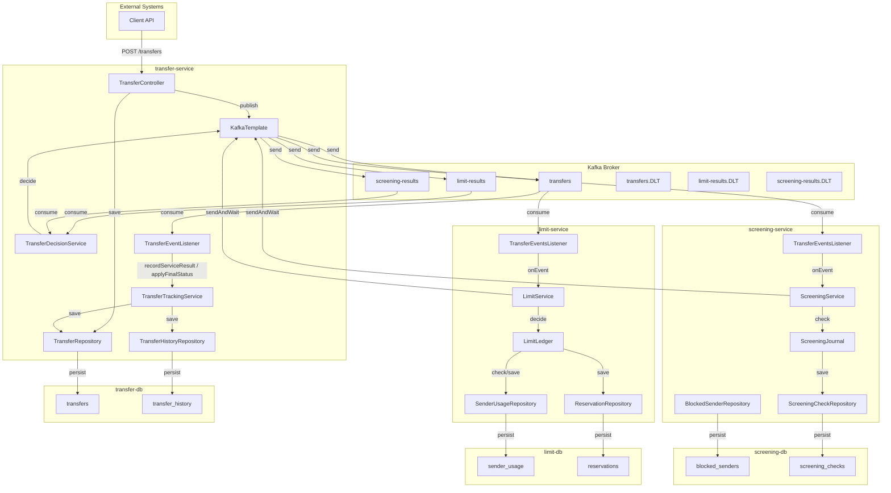
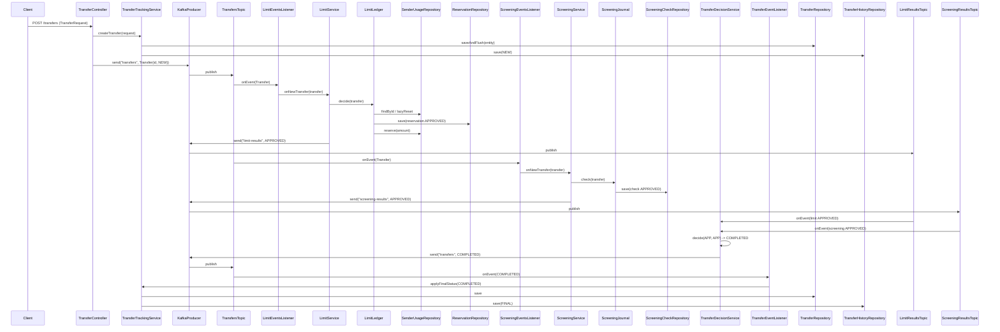
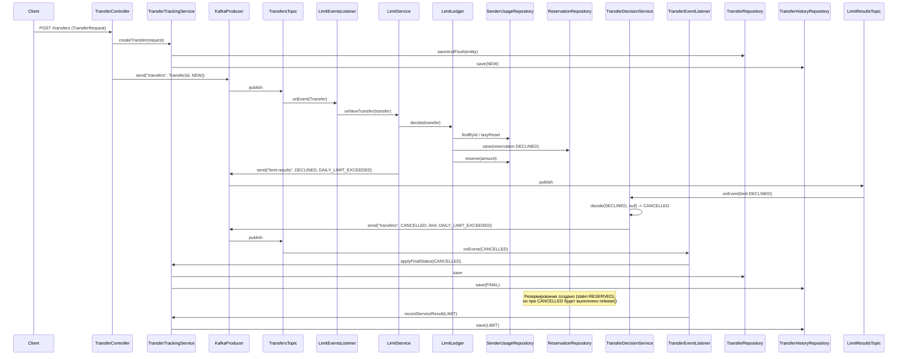

**Диаграмма 1: Component Diagram (C4) — Архитектура системы**



**Диаграмма 2: Sequence Diagram — Основной успешный сценарий (Happy Path)**



**Диаграмма 3: Sequence Diagram — Сценарий отказа (превышен дневной лимит)**



**Диаграмма 4: ER-диаграмма (все базы данных)**

```mermaid
erDiagram
    "transfer-service DB (transferdb)".transfers {
        BIGINT id PK
        BIGINT sender_id
        BIGINT recipient_id
        DECIMAL(15,2) amount
        VARCHAR(10) currency
        VARCHAR(20) status
        VARCHAR(20) decided_by
        TEXT message_info
        TIMESTAMP created_at
        TIMESTAMP updated_at
    }

    "transfer-service DB (transferdb)".transfer_history {
        BIGSERIAL id PK
        BIGINT transfer_id FK "references transfers(id)"
        VARCHAR(20) status
        VARCHAR(20) decided_by
        TEXT message_info
        TIMESTAMP changed_at
        VARCHAR(20) stage
    }

    "limit-service DB (limitdb)".sender_usage {
        BIGINT sender_id PK
        DECIMAL(15,2) daily_used
        DECIMAL(15,2) monthly_used
        DATE last_daily_reset
        DATE last_monthly_reset
        BIGINT version
    }

    "limit-service DB (limitdb)".reservations {
        BIGINT transfer_id PK
        BIGINT sender_id
        DECIMAL(15,2) amount
        VARCHAR(10) decision
        VARCHAR(50) reason
        VARCHAR(20) state
        DATE reserved_on
        TIMESTAMP created_at
        TIMESTAMP updated_at
    }

    "screening-service DB (screeningdb)".blocked_senders {
        BIGSERIAL id PK
        BIGINT sender_id
        VARCHAR(255) reason
        TIMESTAMP blocked_at
    }

    "screening-service DB (screeningdb)".screening_checks {
        BIGINT transfer_id PK
        BIGINT sender_id
        VARCHAR(10) result
        VARCHAR(50) reason
        TIMESTAMP checked_at
    }

    transfers ||--o{ transfer_history : "1:N"
    transfer_history }|--|| transfers : "FK transfer_id"
    
    "Logical links (no FK)":
    transfers.sender_id -> sender_usage.sender_id
    reservations.sender_id -> sender_usage.sender_id
    screening_checks.sender_id -> blocked_senders.sender_id
```

**Диаграмма 5: Диаграмма состояний — TransferEntity**

```mermaid
stateDiagram-v2
    state TransferEntity {
        [*] --> NEW
        NEW --> LIMIT : После публикации в Kafka
        LIMIT --> SCREENING : После получения limit-results
        SCREENING --> FINAL : После получения screening-results
        FINAL --> COMPLETED : if decision = COMPLETED
        FINAL --> CANCELLED : if decision = CANCELLED
        FINAL --> DENIED : if decision = DENIED
        
        state LIMIT {
            [*] --> PENDING
            PENDING --> APPROVED : if limit approved
            PENDING --> DECLINED : if limit declined
        }
        
        state SCREENING {
            [*] --> PENDING
            PENDING --> APPROVED : if screening approved
            PENDING --> DECLINED : if screening declined
        }
        
        COMPLETED --> [*]
        CANCELLED --> [*]
        DENIED --> [*]
    }
    
    note right of LIMIT : История: recordServiceResult(LIMIT)
    note right of SCREENING : История: recordServiceResult(SCREENING)
    note right of FINAL : История: applyFinalStatus()
```