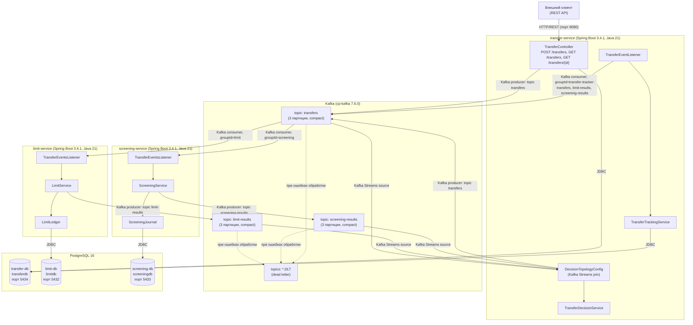
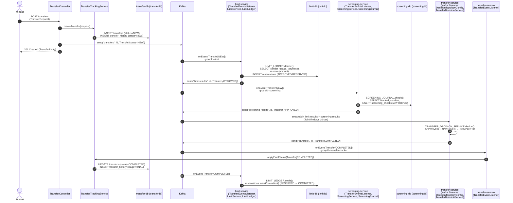
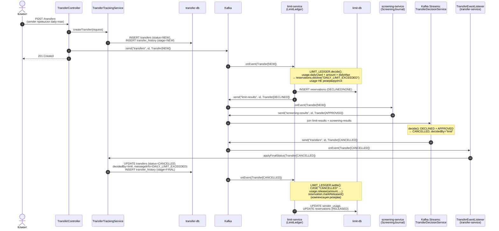
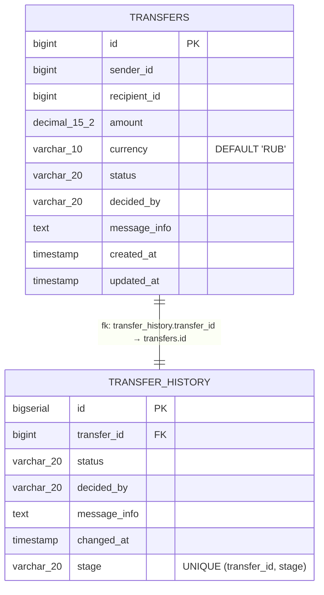
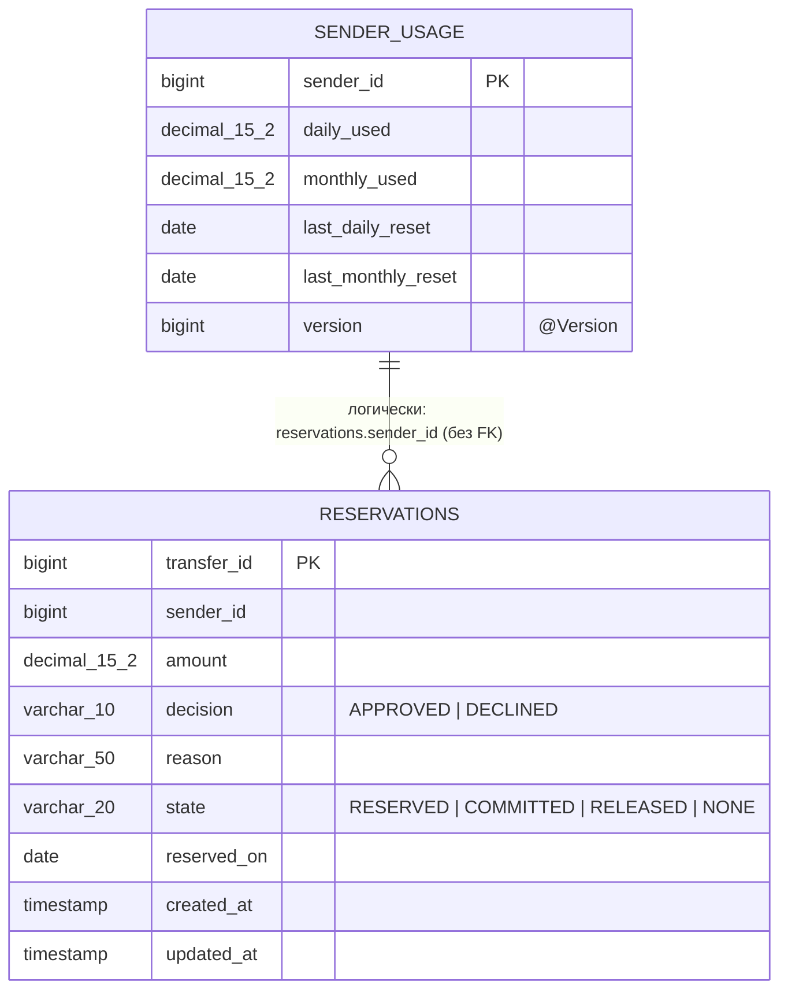
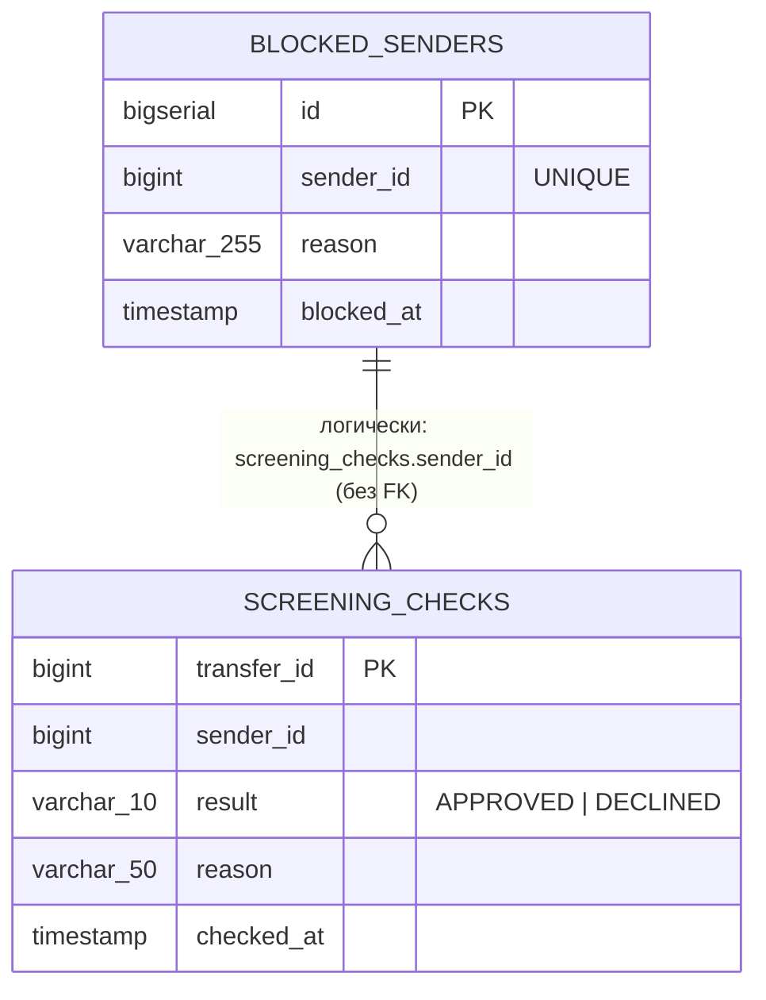
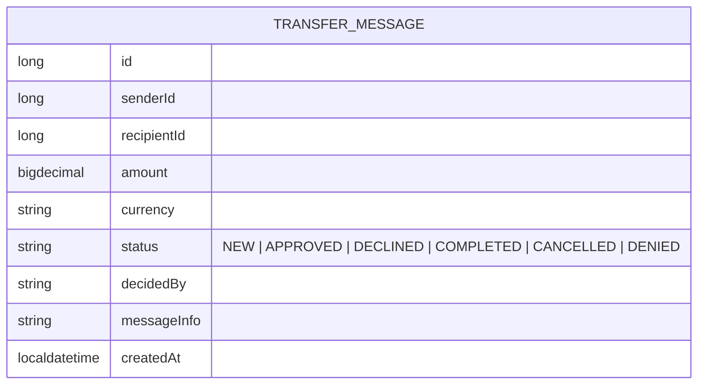
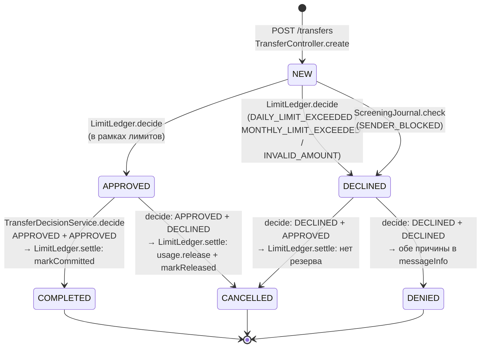

# Диаграмма 1: Component diagram (C4)

Все контейнеры системы: три Spring Boot-сервиса, брокер Kafka, три базы PostgreSQL, внешний клиент REST API и связи между ними с указанием протоколов и каналов.

# Диаграмма 2: Sequence diagram — happy path

Успешный сценарий: оба сервиса (лимиты и скрининг) одобряют перевод, Kafka Streams-join выносит решение `COMPLETED`, лимитная резервация коммитится.

# Диаграмма 3: Sequence diagram — сценарий отказа

Отказ по лимиту: резервация уже создана не будет — declined на этапе решения; затем поток join выносит `CANCELLED`, и уже выполненная лимитная резервация компенсируется (освобождение `SenderUsage`, `RESERVED → RELEASED`). Показан полный путь компенсации.

Дополнительный сценарий частичного отказа, обнаруженный в коде: при недоступности Kafka в `TransferController.publishNew` сущность уже сохранена в БД, клиент получает `503` с сообщением «Kafka недоступна, перевод сохранён — повторите запрос с тем же id», а повторный запрос с тем же `id` (через `duplicate()`) просто переиздаёт событие в `transfers` — двойной записи не возникает.

# Диаграмма 4: ER-диаграммы

Три физические базы данных и один неперсистентный объект сообщения (`Transfer` — Java record, хранится только в Kafka).

Логические связи между сущностями разных диаграмм (без внешних ключей, передача через Kafka по идентификаторам):

- `Transfer.id` ↔ `transfers.id` ↔ `reservations.transfer_id` ↔ `screening_checks.transfer_id` — сквозной идентификатор перевода.
- `Transfer.senderId` ↔ `sender_usage.sender_id`, `blocked_senders.sender_id` — идентификатор отправителя.
- `TransferHistoryEntry.transferId` ↔ `transfers.id` — единственный настоящий FK (в transferdb).

# Диаграмма 5: Диаграмма состояний

Жизненный цикл главной бизнес-сущности `Transfer` (статусы из `Transfer`/`TransferDecisionService`); статусы `APPROVED`/`DECLINED` — промежуточные результаты сервисов, публикуемые в `limit-results`/`screening-results`.

Другая сущность с жизненным циклом — `Reservation` (limit-service), состояния из класса `Reservation`: `NONE` (declined) → финал; `RESERVED` → `COMMITTED` (при `COMPLETED`) или `RESERVED` → `RELEASED` (при `CANCELLED`/`DENIED`, с освобождением `SenderUsage`). Повторные обработки защищены: в `LimitLedger.decide` — проверкой `reservationRepository.findById` (возврат сохранённого решения), в `TransferTrackingService` — уникальным ограничением `uq_transfer_history_stage` и проверкой `existsByTransferIdAndStage`.