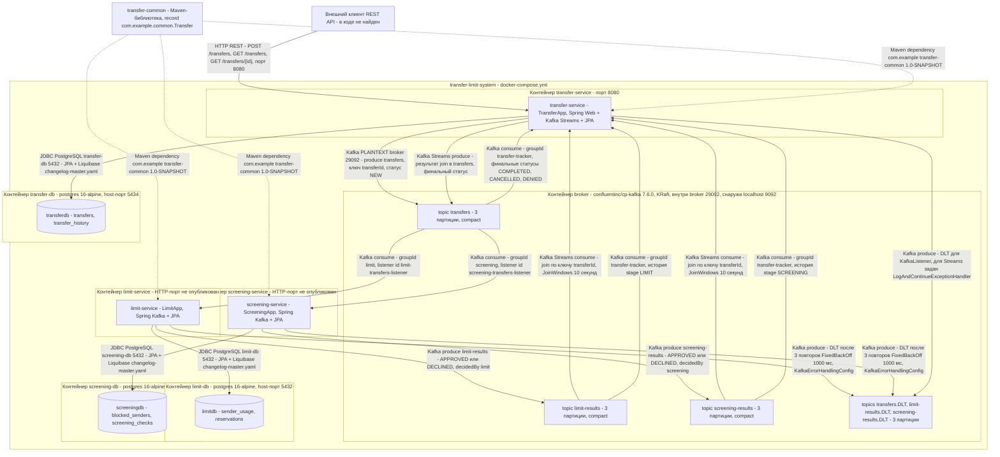
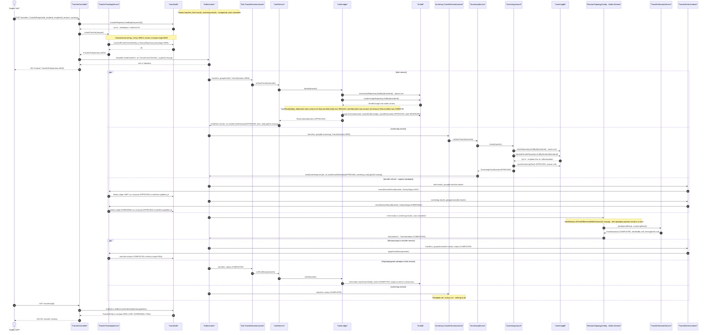
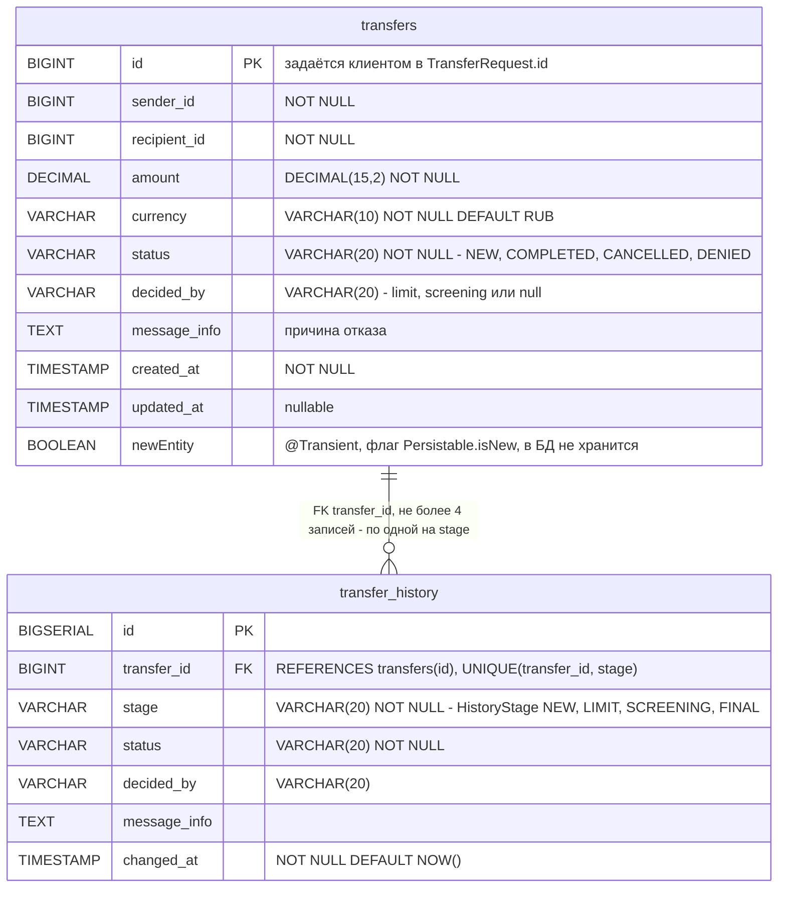
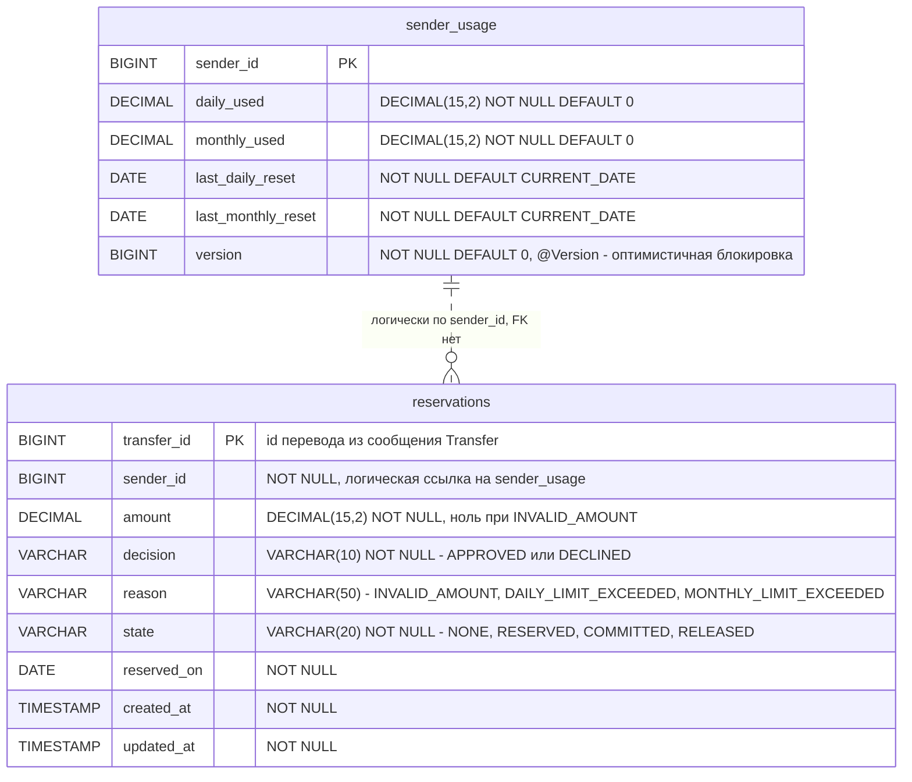
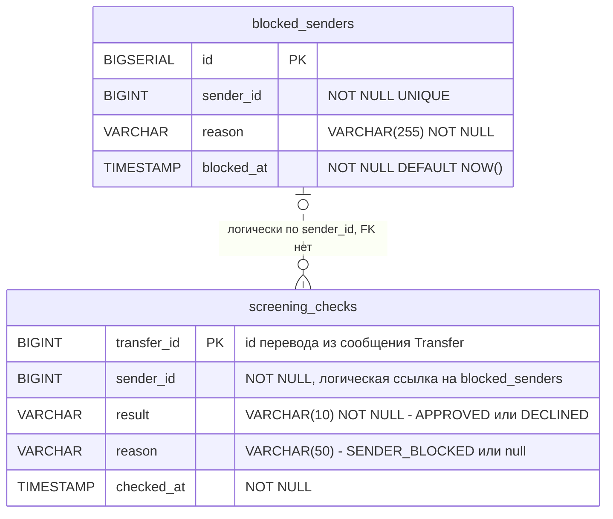
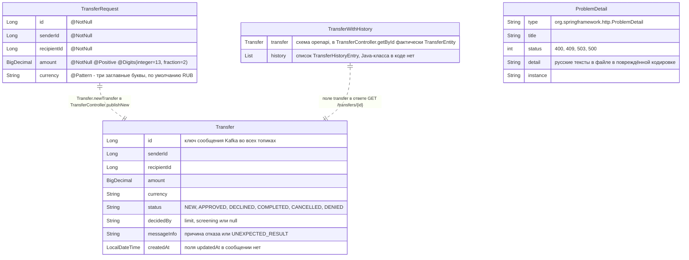
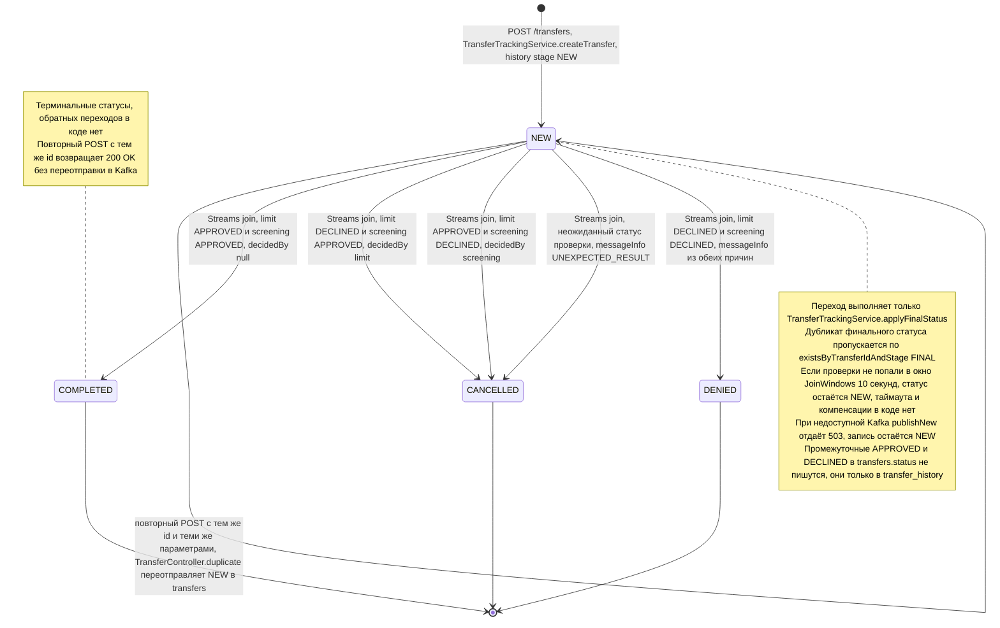

## Диаграмма 1. Component diagram (C4)

Три Spring Boot‑сервиса, три отдельные PostgreSQL‑базы и один брокер Kafka (KRaft) из `docker-compose.yml`; внешних интеграций (платёжные шлюзы, СМЭВ и т.п.) в коде не найдено. Все междусервисные связи — только через топики Kafka, синхронный вход один: REST `TransferController`.

## Диаграмма 2. Sequence diagram — happy path (перевод одобрен)

Основной успешный сценарий: `POST /transfers` → публикация `NEW` → одобрение лимита и скрининга → join в Kafka Streams (`DecisionTopologyConfig`) → `COMPLETED` → фиксация в `transferdb` и подтверждение резерва в `limitdb`. Обращения к БД показаны через participant‑базы, но выполняются репозиториями `TransferRepository`, `TransferHistoryRepository`, `SenderUsageRepository`, `ReservationRepository`, `BlockedSenderRepository`, `ScreeningCheckRepository`.

## Диаграмма 3. Sequence diagram — отказ (отправитель заблокирован, резерв компенсируется)

Наиболее показательный отказ: `senderId=5` есть в `blocked_senders` (`screening-service/src/main/resources/db/changelog/002-insert-test-data.sql`), поэтому скрининг возвращает `DECLINED SENDER_BLOCKED`, а уже списанный лимит откатывается через `LimitLedger.settle` → `SenderUsage.release`. HTTP‑запрос при этом отвечает 201 — отказ формируется асинхронно; технические отказы (503 при недоступной Kafka, 409 при конфликте id) отмечены в примечаниях.

```mermaid
sequenceDiagram
    autonumber
    actor Client as "Клиент API"
    participant TC as "TransferController"
    participant TTS as "TransferTrackingService"
    participant TDB as "transferdb"
    participant K as "Kafka broker"
    participant LEL as "limit TransferEventsListener"
    participant LS as "LimitService"
    participant LL as "LimitLedger"
    participant LDB as "limitdb"
    participant SEL as "screening TransferEventsListener"
    participant SS as "ScreeningService"
    participant SJ as "ScreeningJournal"
    participant SDB as "screeningdb"
    participant ST as "DecisionTopologyConfig - Kafka Streams"
    participant TDS as "TransferDecisionService"
    participant TEL as "TransferEventListener"

    Client->>TC: POST /transfers, id=1001, senderId=5 - заблокированный отправитель
    TC->>TTS: createTransfer(request)
    TTS->>TDB: TransferEntity(status=NEW) и history stage NEW
    TC->>K: send('transfers', id, Transfer(status=NEW))
    TC-->>Client: 201 Created, status=NEW - запрос принят, отказ будет асинхронным

    par limit-service - резерв создан
        K->>LEL: transfers, groupId=limit, status=NEW
        LEL->>LS: onNewTransfer(transfer)
        LS->>LL: decide(transfer)
        LL->>LDB: usage.reserve(amount), Reservation(APPROVED, state=RESERVED)
        Note over LL,LDB: Лимит уже списан - это действие потребуется компенсировать
        LS->>K: send('limit-results', APPROVED, decidedBy=limit)
    and screening-service - отказ
        K->>SEL: transfers, groupId=screening, status=NEW
        SEL->>SS: onNewTransfer(transfer)
        SS->>SJ: check(transfer)
        SJ->>SDB: blockedSenderRepository.findBySenderId(5)
        SDB-->>SJ: BlockedSender(senderId=5, reason=Fraud detected)
        SJ->>SDB: save(ScreeningCheck DECLINED, reason=SENDER_BLOCKED)
        SS->>K: send('screening-results', DECLINED, decidedBy=screening, messageInfo=SENDER_BLOCKED)
    end

    K->>TEL: limit-results и screening-results, groupId=transfer-tracker
    TEL->>TTS: recordServiceResult(LIMIT) и recordServiceResult(SCREENING)
    TTS->>TDB: history LIMIT=APPROVED и SCREENING=DECLINED
    K->>ST: join limit-results и screening-results по ключу transferId
    ST->>TDS: decide(limitResult=APPROVED, screeningResult=DECLINED)
    TDS-->>ST: Transfer(status=CANCELLED, decidedBy=screening, messageInfo=SENDER_BLOCKED)
    ST->>K: to('transfers') - CANCELLED

    K->>TEL: transfers, status=CANCELLED
    TEL->>TTS: applyFinalStatus(transfer)
    TTS->>TDB: transfers.status=CANCELLED, decided_by=screening и history stage FINAL

    K->>LEL: transfers, status=CANCELLED
    LEL->>LS: onFinalStatus(transfer)
    LS->>LL: settle(transfer)
    Note over LL: reservation.isReserved() true, статус CANCELLED - ветка компенсации
    LL->>LDB: usage.release(amount, reservedOn, today) - daily только если reservedOn равен today, monthly только если тот же YearMonth, результат не ниже нуля
    LL->>LDB: reservation.markReleased(), state=RELEASED
    K->>SEL: transfers, status=CANCELLED
    Note over SEL: Screening не держит резервов - ничего не компенсирует

    Client->>TC: GET /transfers/{id}
    TC-->>Client: 200 OK, status=CANCELLED, decidedBy=screening, messageInfo=SENDER_BLOCKED

    Note over TDS: Другие ветки decide - обе DECLINED дают DENIED с склейкой messageInfo через разделитель точка с запятой, DECLINED только у limit даёт CANCELLED decidedBy=limit, при этом Reservation сразу в state=NONE и компенсация не нужна
    Note over TC,TDB: Технический отказ - publishNew при недоступной Kafka бросает ResponseStatusException 503, запись transfers остаётся в NEW без отката, повторный POST с тем же id переотправляет NEW через TransferController.duplicate, а при других параметрах возвращается 409 Conflict
```

## Диаграмма 4а. ER — transferdb (transfer-service)

Единственная связь по внешнему ключу во всём проекте: `transfer_history.transfer_id → transfers.id` плюс уникальность `(transfer_id, stage)`. Источник: `transfer-service/src/main/resources/db/changelog/001-create-tables.sql`, `TransferEntity`, `TransferHistoryEntry`.

## Диаграмма 4б. ER — limitdb (limit-service)

FK между таблицами нет: `reservations.sender_id` ссылается на `sender_usage.sender_id` логически. Источник: `limit-service/src/main/resources/db/changelog/001-create-tables.sql`, `SenderUsage`, `Reservation`.

## Диаграмма 4в. ER — screeningdb (screening-service)

FK нет, связь `screening_checks.sender_id` с `blocked_senders.sender_id` логическая; `blocked_senders` наполняется тестовыми отправителями 5, 13, 21, 34, 42 в `002-insert-test-data.sql`. Источник: `screening-service/src/main/resources/db/changelog/001-create-tables.sql`, `BlockedSender`, `ScreeningCheck`.

## Диаграмма 4г. ER — объекты вне БД (сообщения и DTO)

`Transfer` (`transfer-common`) — сообщение Kafka, `TransferRequest` — входной DTO, `TransferWithHistory` описан только в `openapi/transfer-api.yaml` (в контроллере это `Map`), `ProblemDetail` — стандартный ответ об ошибке Spring.

Логические связи между сущностями разных диаграмм (по идентификатору, без FK):
- `transferdb.transfers.id` ↔ `Transfer.id` (сообщение в топиках `transfers`, `limit-results`, `screening-results`) и ↔ `TransferRequest.id`.
- `transferdb.transfers.id` ↔ `limitdb.reservations.transfer_id`.
- `transferdb.transfers.id` ↔ `screeningdb.screening_checks.transfer_id`.
- `transferdb.transfers.sender_id` ↔ `limitdb.sender_usage.sender_id` и ↔ `limitdb.reservations.sender_id`.
- `transferdb.transfers.sender_id` ↔ `screeningdb.blocked_senders.sender_id` и ↔ `screeningdb.screening_checks.sender_id`.
- `transferdb.transfer_history.transfer_id` ↔ `TransferWithHistory.history` (элементы `TransferHistoryEntry`), `transferdb.transfers` ↔ `TransferWithHistory.transfer`.
- `Transfer.status` в сообщении ↔ `limitdb.reservations.decision` и ↔ `screeningdb.screening_checks.result` (значения APPROVED/DECLINED), финальные статусы сообщения ↔ `transferdb.transfers.status`.

## Диаграмма 5. Состояния ключевой сущности — TransferEntity.status (transfers.status)

Жизненный цикл перевода: `NEW` создаётся синхронно в `TransferTrackingService.createTransfer`, а финальный статус выставляется только в `applyFinalStatus` по результату `TransferDecisionService.decide`; обратных переходов и таймаута ожидания проверок в коде нет.

Остальные сущности с состояниями (диаграммы не рисовались):
- `Reservation` (`limitdb.reservations`): `decision` = APPROVED/DECLINED задаётся в `LimitLedger.decide`; `state`: NONE → RESERVED (approve) → COMMITTED (markCommitted при COMPLETED) или RELEASED (markReleased при CANCELLED/DENIED); при decline сразу NONE.
- `SenderUsage` — статусов нет, есть циклы `lazyReset` (сброс дня/месяца), `reserve` и `release`.
- `ScreeningCheck.result` — APPROVED/DECLINED, выставляется один раз в `ScreeningJournal.check`, переходов нет.
- `HistoryStage` (`transfer_history.stage`) — последовательность этапов NEW → LIMIT/SCREENING → FINAL, уникальна по `(transfer_id, stage)`, это журнал, а не статусная модель.