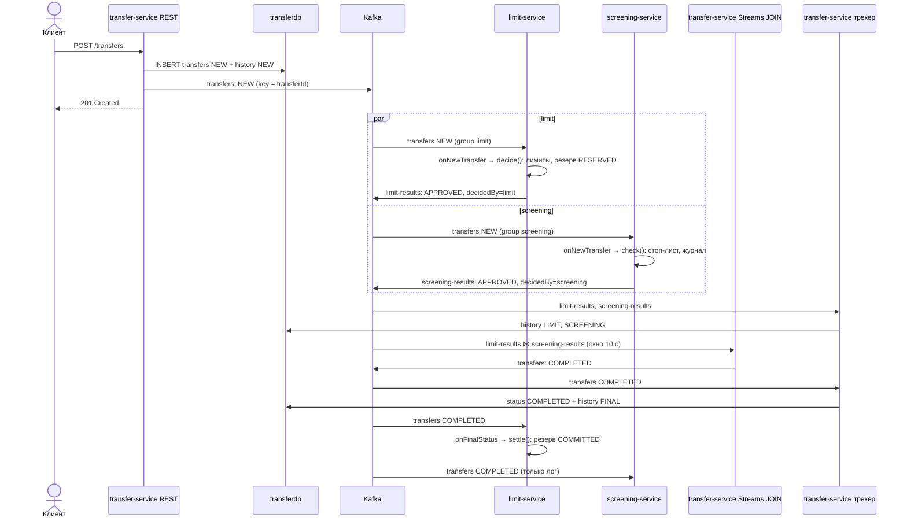
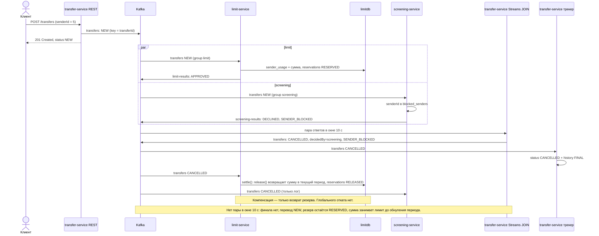
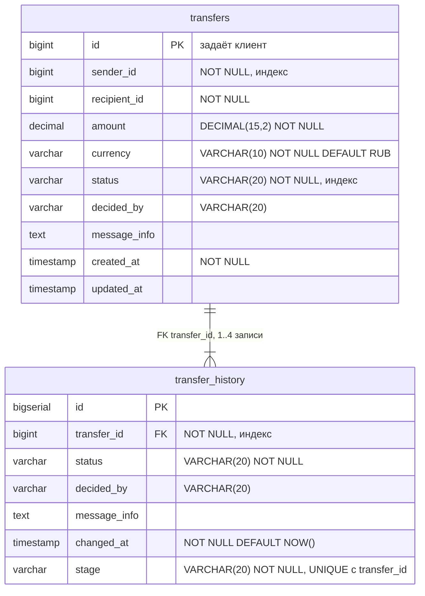
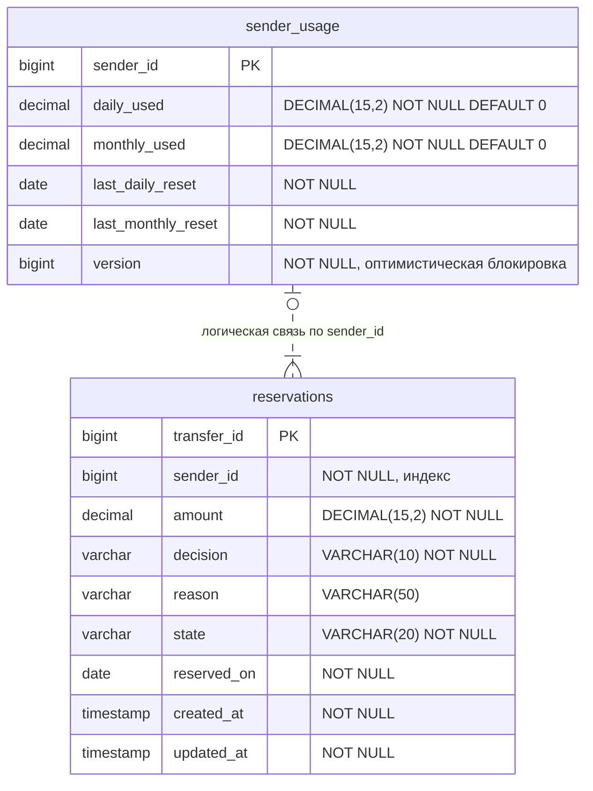
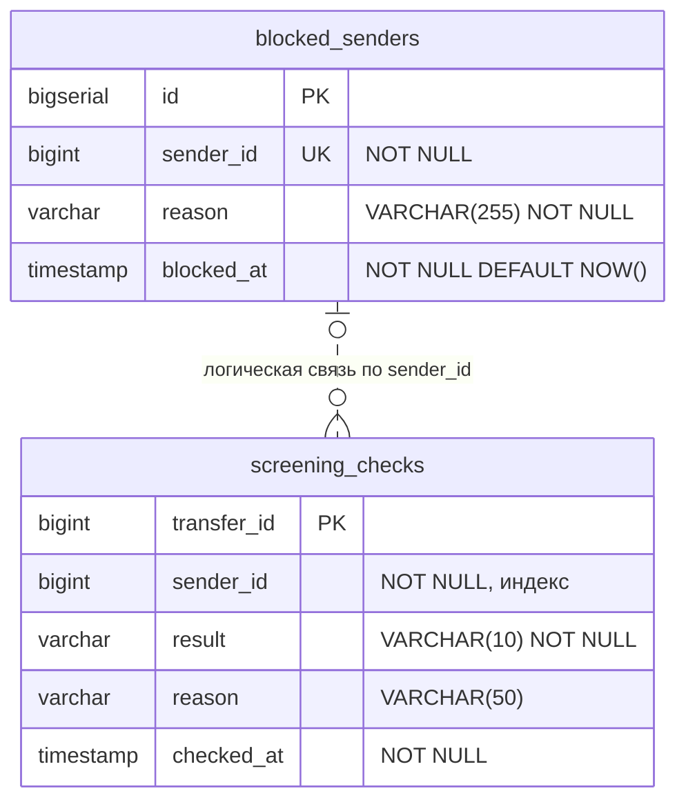
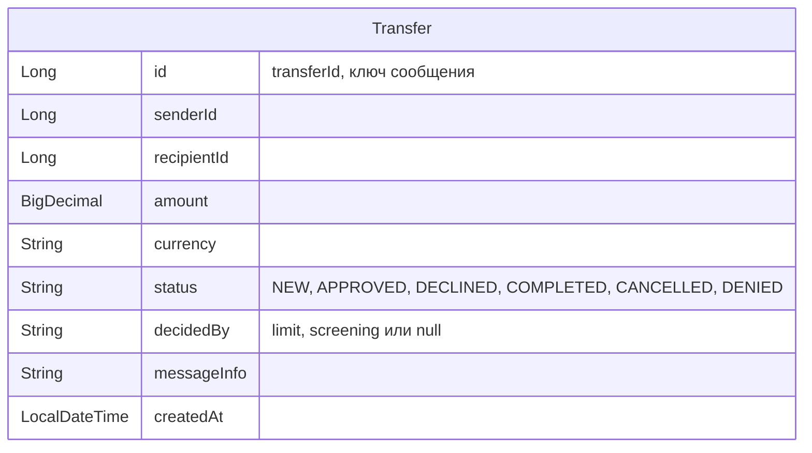
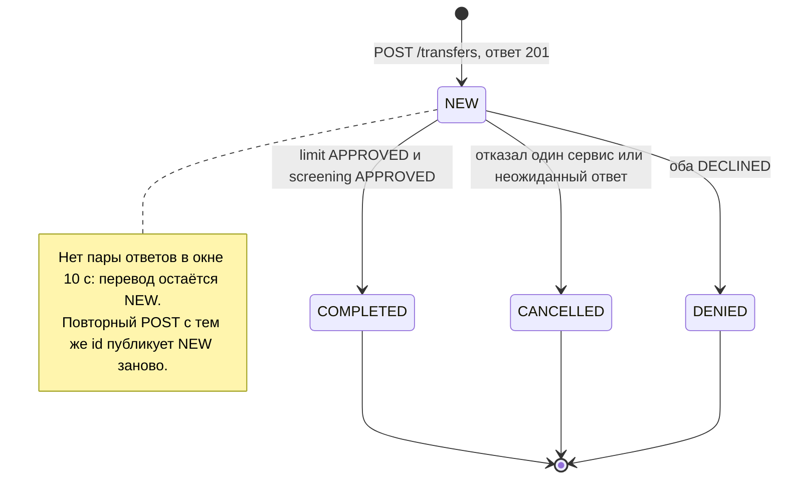
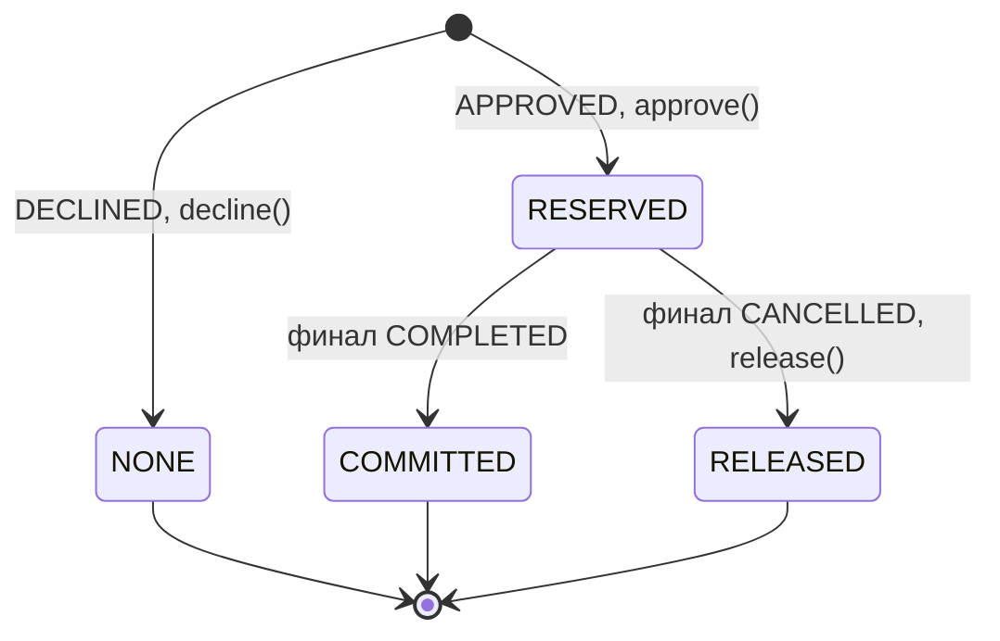

# Эталон ответов: transfer-limit-system

Эталон для проверки ответов моделей. Источник истины - код из `experiment/code.txt`: 57 файлов. Каждое утверждение сверено с кодом, в скобках указаны файл и строки или метод.

---

## 0. Как пользоваться

### 0.1 Принципы

1. **Истина - код.** Если эталон расходится с `code.txt`, прав код, а эталон нужно исправить.
2. **Модели видели только `code.txt`.** Файлов `README.md`, `LICENSE`, `mvnw`, `mvnw.cmd`, `.mvn/`, `.gitignore`, `.gitattributes`, `.dockerignore` у них не было, по ним не оцениваем.
3. **Пропуск** - это только отсутствие пункта "Обязательно". Остальное содержание эталона нужно, чтобы проверять истинность утверждений, а не чтобы требовать полноты.
4. **Утверждения вне эталона** проверяются по коду. Верное дает 0 баллов и записывается в кандидаты на пополнение эталона. Неверное штрафуется по градации из 0.3.

### 0.2 Шкала

| Что | Баллы |
|---|---|
| Все группы "Обязательно" закрыты | база **7** |
| Группа "Обязательно" закрыта частично (есть хотя бы половина атомов) | **−0,5** |
| Группа "Обязательно" не закрыта (меньше половины атомов) | **−1** |
| Каждый пункт "Сильный ответ" | **+1** |
| Ошибки | по 0.3 |
| Итог кейса | сырой балл (индекс) |

Максимум кейса = 7 + число пунктов "Сильный ответ". В статье итог показан в процентах от максимума кейса, общий итог - сумма баллов по пяти кейсам в процентах от суммы максимумов (76). Скрипт `score.py` дополнительно выводит оценку от 1 до 10 (сырой балл, ограниченный этим диапазоном), она используется только в сводках `summary.md` и `compare.md`.

Рядом с итогом всегда фиксируются **сырые составляющие**: сколько групп закрыто, сколько сильных пунктов, сумма штрафов.

### 0.3 Градация ошибок

| Категория | Что это | Баллы |
|---|---|---|
| Неточность | Суть верна, деталь искажена или упрощена ("DLT после 3 повторов" для битых сообщений, "резервирование средств" вместо лимита) | −0,5 |
| Мелкая ошибка | Неверный порт, версия, имя группы, кардинальность. Существующий метод приписан не тому классу | −1 |
| Ложная аномалия или выдуманное расхождение | Модель объявила дефектом то, чего в коде нет | −1 |
| Галлюцинация | Несуществующий класс, метод, эндпоинт, таблица, топик или механизм (раздел 8) | −2 |
| Искажение бизнес-правила | Неверный итог, неверная проверка, неверная компенсация (раздел 8) | −2 |
| Нерабочий Mermaid | Диаграмма не открывается в mermaid-cli 11 или mermaid.live | −1 за каждую диаграмму |
| Нарушение ограничений промпта | Java-типы вместо JSON, предписание классов в кейсе 5 и т. п. | −0,5 за каждый тип нарушения |

**Правила подсчета:**

- Одна и та же ошибка, повторенная в ответе несколько раз, штрафуется **один раз**.
- **Двойного зачета нет.** Одна находка закрывает не больше одного пункта: если она подходит и под "Обязательно", и под "Сильный", сначала закрывается "Обязательно". Исключение - проверочные пункты, они помечены "(проверочный)".
- Факты из раздела 12 (найдены при проверке на запуске) - верные утверждения вне основного эталона: за них не штрафуем, бонус не даем, если пункт не указан в чек-листе.

---

## 1. Паспорт системы

**Назначение.** P2P-переводы с двумя независимыми проверками: лимиты отправителя (limit-service) и стоп-лист отправителей (screening-service). Итоговое решение принимает transfer-service, сводя оба ответа через Kafka Streams JOIN. Фактического движения денег в системе нет: она решает, допустить ли перевод, и ведет учет израсходованных лимитов.

**Архитектурный паттерн.** Событийная архитектура без оркестратора и database-per-service. Сервисы проверки реагируют на событие NEW независимо и параллельно, итог вычисляется в transfer-service JOIN-ом двух потоков ответов.
- **Засчитывать формулировки:** "хореографическая сага", "сага с агрегацией через Kafka Streams", "хореография через Kafka", "scatter-gather с компенсацией", "event-driven + database per service" с описанием сведения ответов.
- **Ошибка:** "оркестратор вызывает сервисы по REST".

**Модули** (корневой `pom.xml`, packaging `pom`, агрегатор без общего родителя):

| Модуль | Роль | Внешний API | Ключевые зависимости |
|---|---|---|---|
| `transfer-common` | Общее сообщение Kafka `Transfer`, неизменяемый Java record | - (библиотека) | Нет зависимостей, нет родителя Spring Boot |
| `transfer-service` | REST API, хранение перевода и истории, Kafka Streams JOIN, трекер событий | **HTTP, порт 8080** | web, validation, spring-kafka, kafka-streams, data-jpa, postgresql, liquibase, transfer-common |
| `limit-service` | Проверка и резервирование лимитов отправителя | нет | spring-boot-starter (без web), spring-kafka, data-jpa, postgresql, liquibase, jackson-databind, jackson-jsr310, transfer-common |
| `screening-service` | Проверка отправителя по стоп-листу | нет | spring-boot-starter (без web), spring-kafka, data-jpa, postgresql, liquibase, jackson-databind, jackson-jsr310, transfer-common |

**Стек и версии.**
- Java 21; Spring Boot 3.4.1 (parent во всех трех сервисах). Версии spring-kafka и kafka-streams управляются Spring Boot, явно в pom не указаны.
- PostgreSQL 16 (`postgres:16-alpine`); Kafka `confluentinc/cp-kafka:7.6.0` в режиме KRaft, без ZooKeeper.
- Liquibase (SQL-changelog), Jackson JSR-310. Тестов в коде нет.

**Каналы Kafka** (подробно - в разделе 5):

| Топик | Пишет | Читает (consumer group) |
|---|---|---|
| `transfers` | transfer-service: NEW (REST) и финалы (Streams) | limit-service (`limit`), screening-service (`screening`), трекер transfer-service (`transfer-tracker`) |
| `limit-results` | limit-service | Kafka Streams transfer-service (`transfer-service`¹), трекер |
| `screening-results` | screening-service | Kafka Streams transfer-service, трекер |
| `transfers.DLT` | обработчики ошибок всех трех сервисов | никто |
| `limit-results.DLT`, `screening-results.DLT` | обработчик ошибок трекера в transfer-service | никто |

¹ `application.id` Kafka Streams явно не задан, Spring Boot берет его из `spring.application.name` = `transfer-service`. Это вывод, а не значение из конфигурации: формулировку "явно не задан" тоже засчитывать.

**Инфраструктура** (`docker-compose.yml`):
- брокер: порт 9092 наружу, 29092 внутри сети, автосоздание топиков выключено (`KAFKA_AUTO_CREATE_TOPICS_ENABLE: "false"`);
- три отдельные БД: transferdb (5434), limitdb (5432), screeningdb (5433);
- сервисы запускаются с профилем `docker`; HTTP-порт наружу публикует только transfer-service (8080);
- образы собираются из корневого многостадийного `Dockerfile` с `ARG MODULE` (по образу на сервис), запускаются на JRE 21 не от root;
- healthcheck у брокера и трех БД, сервисы стартуют после `service_healthy`, `restart: unless-stopped`;
- именованные тома у брокера и БД; у state-dir Kafka Streams (`/tmp/transfer-service-streams`) тома нет;
- часовой пояс контейнеров не задан, на запуске - UTC (сутки лимита сменяются в 03:00 МСК);
- transfer-service не стартует, если имя брокера не резолвится (контейнер `broker` остановлен): `No resolvable bootstrap urls` -> `Could not start stream` -> цикл рестартов. Если имя резолвится, но брокер не отвечает, сервис стартует примерно за 42 с. (проверено запуском)

---

## 2. Бизнес-правила по сервисам

### 2.1 transfer-service

| # | Правило | Где |
|---|---|---|
| T1 | `id` перевода задает клиент, это ключ идемпотентности | `TransferRequest`, `TransferEntity implements Persistable` |
| T2 | Валидация: id, senderId, recipientId, amount обязательны; amount > 0, не более 13 цифр до и 2 после запятой; currency - ровно 3 заглавные латинские буквы, по умолчанию RUB | `TransferRequest` |
| T3 | Новый id: запись в БД со статусом NEW и запись истории NEW в одной транзакции, затем публикация NEW в `transfers` с ожиданием подтверждения до 10 с, ответ **201** | `TransferController.create`, `TransferTrackingService.createTransfer` |
| T4 | Kafka недоступна при публикации -> **503** problem+json; перевод остается в БД в статусе NEW. Время ответа: ~10 с при прогретом продюсере (`delivery.timeout.ms`, в логе `TimeoutException: Expiring 1 record(s)…`), ~5 с, если метаданных топика еще нет (`max.block.ms`). `ResponseStatusException(503)` обрабатывает `ResponseEntityExceptionHandler` (обработчик `ErrorResponseException`): он специфичнее, чем `@ExceptionHandler(Exception.class)` в `ApiExceptionHandler`, поэтому клиент получает именно 503, а не 500. В логе - ERROR `LoggingProducerListener` с телом сообщения. При таймауте сообщение теоретически может дойти до брокера (на запуске не наблюдалось). (проверено запуском) | `TransferController.publishNew`, `ApiExceptionHandler` |
| T5 | Тот же id и те же параметры (amount сравнивается через `compareTo`, currency с учетом умолчания) -> **200** и существующий перевод; если он еще NEW, NEW публикуется повторно | `TransferController.duplicate` |
| T6 | Тот же id, другие параметры -> **409** problem+json; ответ формирует сам контроллер, а не `ApiExceptionHandler` | `TransferController.duplicate` |
| T7 | Гонка двух POST с одним id: второй ловит нарушение PK и уходит в ветку дубликата; если строка не нашлась - 500 | `TransferController.create` |
| T8 | Трекер (`transfer-tracker`) пишет ответы limit и screening только в историю (этапы LIMIT, SCREENING); статус перевода не меняется, обновляется `updatedAt` (сущность сохраняется целиком) | `TransferTrackingService.recordServiceResult` |
| T9 | Финал из `transfers` (любой статус, кроме NEW) -> статус, decidedBy, messageInfo перевода и запись истории FINAL | `TransferEventListener`, `TransferTrackingService.applyFinalStatus` |
| T10 | Идемпотентность трекера: не больше одной записи истории на этап (`existsByTransferIdAndStage` + UNIQUE(transfer_id, stage)); первый финал побеждает | `TransferTrackingService`, `001-create-tables.sql` |
| T11 | Ответ по неизвестному переводу трекер пропускает с предупреждением | `TransferTrackingService` |
| T12 | GET `/transfers/{id}`: история сортируется по этапу (NEW -> LIMIT -> SCREENING -> FINAL), затем по времени. Перевод и история читаются двумя запросами без общей транзакции | `TransferController.getById` |
| T13 | Время `createdAt/updatedAt/changedAt` усекается до микросекунд | `TransferTrackingService.now` |

### 2.2 Решение JOIN (`TransferDecisionService.decide`)

| limit \ screening | APPROVED | DECLINED |
|---|---|---|
| **APPROVED** | COMPLETED, decidedBy = null | CANCELLED, decidedBy = `screening`, messageInfo от screening |
| **DECLINED** | CANCELLED, decidedBy = `limit`, messageInfo от limit | DENIED, decidedBy = null, messageInfo = `"<limit>; <screening>"` |

- Любая другая комбинация (статус не APPROVED/DECLINED, в том числе null или другой регистр) -> **CANCELLED**, decidedBy = null, messageInfo = `UNEXPECTED_RESULT: limit=…, screening=…`. Статус NEW на выходе невозможен.
- Итоговое сообщение строится из ответа limit-service через `withDecision(...)`.
- JOIN: inner join `limit-results` и `screening-results` по ключу transferId, окно **10 секунд без grace** (`JoinWindows.ofTimeDifferenceWithNoGrace`), результат пишется в `transfers`.
- Нет пары в окне -> финала нет, перевод остается NEW (аномалия A1).
- **Последствия для резерва** (засчитывать как "сквозную таблицу"): COMPLETED -> резерв COMMITTED; CANCELLED со screening -> RELEASED; CANCELLED с limit -> резерва нет (NONE); DENIED -> резерва нет (NONE), поэтому возврат при DENIED недостижим; UNEXPECTED_RESULT при RESERVED -> RELEASED.

### 2.3 limit-service

| # | Правило | Где |
|---|---|---|
| L1 | Из `transfers` (группа `limit`): NEW -> `LimitService.onNewTransfer`, любой другой статус -> `LimitService.onFinalStatus` (финализация резерва) | `limit/listener/TransferEventsListener.onEvent` |
| L2 | Повторный NEW по тому же transferId -> возвращается сохраненное решение, счетчики не меняются, ответ отправляется снова. Сверяется только transferId: сумма и отправитель не сравниваются (B14). Ответ собирается из **нового** входящего сообщения (`transfer.withDecision(...)`), поэтому в `limit-results` уходят новые сумма и отправитель со старым решением. (проверено запуском) | `LimitLedger.decide`, `LimitService.onNewTransfer` |
| L3 | amount null или ≤ 0 -> DECLINED `INVALID_AMOUNT`, резерв с суммой 0; **счетчики не загружаются и не сохраняются** (ранний return) | `LimitLedger.decide` |
| L4 | Счетчики на отправителя (`sender_usage`); новый отправитель - строка с нулями | `LimitLedger.decide` |
| L5 | Ленивое обнуление: смена дня -> дневной счетчик = 0; смена месяца -> месячный = 0 | `SenderUsage.lazyReset` |
| L6 | Проверка по порядку: dailyUsed + amount > **50 000.00** -> `DAILY_LIMIT_EXCEEDED`; иначе monthlyUsed + amount > **200 000.00** -> `MONTHLY_LIMIT_EXCEEDED`; иначе APPROVED и резерв (`SenderUsage.reserve` увеличивает оба счетчика). Сравнивается **накопленная сумма с учетом операции**, а не сумма операции. При отказе по DAILY/MONTHLY строка `sender_usage` тоже сохраняется (новому отправителю - с нулями); при `INVALID_AMOUNT` не сохраняется | `LimitLedger.decide`, `application.yml` |
| L7 | Граница включительна: ровно 50 000.00 при нулевом дневном счетчике -> APPROVED (сравнение строго `> 0`). Следствие: один перевод больше 50 000.00 всегда отклоняется, это фактический максимум суммы операции | `LimitLedger.decide` |
| L8 | Если превышены оба лимита - причина DAILY (дневной проверяется первым) | `LimitLedger.decide` |
| L9 | Лимиты общие для всех отправителей, задаются в конфигурации, без учета валюты | `LimitLedger`, `application.yml` |
| L10 | Ответ в `limit-results`: APPROVED/DECLINED, messageInfo = причина (null при APPROVED), decidedBy = `limit`; ожидание подтверждения до 10 с, ошибка -> повтор обработки. Решение коммитится до отправки ответа | `LimitService.onNewTransfer` |
| L11 | Финализация только для резерва в состоянии RESERVED; для NONE, COMMITTED, RELEASED и неизвестного transferId - ничего | `LimitLedger.settle` |
| L12 | COMPLETED -> резерв COMMITTED, сумма остается в счетчиках | `LimitLedger.settle` |
| L13 | CANCELLED или DENIED -> сумма возвращается, резерв RELEASED. Вычитается (`SenderUsage.release`) только из того периода, где был резерв: дневной - если резерв сделан сегодня, месячный - если в текущем месяце; не ниже 0. Для DENIED ветка фактически недостижима: DENIED бывает только при отказе limit, а значит резерв в состоянии NONE | `LimitLedger.settle`, `SenderUsage.release` |
| L14 | Неожиданный финальный статус -> предупреждение, без изменений | `LimitLedger.settle` |
| L15 | Оптимистическая блокировка счетчиков (`@Version` в `SenderUsage`) | `SenderUsage` |

Состояния резерва: `RESERVED` (через `approve()`), `NONE` (через `decline()`, конечное), `COMMITTED`, `RELEASED` (`markCommitted()`, `markReleased()`).

### 2.4 screening-service

| # | Правило | Где |
|---|---|---|
| S1 | Из `transfers` (группа `screening`) обрабатывается только NEW (`ScreeningService.onNewTransfer`); финальные статусы только логируются | `screening/listener/TransferEventsListener.onEvent` |
| S2 | Проверяется только **отправитель** (senderId) по таблице `blocked_senders`; найден -> DECLINED `SENDER_BLOCKED`, иначе APPROVED; причина из стоп-листа наружу не передается | `ScreeningJournal.check` |
| S3 | Каждая проверка пишется в журнал `screening_checks`; повторный NEW по тому же transferId -> сохраненный результат без новой проверки | `ScreeningJournal.check` |
| S4 | Ответ в `screening-results`: APPROVED/DECLINED, messageInfo, decidedBy = `screening` | `ScreeningService` |
| S5 | Тестовый стоп-лист: отправители 5, 13, 21, 34, 42, заносится миграцией `002-insert-test-data.sql` в основной цепочке | `002-insert-test-data.sql` |

---

## 3. Сценарии

| # | Сценарий | Итог перевода | Резерв limit-service |
|---|---|---|---|
| 1 | Оба APPROVED | COMPLETED, decidedBy = null | RESERVED -> COMMITTED, сумма остается |
| 2 | limit DECLINED (лимит), screening APPROVED | CANCELLED, decidedBy = limit, `DAILY_/MONTHLY_LIMIT_EXCEEDED` | NONE, возвращать нечего |
| 3 | limit APPROVED, screening DECLINED | CANCELLED, decidedBy = screening, `SENDER_BLOCKED` | RESERVED -> RELEASED, счетчики уменьшены |
| 4 | Оба DECLINED | DENIED, decidedBy = null, `"DAILY_LIMIT_EXCEEDED; SENDER_BLOCKED"` | NONE |
| 5 | Неожиданный ответ | CANCELLED, `UNEXPECTED_RESULT…`, decidedBy = null | если был RESERVED -> RELEASED |
| 6 | Ответы пришли с разницей > 10 с | остается NEW | если limit одобрил - запись остается RESERVED; сумма занимает лимит до ленивого обнуления (дневной - до конца суток, месячный - до конца месяца). Восстановление - повторный POST с тем же id |
| 7 | Kafka недоступна при POST | 503 через ~10 с (или ~5 с без метаданных), в БД NEW; повторный POST при лежащем брокере - снова 503 (B6) | повторный POST после восстановления -> 200 -> обработка (проверено запуском) |
| 8 | Повторный POST, те же параметры | 200; если NEW - повторная публикация | счетчики не удваиваются |
| 9 | Повторный POST, другие параметры | 409 | - |
| 10 | Невалидный запрос | 400 problem+json, перевод не создается | - |
| 11 | Битое сообщение (не десериализуется ключ или значение) | сразу в `<топик>.DLT`, **без повторов**, исходные байты; битое сообщение в `transfers` дает **по копии на каждую группу** (limit, screening, transfer-tracker - 3 записи, заголовок `kafka_dlt-original-consumer-group`). Ошибка обработки (БД, отправка) - 3 повтора с паузой 1 с, затем DLT, и туда уходит **заново сериализованный JSON**, а не исходные байты. spring-kafka не пишет WARN/ERROR ни о повторах, ни о DLT (проверено запуском) | - |
| 12 | Смена суток или месяца между резервом и отменой | финал как обычно | дневной счетчик не уменьшается (уже обнулен), месячный - только если месяц тот же |

**Порядок шагов (happy path):**
1. POST -> INSERT перевода NEW и истории NEW (одна транзакция) -> публикация NEW в `transfers` -> 201.
2. limit-service и screening-service читают NEW параллельно, каждый в своей consumer group.
3. Каждый сохраняет решение по transferId и публикует ответ в свой топик.
4. Трекер пишет ответы в историю (LIMIT, SCREENING).
5. JOIN сводит пару ответов -> финал в `transfers`.
6. Трекер применяет финал (статус и история FINAL); limit-service финализирует резерв; screening-service финал только логирует.

---

## 4. Модель данных

### 4.1 transferdb

**transfers** (`TransferEntity`, без `@Version`):

| Колонка | Тип | Ограничения |
|---|---|---|
| id | BIGINT | PK, задает клиент |
| sender_id | BIGINT | NOT NULL, индекс |
| recipient_id | BIGINT | NOT NULL |
| amount | DECIMAL(15,2) | NOT NULL |
| currency | VARCHAR(10) | NOT NULL, DEFAULT 'RUB' |
| status | VARCHAR(20) | NOT NULL, индекс; NEW / COMPLETED / CANCELLED / DENIED |
| decided_by | VARCHAR(20) | limit / screening / null |
| message_info | TEXT | причина |
| created_at | TIMESTAMP | NOT NULL |
| updated_at | TIMESTAMP | nullable в схеме; через API заполняется всегда |

**transfer_history** (`TransferHistoryEntry`):

| Колонка | Тип | Ограничения |
|---|---|---|
| id | BIGSERIAL | PK |
| transfer_id | BIGINT | NOT NULL, FK -> transfers(id), индекс |
| status | VARCHAR(20) | NOT NULL; NEW / APPROVED / DECLINED / COMPLETED / CANCELLED / DENIED |
| decided_by | VARCHAR(20) | nullable |
| message_info | TEXT | nullable |
| changed_at | TIMESTAMP | NOT NULL, DEFAULT NOW() |
| stage | VARCHAR(20) | NOT NULL; NEW / LIMIT / SCREENING / FINAL (`HistoryStage`) |
| (transfer_id, stage) | UNIQUE | не больше одной записи на этап |

У перевода от 1 до 4 записей истории: NEW создается в той же транзакции, что и перевод.

### 4.2 limitdb

**sender_usage** (`SenderUsage`): sender_id BIGINT PK; daily_used и monthly_used DECIMAL(15,2) NOT NULL DEFAULT 0; last_daily_reset и last_monthly_reset DATE NOT NULL DEFAULT CURRENT_DATE; version BIGINT NOT NULL DEFAULT 0 (оптимистическая блокировка).

**reservations** (`Reservation`): transfer_id BIGINT PK; sender_id BIGINT NOT NULL (индекс); amount DECIMAL(15,2) NOT NULL; decision VARCHAR(10) NOT NULL (APPROVED/DECLINED); reason VARCHAR(50); state VARCHAR(20) NOT NULL (RESERVED/NONE/COMMITTED/RELEASED); reserved_on DATE NOT NULL; created_at, updated_at TIMESTAMP NOT NULL.

Внешних ключей между таблицами нет. Связь `reservations.sender_id → sender_usage.sender_id` логическая. У резерва 0..1 строки счетчиков: при `INVALID_AMOUNT` для нового отправителя `sender_usage` не создается. CHECK-ограничений на допустимые значения нет.

### 4.3 screeningdb

**blocked_senders** (`BlockedSender`): id BIGSERIAL PK; sender_id BIGINT NOT NULL UNIQUE (плюс отдельный индекс); reason VARCHAR(255) NOT NULL; blocked_at TIMESTAMP NOT NULL DEFAULT NOW(). 5 тестовых строк.

**screening_checks** (`ScreeningCheck`): transfer_id BIGINT PK; sender_id BIGINT NOT NULL (индекс); result VARCHAR(10) NOT NULL (APPROVED/DECLINED); reason VARCHAR(50); checked_at TIMESTAMP NOT NULL.

### 4.4 Сообщение Kafka `Transfer` (`transfer-common`, Java record)

| Поле | Тип | Значения |
|---|---|---|
| id | Long | transferId, он же ключ сообщения |
| senderId, recipientId | Long | идентификаторы |
| amount | BigDecimal | сумма |
| currency | String | код валюты |
| status | String | NEW; APPROVED/DECLINED (ответы); COMPLETED/CANCELLED/DENIED (финал) |
| decidedBy | String | limit / screening / null |
| messageInfo | String | `DAILY_LIMIT_EXCEEDED`, `MONTHLY_LIMIT_EXCEEDED`, `INVALID_AMOUNT`, `SENDER_BLOCKED`, `"<a>; <b>"`, `UNEXPECTED_RESULT: …` |
| createdAt | LocalDateTime | время создания перевода |

- Порядок полей: id, senderId, recipientId, amount, currency, status, decidedBy, messageInfo, createdAt. Фабрика `newTransfer(...)` (status = NEW), решение добавляется через `withDecision(status, decidedBy, messageInfo)`.
- Статусы - строки, не enum. Одно поле `status` несет три набора значений в разных топиках.
- **Сериализация `createdAt` в Kafka:** `JsonSerializer`/`JsonSerde` заданы по имени класса (и в DLT-шаблонах - `new JsonSerializer<>()`), поэтому используют собственный `ObjectMapper` spring-kafka, а не настроенный Spring Boot. `LocalDateTime` пишется **массивом** `[год, месяц, день, час, мин, сек, нано]`, например `[2026,10,5,15,13,32,938123000]`. Нулевые секунды и наносекунды Jackson опускает, поэтому длина массива - 5–7 элементов. В REST-ответах transfer-service даты - ISO-строки. Утверждение "в Kafka ISO-строка" (в том числе в примерах) - неточность (−0,5). (проверено запуском)
- Заголовок `__TypeId__` есть у всех сообщений, включая финал от Kafka Streams. (проверено запуском)

---

## 5. Kafka

### 5.1 Топики

| Топик | Партиции / политика | Кто объявляет |
|---|---|---|
| `transfers` | 3, compact | все три сервиса (`TopicsConfig`) |
| `limit-results` | 3, compact | все три сервиса |
| `screening-results` | 3, compact | все три сервиса |
| `transfers.DLT` | 3, политика не задана (действует настройка брокера, по умолчанию delete) | все три сервиса (`KafkaErrorHandlingConfig`) |
| `limit-results.DLT`, `screening-results.DLT` | 3, политика не задана (на запуске - delete) | только transfer-service |
| `transfer-service-KSTREAM-JOINTHIS-0000000004-store-changelog`, `transfer-service-KSTREAM-JOINOTHER-0000000005-store-changelog` | 3, delete, `retention.ms` 86420000 | создает Kafka Streams (внутренние топики JOIN; называть их - не галлюцинация) (проверено запуском) |

- Ключ везде - transferId (`Long`), значение - JSON `Transfer`. Тип значения consumer берет из заголовка `__TypeId__` (`spring.json.value.default.type` не задан). Формат сообщения нигде не описан: OpenAPI покрывает только REST.
- `spring.kafka.admin.modify-topic-configs: true` выравнивает конфигурацию существующих топиков. Коэффициент репликации не задан.

### 5.2 Надежность

- **Consumer:** `auto-offset-reset: earliest`; ключ и значение читаются через `ErrorHandlingDeserializer` (делегаты `LongDeserializer` и `JsonDeserializer`, `trusted.packages: "*"`).
- **Ошибки обработки:** `DefaultErrorHandler` с `FixedBackOff(1000, 3)` - 3 повтора с паузой 1 с, затем `DeadLetterPublishingRecoverer` в `<топик>.DLT`, в ту же партицию. **Сообщения с не десериализуемым ключом или значением уходят в DLT сразу, без повторов.** Успешная публикация в DLT логируется на DEBUG. Если публикация в DLT не удалась, запись пропускается с ERROR в логе (`setFailIfSendResultIsError(false)`).
- **Параллелизм:** `concurrency` не задан - каждый слушатель обрабатывает свои партиции последовательно одним потоком.
- **Kafka Streams:** at-least-once (exactly-once не настроен); `LogAndContinueExceptionHandler` - не десериализованная запись пропускается с WARN в логе; в DLT Streams не пишет.
- **Producer `KafkaTemplate`** (REST, ответы limit и screening, DLT-шаблоны): `max.block.ms` 5000, `request.timeout.ms` 5000, `delivery.timeout.ms` 10000; отправка синхронная - `send(...).get(10, SECONDS)`.
- **Producer Kafka Streams** этих настроек не получает (у Streams свои `spring.kafka.streams.*`) и работает с умолчаниями Kafka: `max.block.ms` 60000, `delivery.timeout.ms` 120000; запись финала асинхронная. (проверено запуском)
- **Идемпотентность потребителей:** limit (`reservations`), screening (`screening_checks`), трекер (UNIQUE по этапу).

### 5.3 Kafka Streams

- Топология в `config/DecisionTopologyConfig`: `stream("limit-results")` join `stream("screening-results")`, оба KStream, **KTable нет**.
- Joiner - `TransferDecisionService::decide` (левый аргумент - ответ limit, правый - screening).
- Окно - `JoinWindows.ofTimeDifferenceWithNoGrace(10 с)` по меткам времени записей; опоздавшие записи отбрасываются.
- Serde - `JsonSerde<>(Transfer.class)`; результат - `peek` (лог) и `to("transfers")` с тем же ключом.
- Co-partitioning соблюден: оба входа по 3 партиции.

---

## 6. REST API (transfer-service)

| Метод | Путь | Ответы |
|---|---|---|
| POST | `/transfers` | 201 новый; 200 повтор с теми же параметрами; 409 тот же id, другие параметры; 400 валидация или битый JSON; 503 Kafka недоступна; 500 прочие ошибки |
| GET | `/transfers` | 200, список, новые первыми, без пагинации |
| GET | `/transfers/{id}` | 200 `{ "transfer": …, "history": [...] }`; 404 без тела; 400 при нечисловом id |

- Тело POST: `TransferRequest` {id, senderId, recipientId, amount, currency?}. Ответ POST - `TransferEntity`.
- Ошибки 400/409/500/503 - `application/problem+json`. Тексты 409, 500 и 503 на русском. Тексты 400 - стандартные английские тексты Spring: `Invalid request content.` (валидация, поле не указывается), `Failed to read request` (битый JSON), `Failed to convert 'id' with value: 'abc'` (GET). 500 - `ApiExceptionHandler.handleUnexpected` без текста исключения. (проверено запуском)

### 6.1 Расхождения контракта `transfer-api.yaml` (OpenAPI 3.0.3) с кодом

| # | Расхождение | Статус |
|---|---|---|
| O1 | Код 500 не описан ни для одной операции | подтверждено |
| O2 | Код 400 для GET `/transfers/{id}` (нечисловой id) не описан | подтверждено |
| O3 | Стандартные коды Spring MVC (405, 406, 415) не описаны | подтверждено, мелко |
| O4 | Формат дат не указан | подтверждено |
| O5 | У схем ответа нет `required` | подтверждено |
| O6 | `currency: null` в запросе принимается (подставляется RUB), а в контракте `nullable` не указан | подтверждено |
| O7 | `updatedAt` не помечен `nullable`, хотя колонка допускает NULL (через API всегда заполнено) | подтверждено, формально |
| O8 | `multipleOf: 0.01` пропускает `10.100`, а `@Digits(fraction = 2)` по `BigDecimal` с масштабом 3 дает 400 (и числом, и строкой `"10.100"`) | подтверждено (проверено запуском) |
| O9 | Сумма строкой (`"10.00"`) фактически принимается | подтверждено (Jackson), необязательно |

**Выдуманные расхождения** (штраф −1): "в контракте нет `minimum`/`maximum`/`multipleOf` для amount" (они есть); "503 превращается в 500" (см. T4); "enum в контракте против String в коде" как расхождение (значения совпадают).

---

## 7. Реестр аномалий и рисков

### Уровень A - ключевые находки

| # | Аномалия | Последствие | Где |
|---|---|---|---|
| A1 | Окно JOIN 10 с без grace, inner join, нет таймаута и компенсации | Если limit- или screening-service ответил на > 10 с позже другого (рестарт, лаг, повторы, ожидание отправки), финала нет: перевод остается NEW, резерв - RESERVED. Лимит занят до ленивого обнуления (дневной - до конца суток, месячный - до конца месяца). Решение limit-service коммитится до отправки ответа. Восстановление - только повторный POST с тем же id, а клиент, получивший 201, обычно не повторяет | `DecisionTopologyConfig`, `LimitService` |
| A2 | Нет transactional outbox: запись в БД коммитится до публикации | Сбой публикации -> 503 и NEW в БД. Если клиент не повторит запрос или процесс упал между коммитом и отправкой, перевод остается NEW | `TransferController.create` |
| A3 | `transfers` - compact, а NEW и финал пишутся с одним ключом | После компакции в топике остается только финал: новая consumer group или перечитывание не увидит NEW. Компакция затрагивает только закрытые сегменты (`segment.ms` по умолчанию 7 суток), поэтому на демо-стенде NEW обычно еще виден | `TopicsConfig` |
| A4 | Лимиты не учитывают валюту | 50 000 USD и 50 000 RUB съедают одинаковый лимит | `LimitLedger.decide` |
| A5 | Границы суток и месяца - по часовому поясу сервера, день резерва - по моменту обработки | "День" лимита зависит от TZ контейнера. Перевод, созданный в 23:59:59 и обработанный после полуночи, спишется с лимита следующего дня. Метки времени без зоны | `LimitLedger.decide`, `LimitLedger.settle` |

### Уровень B - важные

| # | Аномалия | Где |
|---|---|---|
| B1 | DLT никто не читает, мониторинга и переобработки нет. Последствия зависят от того, где запись ушла в DLT: NEW у limit-service - перевод навсегда NEW; финал у limit-service - резерв RESERVED; финал у трекера - в transferdb NEW при уже урегулированном резерве; ответ сервиса у трекера - теряется только запись истории. Уход в DLT молчаливый; если публикация в DLT не удалась, запись теряется | `KafkaErrorHandlingConfig` |
| B2 | Kafka Streams пропускает не десериализованную запись с WARN в логе (`LogAndContinue`), без DLT и без ERROR -> JOIN не срабатывает -> перевод NEW. Формулировку "молча" засчитывать как верную по сути (проверено запуском) | `application.yml` (transfer-service) |
| B3 | Скрининг проверяет только отправителя; причина из стоп-листа не передается; изменение стоп-листа не влияет на уже проверенный transferId | `ScreeningJournal.check` |
| B4 | Нет проверки sender ≠ recipient; id - любые Long, включая отрицательные | `TransferRequest` |
| B5 | Лимиты одни на всех: нет индивидуальных и нет отдельного лимита на операцию (фактически его задает дневной, L7) | `application.yml` (limit) |
| B6 | Повторный POST по существующему NEW при недоступной Kafka возвращает 503, а не 200 | `TransferController.duplicate` |
| B7 | Каждый повторный POST, пока перевод NEW, заново публикует NEW; limit и screening отвечают сохраненными решениями, а stream-stream JOIN соединяет **все** пары ответов в окне 10 с: N публикаций дают до N² финалов (на запуске 10 POST -> 100 COMPLETED). Все одинаковы, применяется первый, остальные отсекает идемпотентность трекера и limit-service. Риск - квадратичный рост нагрузки. Формулировку "несколько финалов" засчитывать как верную (проверено запуском) | `DecisionTopologyConfig`, `TransferTrackingService` |
| B8 | История сортируется по этапу, а не по времени: `changedAt` у LIMIT/SCREENING может быть позже FINAL. Порядок записи LIMIT и SCREENING в историю произвольный (проверено запуском) | `TransferController.getById` |
| B9 | GET `/transfers` без пагинации | `TransferController.all` |
| B10 | Безопасность: нет аутентификации и авторизации; `trusted.packages: "*"`; пароли БД в `application.yml`; `show-sql: true`; логирование сумм и причин блокировки | конфиги, `LimitLedger`, `ScreeningJournal` |
| B11 | Статусы и `decidedBy` - строки; неожиданный регистр уводит в UNEXPECTED_RESULT | `Transfer`, `TransferDecisionService` |
| B12 | Ключ - transferId, поэтому переводы одного отправителя попадают в разные партиции; корректность счетчиков держится на `@Version` и повторах | `SenderUsage`, `KafkaErrorHandlingConfig` |
| B13 | **Потерянное обновление в transferdb (латентно).** У `TransferEntity` нет `@Version`, а `recordServiceResult` сохраняет сущность целиком. При параллельной обработке трекером ответ сервиса может перезаписать финальный статус на NEW, а повторный финал отсечется проверкой FINAL. Сейчас не проявляется: трекер работает в один поток | `TransferTrackingService.recordServiceResult` |
| B14 | **Идемпотентность limit и screening только по transferId.** Повторный NEW с тем же id, но другой суммой или отправителем (например, записанный в топик в обход API) получит старое решение без сверки | `LimitLedger.decide`, `ScreeningJournal.check` |
| B15 | **После 503 клиент может создать дубль.** Если сообщение все же дошло до брокера, а клиент повторил перевод с новым id, будут обработаны оба перевода. На запуске неудачные публикации до брокера не дошли: сценарий теоретический | `TransferController.publishNew` |
| B16 | **GET `/transfers/{id}` без транзакции.** Перевод и история читаются двумя запросами, поэтому в одном ответе возможны "статус NEW" и запись FINAL | `TransferController.getById` |
| B17 | **Расхождение итоговых данных при уходе финала в DLT у трекера.** limit-service уже урегулировал резерв, а в transferdb перевод остается NEW (частный случай B1, выделен из-за бизнес-последствия) | `KafkaErrorHandlingConfig`, `TransferTrackingService` |

### Уровень C - мелкие

| # | Замечание |
|---|---|
| C1 | `blocked_senders.sender_id` - UNIQUE плюс отдельный индекс (дублирование) |
| C2 | `currency VARCHAR(10)` при валидации ровно 3 символа; код валюты не проверяется по ISO 4217 |
| C3 | `INVALID_AMOUNT` недостижим через REST - защита от сообщений в обход API. NEW, записанный в `transfers` в обход REST, обрабатывается полностью: лимит резервируется за перевод, которого нет в transferdb |
| C4 | Репликация топиков не задана |
| C5 | Нет health-check / actuator в сервисах |
| C6 | Контракт OpenAPI без описаний поведения и не подключен к коду (раздел 6.1) |
| C7 | Фабрики продюсеров для DLT не регистрируются как бины; `state-dir` Kafka Streams в `/tmp` без тома |
| C8 | Стоп-лист зашит в миграцию Liquibase - тестовые данные в основной цепочке; ошибка валидации POST без указания поля |

---

## 8. Чего в системе НЕТ (маркеры галлюцинаций)

Утверждение о любом пункте ниже как о существующем - галлюцинация (−2).

**Функции:**
- эндпоинтов, кроме трех (нет PUT/DELETE/PATCH, нет `/generate`, нет отмены перевода);
- HTTP API у limit-service и screening-service;
- планировщика, таймаута или фоновой задачи для зависших переводов;
- transactional outbox, Saga-оркестратора, распределенной транзакции;
- KTable, GlobalKTable, interactive queries;
- проверки получателя, конвертации валют, индивидуальных лимитов, отдельного правила "лимит на одну операцию". Утверждение "перевод больше 50 000 не пройдет" верно и не штрафуется;
- аутентификации, ролей, rate limiting;
- тестов.

**Маркеры контаминации piomin** (модель "вспоминает" публичный проект вместо чтения кода):
- сущности `Order`, `Customer`, `Product`; сервисы payment / stock / order;
- поля `productId`, `productCount`, `price`, `amountAvailable`, `amountReserved`, поле `source` со значениями `PAYMENT`/`STOCK`;
- `/orders`, `/orders/generate`, Datafaker; `OrderManageService`, модуль `base-domain`;
- словарь прототипа: статусы ACCEPT / REJECT, CONFIRMED / ROLLBACK / REJECTED.

**Не маркеры** (существуют в коде, не штрафовать): `LimitService.onNewTransfer`, `LimitService.onFinalStatus`, `ScreeningService.onNewTransfer`, `TransferEventsListener.onEvent`, `LimitLedger.decide/settle`, `ScreeningJournal.check`, `SenderUsage.reserve/release/lazyReset`.

**Частые искажения:**

| Утверждение | Правда | Категория |
|---|---|---|
| "screening-service компенсирует / обрабатывает CANCELLED" | финалы только логирует | искажение (−2) |
| "проверяются участники перевода / получатель" | только отправитель | искажение (−2) |
| "статус перевода меняется на APPROVED / DECLINED" | эти значения только в истории и топиках ответов | искажение (−2) |
| "при превышении лимита перевод DENIED" | только если screening тоже DECLINED, иначе CANCELLED с decidedBy = limit | искажение (−2) |
| "CANCELLED всегда возвращает лимит" | только если был резерв (RESERVED) | искажение (−2) |
| "лимит сравнивается с суммой операции" | сравнивается накопленная сумма плюс операция | искажение (−2) |
| "повторный NEW пересчитывается по текущим лимитам" | возвращается сохраненное решение | искажение (−2) |
| "503 превращается в 500 из-за handleUnexpected" | клиент получает 503 (T4) | ложная аномалия (−1) |
| "топики создает только transfer-service" / "брокер создает топики автоматически" | объявляет каждый сервис, автосоздание выключено | мелкая ошибка (−1) |
| путаница групп: `transfer-service` читает `transfers` | `transfers` читают `limit`, `screening`, `transfer-tracker`; `transfer-service` - группа Streams, читает только топики ответов | мелкая ошибка (−1) |
| "`*-results.DLT` пишут все сервисы" | только transfer-service | мелкая ошибка (−1) |
| "битое сообщение повторяется 3 раза перед DLT" | не десериализуемые ключ или значение уходят в DLT сразу | неточность (−0,5) |
| "резервирование средств / денег" | резервируется лимит | неточность (−0,5) |
| "NONE -> RESERVED" | NONE - конечное состояние (`decline()`) | мелкая ошибка (−1) |
| `LimitService.onEvent`, `ScreeningService.onEvent` | `onEvent` есть у `TransferEventsListener` | мелкая ошибка (−1) |
| "сервисы нельзя собрать / нет Dockerfile" | корневой `Dockerfile` с `ARG MODULE` | мелкая ошибка (−1) |
| "`createdAt` в Kafka - ISO-строка" | массив из 5–7 элементов (4.4) | неточность (−0,5) |
| "все тексты ошибок API на русском" | тексты 400 - стандартные английские тексты Spring | неточность (−0,5) |

---

## 9. Эталон для диаграмм

### 9.1 Что должно быть на диаграммах (пять диаграмм из промпта)

- **1. Компонентная:** клиент, transfer-service (REST + Streams + трекер), limit-service, screening-service, Kafka (3 бизнес-топика), 3 отдельные БД. Протокол или топик на каждой связи, никаких прямых вызовов между сервисами.
- **2. Sequence happy path:** INSERT и публикация NEW **до** ответа 201; параллельная обработка limit и screening (`par` или явная пометка); JOIN; финал читают трекер, limit-service и screening-service. Допустимы оба уровня детализации: точки входа (`onNewTransfer`/`onFinalStatus`) или внутренние методы (`decide`/`check`/`settle`).
- **3. Sequence сценария отказа:** засчитывается полностью **бизнес-отказ с компенсацией** (сценарий 3: резерв -> release -> RELEASED). Технический отказ (Kafka недоступна -> 503, NEW остается в БД) засчитывается частично: это реальный случай, но компенсации в нем нет.
- **4. ER:** диаграмма по каждой БД плюс отдельная для сообщения; FK только `transfer_history → transfers`; остальные связи логические.
- **5. Состояния перевода:** NEW -> COMPLETED | CANCELLED | DENIED, конечные; NEW может остаться навсегда. Состояния резерва - бонус.

### 9.2 Эталонная sequence-диаграмма (happy path)

### 9.3 Эталонная sequence-диаграмма сценария отказа

### 9.4 Эталонная ER-диаграмма

**transferdb**

**limitdb**

**screeningdb**

**Сообщение Kafka**

Логические связи между диаграммами: `transfers.id` = `Transfer.id` = `reservations.transfer_id` = `screening_checks.transfer_id`; `transfers.sender_id` = `Transfer.senderId` = `reservations.sender_id` = `sender_usage.sender_id` = `screening_checks.sender_id` (= `blocked_senders.sender_id`, если отправитель заблокирован).

**Неточность (−0,5), а не ошибка:** `sender_usage ||..|{ reservations` (1 вместо 0..1). **Ошибка:** FK между разными БД, общая БД, связь `TransferRequest ||..|| Transfer` как 1:1 с хранимой сущностью.

### 9.5 Эталонные диаграммы состояний

**Перевод**

**Резерв лимита**

Переход `RESERVED → RELEASED` при DENIED в коде есть, но недостижим (L13).

---

## 10. Кейс 5 "Постановка": доработка лимита на операцию и API управления лимитами

Задача бизнеса: (1) настройка "максимальная сумма одного перевода" для всех отправителей с отказом и понятной причиной; (2) REST API для просмотра и изменения всех лимитов. Задача проектная, единственно верного решения нет. Оцениваются корректность понимания системы, обоснованность решений и полнота постановки.

**Обязательно**

| ID | Группа | Атомы |
|---|---|---|
| K5-M1 | Новая проверка | (a) выполняется в limit-service при обработке NEW; (b) результат DECLINED с новым кодом причины длиной до 50 символов (`reservations.reason VARCHAR(50)`); (c) граница сравнения задана явно; (d) порядок относительно дневного и месячного задан явно |
| K5-M2 | Итог и данные при отказе | (a) итог по существующей матрице: CANCELLED с decidedBy = limit или DENIED при отказе скрининга; (b) счетчики `sender_usage` не растут; (c) решение сохраняется в `reservations` (DECLINED/NONE) или прямо не сказано обратное |
| K5-M3 | Хранение изменяемых лимитов | (a) персистентно, без перезапуска (таблица в limitdb или обоснованная альтернатива); (b) миграция с начальными значениями 50 000 / 200 000 и стартовым значением лимита на операцию, помеченным как требующее решения бизнеса или обоснованным; (c) `application.yml` перестает быть источником или описано их соотношение |
| K5-M4 | API управления | (a) размещение обосновано; (b) отмечено, что у limit-service сейчас нет HTTP-слоя или порт не опубликован; (c) просмотр и изменение расписаны по формату промпта; (d) валидация значений и коды ответа |
| K5-M5 | Влияние на остальное | (a) transfer-service, screening-service и transfer-common без изменений (или изменения обоснованы); (b) повторный NEW после изменения лимитов возвращает сохраненное решение |
| K5-M6 | Критерии приемки | (a) ровно на границе и на копейку выше; (b) одновременное превышение разового и дневного; (c) изменение лимита без перезапуска; (d) невалидный запрос на изменение |
| K5-M7 | Открытые вопросы | хотя бы 3 из 5: начальное значение; валюта; права доступа; аудит изменений; снижение лимита ниже уже израсходованного |

**Сильный ответ (+1 каждый)**

| ID | Пункт |
|---|---|
| K5-S1 | Сравнены варианты размещения API (limit-service / transfer-service + топик / отдельный сервис / общая БД) с плюсами и минусами |
| K5-S2 | Сравнены варианты хранения (yml / БД / в памяти) с аргументом про несколько экземпляров |
| K5-S3 | Рассмотрена и отвергнута синхронная проверка в POST (история, контракт, идемпотентность) |
| K5-S4 | Замечено, что фактический максимум операции уже 50 000.00 (L7): лимит имеет смысл только ниже |
| K5-S5 | Отсутствие аутентификации описано как риск (открытый PUT снимает лимиты для всех), а не только как вопрос |
| K5-S6 | Учтены выкатка и отказоустойчивость: перезапуск limit-service и окно JOIN, недоступность таблицы настроек |
| K5-S7 | Замечено расхождение "отклонять" (бизнес) и CANCELLED (система), а также составная причина при DENIED |
| K5-S8 | Соотношение лимитов (разовый ≤ дневной ≤ месячный) или вопрос о нем |
| K5-S9 | Учтена валюта (A4) как ограничение новой проверки |
| K5-S10 | Тесты на DENIED (заблокированный отправитель) и на повторный NEW/POST после изменения лимита |

**Штраф**

| Нарушение | Баллы |
|---|---|
| Предписание классов, методов, аннотаций или зависимостей как инструкция ("убрать `@Value` в `LimitLedger`", "создать контроллер X") | −0,5 за тип |
| Неверный пересказ текущего правила (сумма операции против накопленной) | −2 |
| Безусловный DENIED при отказе по лимиту | −2 |
| Повторный NEW пересчитывается по новым лимитам | −2 |
| Утверждение, что у limit-service уже есть HTTP API или в системе есть аутентификация | −2 |
| Хранение лимитов только в памяти без персистентности | −1 |
| Изменение логики transfer-service или screening-service без обоснования | −1 |
| Тест, противоречащий собственной границе | −1 |
| "При отказе ничего не сохраняется" (ломает идемпотентность) | −0,5 |
| Решение в схеме принято раньше открытого вопроса к бизнесу (например, CHECK ≥ 0 при вопросе "можно ли 0") | −0,5 |

---

## 11. Чек-листы кейсов 1–4

### Кейс 1. Паспорт системы

**Обязательно**

| ID | Группа | Атомы |
|---|---|---|
| K1-M1 | Назначение | (a) переводы; (b) проверка лимитов отправителя; (c) проверка отправителя по стоп-листу; (d) итог по двум проверкам |
| K1-M2 | Архитектура | (a) асинхронно через Kafka, без синхронных вызовов между сервисами; (b) проверки независимы и параллельны; (c) итог сводится в transfer-service (Kafka Streams) |
| K1-M3 | Модули | (a) 4 модуля; (b) `transfer-common` - библиотека; (c) HTTP API только у transfer-service |
| K1-M4 | Стек | (a) Java 21; (b) Spring Boot 3.4.1; (c) Kafka и Kafka Streams; (d) PostgreSQL и Liquibase |
| K1-M5 | Каналы | (a) `transfers`: кто пишет и три группы-потребителя; (b) `limit-results` и `screening-results`: кто пишет и кто читает |
| K1-M6 | Инфраструктура | (a) Kafka cp-kafka 7.6.0; (b) три PostgreSQL 16, по одной БД на сервис |

**Сильный ответ**

| ID | Пункт |
|---|---|
| K1-S1 | DLT-топики с верным распределением: `transfers.DLT` у всех, `*-results.DLT` только у transfer-service |
| K1-S2 | Группа Kafka Streams = `transfer-service` (вывод из `spring.application.name`) |
| K1-S3 | Автосоздание выключено, топики объявляет каждый сервис, compact |
| K1-S4 | `transfer-common` - record без зависимостей и без родителя Spring Boot |
| K1-S5 | Клиент получает 201 со статусом NEW, итог - асинхронно (через GET) |
| K1-S6 | Детали развертывания: порты, KRaft, healthcheck, `Dockerfile` с `ARG MODULE`, тома |

### Кейс 2. Бизнес-логика и реестр аномалий

**Обязательно**

| ID | Группа | Атомы |
|---|---|---|
| K2-M1 | Точки входа | (a) POST `/transfers`; (b) GET-эндпоинты; (c) трекер; (d) JOIN / Kafka Streams; (e) слушатель limit-service (NEW и финал); (f) слушатель screening-service |
| K2-M2 | Таблица решений JOIN | (a) APPROVED + APPROVED -> COMPLETED; (b) limit APPROVED + screening DECLINED -> CANCELLED, decidedBy = screening; (c) limit DECLINED + screening APPROVED -> CANCELLED, decidedBy = limit; (d) оба DECLINED -> DENIED, причины склеены |
| K2-M3 | Лимиты | (a) 50 000 / 200 000; (b) дневной проверяется первым; (c) граница включительна; (d) ленивое обнуление; (e) `INVALID_AMOUNT` |
| K2-M4 | Резерв | (a) резерв при APPROVED; (b) COMPLETED -> COMMITTED; (c) CANCELLED/DENIED -> возврат; (d) только из RESERVED |
| K2-M5 | Скрининг | (a) только отправитель; (b) `SENDER_BLOCKED`; (c) финалы не обрабатываются |
| K2-M6 | Идемпотентность | (a) POST 201/200/409; (b) повторный NEW в limit и screening -> сохраненное решение; (c) трекер - одна запись на этап |
| K2-M7 | Аномалии (проверочный) | В реестре хотя бы одна аномалия уровня A. Нет ни одной -> −1. Бонусы за A начисляются независимо |

**Сильный ответ**

| ID | Пункт |
|---|---|
| K2-S1 | A1 полностью: NEW навсегда + резерв занят + восстановление повторным POST |
| K2-S2 | A2: нет outbox (503 и NEW в БД, падение между коммитом и отправкой) |
| K2-S3 | A3: компакция `transfers` стирает NEW |
| K2-S4 | A4: лимиты без учета валюты |
| K2-S5 | A5: часовой пояс сервера и/или день по моменту обработки |
| K2-S6 | Сквозная таблица "ответы -> итог -> резерв" (2.2) |
| K2-S7 | Ветка `UNEXPECTED_RESULT` |
| K2-S8 | Возврат резерва только в свой период (L13) |
| K2-S9 | Хотя бы одна из B6, B7, B13–B17 (+1 максимум) |

**Специфичные штрафы:** ложная аномалия −1 (раздел 8: "нет механизма повторов", "503 -> 500", "две записи с одним ключом", "финал раньше промежуточного этапа в API"). Описание алгоритмов терминами кода вместо бизнес-языка - нарушение ограничений промпта (−0,5).

### Кейс 3. Спецификации

**Обязательно**

| ID | Группа | Атомы |
|---|---|---|
| K3-M1 | HTTP API | (a) три операции; (b) коды POST 201/200/409/400/503; (c) GET `/{id}` 200/404; (d) JSON-типы в таблицах |
| K3-M2 | БД | (a) 6 таблиц в 3 БД; (b) `DECIMAL(15,2)` для денег; (c) PK, включая transferId в `reservations` и `screening_checks`; (d) FK `transfer_history → transfers`; (e) UNIQUE(transfer_id, stage); (f) UNIQUE `blocked_senders.sender_id` |
| K3-M3 | Сообщение | (a) 9 полей `Transfer` с типами; (b) наборы значений `status` |
| K3-M4 | Каналы | (a) три бизнес-топика: 3 партиции, compact; (b) ключ Long transferId, JSON-значение; (c) отправители и группы получателей |
| K3-M5 | Раздел 4 | Есть, с реальными расхождениями или явным "расхождений нет" |

**Сильный ответ**

| ID | Пункт |
|---|---|
| K3-S1 | `version` / `@Version` в `sender_usage` |
| K3-S2 | Нет FK внутри limitdb и screeningdb, связи логические |
| K3-S3 | DLT-топики и кто их объявляет и пишет |
| K3-S4 | `status` - строка с тремя наборами значений по каналам |
| K3-S5 | Состояния резерва (NONE, RESERVED, COMMITTED, RELEASED) |
| K3-S6 | Группа Kafka Streams |
| K3-S7 | Не меньше двух реальных расхождений контракта из O2–O8 (500 есть у всех и в зачет не идет) |
| K3-S8 | Заголовок `__TypeId__` |
| K3-S9 | Сериализация `createdAt` в Kafka массивом (4.4) |

**Специфичные штрафы:** выдуманное расхождение −1 (6.1); Java-типы вместо JSON-типов в HTTP - нарушение ограничений (−0,5); `*-results.DLT` у всех сервисов - мелкая ошибка (−1).

### Кейс 4. Диаграммы

**Обязательно**

| ID | Группа | Атомы |
|---|---|---|
| K4-M1 | Компонентная | (a) три сервиса; (b) три отдельные БД; (c) Kafka с бизнес-топиками; (d) протокол или топик на связях; (e) нет прямых вызовов между сервисами |
| K4-M2 | Happy path | (a) INSERT и публикация NEW до 201; (b) параллельная обработка (`par` или явная пометка); (c) JOIN; (d) финал читают трекер и limit-service |
| K4-M3 | Сценарий отказа | (a) отказ одной проверки; (b) частично выполненное действие (резерв); (c) его компенсация (release -> RELEASED). Технический отказ без компенсации - группа закрыта частично |
| K4-M4 | ER | (a) таблицы по БД; (b) единственный FK `transfer_history → transfers`; (c) сообщение `Transfer` отдельно; (d) логические связи отмечены как логические |
| K4-M5 | Состояния перевода | (a) NEW; (b) COMPLETED / CANCELLED / DENIED с условиями; (c) конечность финальных состояний |

**Сильный ответ**

| ID | Пункт |
|---|---|
| K4-S1 | Ветка "нет пары в окне 10 с" (перевод остается NEW) |
| K4-S2 | Состояния резерва верно, NONE - конечное |
| K4-S3 | Трекер - отдельный участник; screening только логирует финал |
| K4-S4 | DLT на компонентной диаграмме с верными продюсерами |
| K4-S5 | ER с точными типами и ограничениями (DECIMAL(15,2), NOT NULL, UNIQUE) |
| K4-S6 | Кардинальность 0..1 у `reservations → sender_usage` (INVALID_AMOUNT) |
| K4-S7 | `UNEXPECTED_RESULT` на диаграмме состояний |

**Специфичные штрафы:** каждая нерендерящаяся диаграмма −1; несуществующий класс или метод −2; существующий метод не того класса −1; REST между сервисами, общая БД или KTable −2; неверный переход состояния −1.

---

## 12. Верные факты вне основного эталона

Найдены при проверке на запущенной системе (`reference/etalon-verification.md`, раздел 5). Если модель их называет, это верные утверждения: штрафа нет, бонуса нет, кроме случаев, когда факт закрывает пункт чек-листа.

| # | Факт | Где проявляется |
|---|---|---|
| F-1 | N повторных POST, пока перевод NEW, дают до N² финалов в `transfers` (B7) | R15 |
| F-2 | Ответ limit- и screening-service на повторный NEW собирается из нового сообщения: сохраненное решение уходит с новыми суммой и отправителем (L2, B14) | `LimitService`, `ScreeningService`, R23 |
| F-3 | Битое сообщение в `transfers` попадает в `transfers.DLT` тремя копиями - по одной на группу, различаются заголовком `kafka_dlt-original-consumer-group` | R11 |
| F-4 | При ошибке обработки в DLT уходит заново сериализованный JSON с `__TypeId__`, при ошибке десериализации - исходные байты без `__TypeId__` | `KafkaErrorHandlingConfig`, R11, R21 |
| F-5 | spring-kafka не пишет WARN/ERROR ни о повторах, ни о публикации в DLT: видны только INFO `Seeking to offset N` и повторные `Received …` | R11, R21 |
| F-6 | Массив `createdAt` в Kafka имеет переменную длину (5–7 элементов) | R10, R21 |
| F-7 | Тексты 400 английские, поле в ошибке валидации не указывается | R3 |
| F-8 | transfer-service не стартует без резолвимого имени брокера (цикл рестартов), REST в это время недоступен | R4b |
| F-9 | 503 приходит через ~10 с при прогретом продюсере и через ~5 с без метаданных топика | R4, R4b |
| F-10 | Гонка двух POST с одним id дает в логах пару WARN+ERROR Hibernate `duplicate key`, хотя клиент получает 200 - ложный ERROR для мониторинга | R15 |
| F-11 | Часовой пояс контейнеров - UTC: сутки лимита сменяются в 03:00 МСК (A5) | R22 |
| F-12 | Порядок записи LIMIT и SCREENING в историю произвольный; GET скрывает это сортировкой по этапу (B8) | R15 |
| F-13 | Метка времени финала равна более поздней метке из пары ответов | R6 |
| F-14 | Kafka Streams при каждом старте предупреждает о state-dir в `/tmp` (C7); после недоступности брокера Streams восстанавливается без рестарта сервиса | лог transfer-service, R4 |
