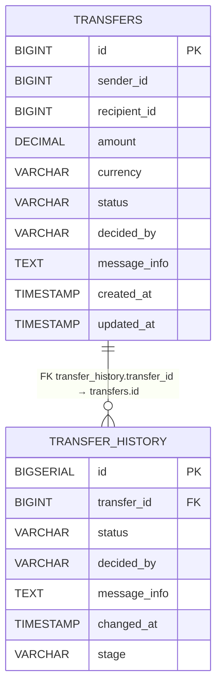
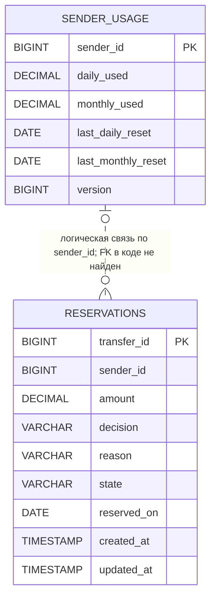
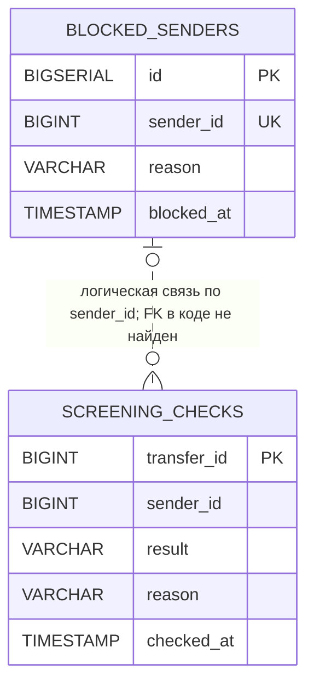
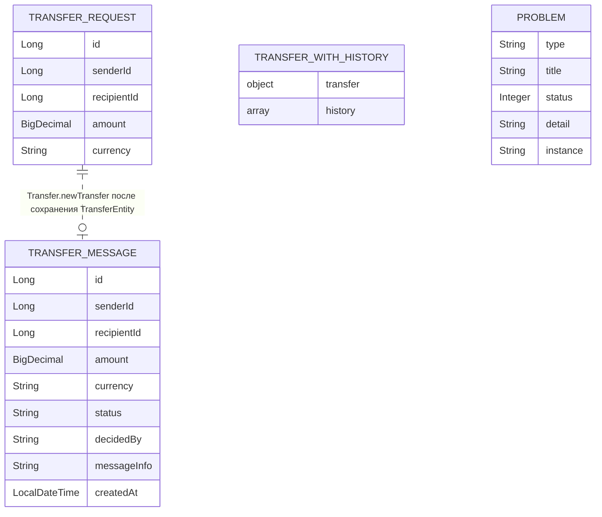
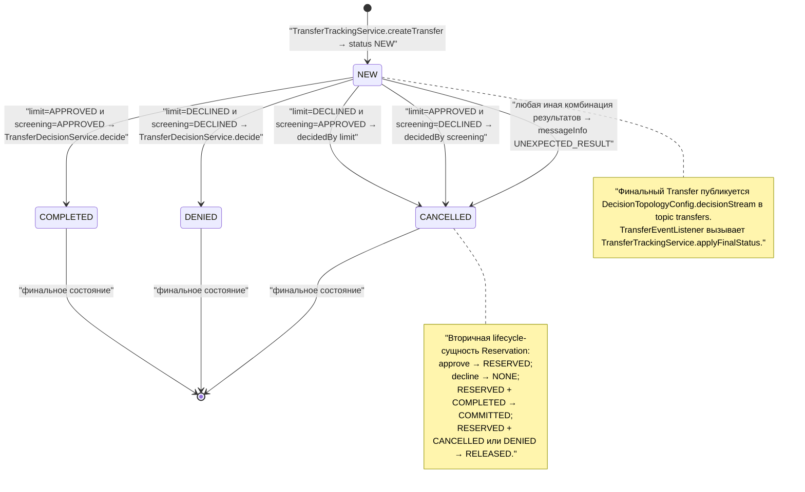

```mermaid
%% ДИАГРАММА 1 — Component diagram (C4)
%% Показаны все найденные в коде runtime-сервисы, PostgreSQL БД, Kafka и используемые топики, включая DLT. Других внешних систем, кроме вызывающего REST API клиента, в коде не найдено.
%% Источники: docker-compose.yml; TransferController; DecisionTopologyConfig; TransferEventListener; limit.TransferEventsListener; screening.TransferEventsListener.

flowchart TB

    subgraph EXT["Внешняя среда"]
        CLIENT["API-клиент<br/>имя в коде не найдено"]
    end

    subgraph TS["Контейнер: transfer-service"]
        TC["TransferController"]
        TTS["TransferTrackingService"]
        TEL["TransferEventListener"]
        DTC["DecisionTopologyConfig.decisionStream"]
        TDS["TransferDecisionService.decide"]
        TKEH["KafkaErrorHandlingConfig.kafkaErrorHandler"]
    end

    subgraph LS["Контейнер: limit-service"]
        LEL["limit.listener.TransferEventsListener"]
        LSVC["LimitService"]
        LLED["LimitLedger"]
        LKEH["limit.config.KafkaErrorHandlingConfig.kafkaErrorHandler"]
    end

    subgraph SS["Контейнер: screening-service"]
        SEL["screening.listener.TransferEventsListener"]
        SSVC["ScreeningService"]
        SJ["ScreeningJournal"]
        SKEH["screening.config.KafkaErrorHandlingConfig.kafkaErrorHandler"]
    end

    subgraph KAFKA["Контейнер: broker — Kafka"]
        TRANSFERS["topic: transfers"]
        LIMIT_RESULTS["topic: limit-results"]
        SCREENING_RESULTS["topic: screening-results"]
        TRANSFERS_DLT["topic: transfers.DLT"]
        LIMIT_RESULTS_DLT["topic: limit-results.DLT"]
        SCREENING_RESULTS_DLT["topic: screening-results.DLT"]
    end

    subgraph TDB["Контейнер: transfer-db — PostgreSQL / transferdb"]
        TDB_DATA["tables: transfers, transfer_history"]
    end

    subgraph LDB["Контейнер: limit-db — PostgreSQL / limitdb"]
        LDB_DATA["tables: sender_usage, reservations"]
    end

    subgraph SDB["Контейнер: screening-db — PostgreSQL / screeningdb"]
        SDB_DATA["tables: blocked_senders, screening_checks"]
    end

    CLIENT -->|"HTTP REST / POST /transfers; GET /transfers; GET /transfers/{id}"| TC

    TC -->|"in-process Java / TransferTrackingService.createTransfer"| TTS
    TC -->|"JPA + JDBC PostgreSQL / TransferRepository и TransferHistoryRepository"| TDB_DATA
    TTS -->|"JPA + JDBC PostgreSQL / transfer-db:5432/transferdb"| TDB_DATA
    TC -->|"Kafka PLAINTEXT / broker:29092 / topic transfers / key Long / value Transfer JSON"| TRANSFERS

    TRANSFERS -->|"Kafka consumer / group limit / limit-transfers-listener / TransferEventsListener.onEvent"| LEL
    LEL -->|"in-process Java / LimitService.onNewTransfer или LimitService.onFinalStatus"| LSVC
    LSVC -->|"in-process Java / LimitLedger.decide или LimitLedger.settle"| LLED
    LLED -->|"JPA + JDBC PostgreSQL / limit-db:5432/limitdb"| LDB_DATA
    LSVC -->|"Kafka PLAINTEXT / topic limit-results / key transfer.id / value Transfer JSON"| LIMIT_RESULTS

    TRANSFERS -->|"Kafka consumer / group screening / screening-transfers-listener / TransferEventsListener.onEvent"| SEL
    SEL -->|"in-process Java / ScreeningService.onNewTransfer для status NEW"| SSVC
    SSVC -->|"in-process Java / ScreeningJournal.check"| SJ
    SJ -->|"JPA + JDBC PostgreSQL / screening-db:5432/screeningdb"| SDB_DATA
    SSVC -->|"Kafka PLAINTEXT / topic screening-results / key transfer.id / value Transfer JSON"| SCREENING_RESULTS

    LIMIT_RESULTS -->|"Kafka Streams / DecisionTopologyConfig.decisionStream"| DTC
    SCREENING_RESULTS -->|"Kafka Streams / DecisionTopologyConfig.decisionStream"| DTC
    DTC -->|"in-process Java method reference / TransferDecisionService.decide"| TDS
    TDS -->|"in-process Java / итоговый Transfer"| DTC
    DTC -->|"Kafka Streams / topic transfers / join window 10 seconds"| TRANSFERS

    TRANSFERS -->|"Kafka consumer / group transfer-tracker / TransferEventListener.onEvent"| TEL
    LIMIT_RESULTS -->|"Kafka consumer / group transfer-tracker / TransferEventListener.onEvent"| TEL
    SCREENING_RESULTS -->|"Kafka consumer / group transfer-tracker / TransferEventListener.onEvent"| TEL
    TEL -->|"in-process Java / recordServiceResult или applyFinalStatus"| TTS

    LEL -.->|"Spring Kafka DefaultErrorHandler / после FixedBackOff / topic transfers.DLT"| LKEH
    LKEH -.->|"Kafka / transfers.DLT / исходная partition"| TRANSFERS_DLT

    SEL -.->|"Spring Kafka DefaultErrorHandler / после FixedBackOff / topic transfers.DLT"| SKEH
    SKEH -.->|"Kafka / transfers.DLT / исходная partition"| TRANSFERS_DLT

    TEL -.->|"Spring Kafka DefaultErrorHandler / ошибка записи из transfers"| TKEH
    TEL -.->|"Spring Kafka DefaultErrorHandler / ошибка записи из limit-results"| TKEH
    TEL -.->|"Spring Kafka DefaultErrorHandler / ошибка записи из screening-results"| TKEH
    TKEH -.->|"Kafka / transfers.DLT"| TRANSFERS_DLT
    TKEH -.->|"Kafka / limit-results.DLT"| LIMIT_RESULTS_DLT
    TKEH -.->|"Kafka / screening-results.DLT"| SCREENING_RESULTS_DLT
```

```mermaid
%% ДИАГРАММА 2 — Sequence diagram: основной успешный сценарий
%% Happy path — создание перевода, успешные проверки лимитов и screening, объединение результатов в COMPLETED и фиксация финального статуса. HTTP 201 возвращается после публикации NEW, а окончательный результат формируется асинхронно через Kafka.
%% Источники: TransferController.create/publishNew; LimitLedger.decide/settle; ScreeningJournal.check; DecisionTopologyConfig.decisionStream; TransferDecisionService.decide; TransferTrackingService.

sequenceDiagram
    actor C as API-клиент
    participant TC as TransferController
    participant TTS as TransferTrackingService
    participant TDB as transfer-db
    participant K as Kafka
    participant LL as limit.TransferEventsListener
    participant LS as LimitService
    participant LLED as LimitLedger
    participant LDB as limit-db
    participant SL as screening.TransferEventsListener
    participant SS as ScreeningService
    participant SJ as ScreeningJournal
    participant SDB as screening-db
    participant TEL as TransferEventListener
    participant DT as DecisionTopologyConfig
    participant DS as TransferDecisionService

    C->>TC: "HTTP POST /transfers → TransferController.create"
    TC->>TDB: "TransferRepository.findById"
    TDB-->>TC: "Optional.empty"

    TC->>TTS: "TransferTrackingService.createTransfer"
    TTS->>TDB: "saveAndFlush TransferEntity со status NEW"
    TTS->>TDB: "save TransferHistoryEntry stage NEW, status NEW"
    TDB-->>TTS: "commit транзакции"
    TTS-->>TC: "TransferEntity"

    TC->>K: "TransferController.publishNew → topic transfers → Transfer status NEW"
    K-->>TC: "Kafka send acknowledgement"
    TC-->>C: "HTTP 201 Created → TransferEntity со status NEW"

    Note over K,SL: "limit-service и screening-service получают NEW независимо; порядок обработки между ними не задан"

    K-->>LL: "topic transfers / status NEW → TransferEventsListener.onEvent"
    LL->>LS: "LimitService.onNewTransfer"
    LS->>LLED: "LimitLedger.decide"
    LLED->>LDB: "ReservationRepository.findById"
    LLED->>LDB: "SenderUsageRepository.findById"
    LLED->>LDB: "SenderUsage.reserve → save sender_usage"
    LLED->>LDB: "Reservation.approve → state RESERVED → save reservations"
    LDB-->>LLED: "Reservation decision APPROVED"
    LLED-->>LS: "Reservation APPROVED / RESERVED"
    LS->>K: "LimitService.sendAndWait → topic limit-results → Transfer status APPROVED, decidedBy limit"
    K-->>LS: "Kafka send acknowledgement"

    K-->>SL: "topic transfers / status NEW → TransferEventsListener.onEvent"
    SL->>SS: "ScreeningService.onNewTransfer"
    SS->>SJ: "ScreeningJournal.check"
    SJ->>SDB: "ScreeningCheckRepository.findById"
    SJ->>SDB: "BlockedSenderRepository.findBySenderId"
    SDB-->>SJ: "blocked sender отсутствует"
    SJ->>SDB: "save ScreeningCheck result APPROVED"
    SDB-->>SJ: "ScreeningCheck APPROVED"
    SJ-->>SS: "ScreeningCheck APPROVED"
    SS->>K: "ScreeningService.sendAndWait → topic screening-results → Transfer status APPROVED, decidedBy screening"
    K-->>SS: "Kafka send acknowledgement"

    K-->>TEL: "topic limit-results → TransferEventListener.onEvent"
    TEL->>TTS: "recordServiceResult stage LIMIT"
    TTS->>TDB: "save TransferHistoryEntry stage LIMIT, status APPROVED"

    K-->>TEL: "topic screening-results → TransferEventListener.onEvent"
    TEL->>TTS: "recordServiceResult stage SCREENING"
    TTS->>TDB: "save TransferHistoryEntry stage SCREENING, status APPROVED"

    K-->>DT: "Kafka Streams input topic limit-results"
    K-->>DT: "Kafka Streams input topic screening-results"
    DT->>DS: "TransferDecisionService.decide"
    DS-->>DT: "Transfer status COMPLETED"
    DT->>K: "DecisionTopologyConfig.decisionStream → topic transfers → status COMPLETED"

    K-->>TEL: "topic transfers / status COMPLETED"
    TEL->>TTS: "TransferTrackingService.applyFinalStatus"
    TTS->>TDB: "update transfers.status = COMPLETED"
    TTS->>TDB: "save TransferHistoryEntry stage FINAL, status COMPLETED"

    K-->>LL: "topic transfers / status COMPLETED"
    LL->>LS: "LimitService.onFinalStatus"
    LS->>LLED: "LimitLedger.settle"
    LLED->>LDB: "Reservation.markCommitted → state COMMITTED → save"

    K-->>SL: "topic transfers / status COMPLETED"
    Note over SL: "screening.TransferEventsListener только логирует финальный статус; резервов у screening нет"

    C->>TC: "HTTP GET /transfers/{id} → TransferController.getById"
    TC->>TDB: "TransferRepository.findById"
    TC->>TDB: "TransferHistoryRepository.findByTransferIdOrderByChangedAtAsc"
    TDB-->>TC: "TransferEntity COMPLETED + история NEW, LIMIT, SCREENING, FINAL"
    TC-->>C: "HTTP 200 OK → финальный результат COMPLETED"
```

```mermaid
%% ДИАГРАММА 3 — Sequence diagram: основной сценарий отказа
%% Показан бизнес-отказ, при котором limit-service уже зарезервировал сумму, но screening-service обнаружил заблокированного отправителя. Итог CANCELLED приводит к компенсирующему освобождению ранее зарезервированного лимита; записи аудита и проверки не удаляются.
%% Источники: ScreeningJournal.check; TransferDecisionService.decide; LimitLedger.settle.

sequenceDiagram
    actor C as API-клиент
    participant TC as TransferController
    participant TTS as TransferTrackingService
    participant TDB as transfer-db
    participant K as Kafka
    participant LL as limit.TransferEventsListener
    participant LS as LimitService
    participant LLED as LimitLedger
    participant LDB as limit-db
    participant SL as screening.TransferEventsListener
    participant SS as ScreeningService
    participant SJ as ScreeningJournal
    participant SDB as screening-db
    participant TEL as TransferEventListener
    participant DT as DecisionTopologyConfig
    participant DS as TransferDecisionService

    C->>TC: "HTTP POST /transfers → TransferController.create"
    TC->>TDB: "TransferRepository.findById"
    TDB-->>TC: "Optional.empty"

    TC->>TTS: "TransferTrackingService.createTransfer"
    TTS->>TDB: "insert transfers со status NEW"
    TTS->>TDB: "insert transfer_history stage NEW"
    TDB-->>TTS: "commit"
    TTS-->>TC: "TransferEntity"

    TC->>K: "TransferController.publishNew → topic transfers → NEW"
    K-->>TC: "Kafka send acknowledgement"
    TC-->>C: "HTTP 201 Created → status NEW"

    K-->>LL: "topic transfers / NEW"
    LL->>LS: "LimitService.onNewTransfer"
    LS->>LLED: "LimitLedger.decide"
    LLED->>LDB: "load или создать SenderUsage"
    LLED->>LDB: "SenderUsage.reserve → dailyUsed и monthlyUsed увеличены"
    LLED->>LDB: "Reservation.approve → state RESERVED"
    LDB-->>LLED: "Reservation APPROVED / RESERVED"
    LLED-->>LS: "APPROVED"
    LS->>K: "topic limit-results → Transfer status APPROVED, decidedBy limit"

    K-->>SL: "topic transfers / NEW"
    SL->>SS: "ScreeningService.onNewTransfer"
    SS->>SJ: "ScreeningJournal.check"
    SJ->>SDB: "BlockedSenderRepository.findBySenderId"
    SDB-->>SJ: "BlockedSender найден"
    SJ->>SDB: "save ScreeningCheck result DECLINED, reason SENDER_BLOCKED"
    SDB-->>SJ: "ScreeningCheck DECLINED"
    SJ-->>SS: "DECLINED / SENDER_BLOCKED"
    SS->>K: "topic screening-results → Transfer status DECLINED, decidedBy screening, messageInfo SENDER_BLOCKED"

    K-->>TEL: "topic limit-results"
    TEL->>TTS: "recordServiceResult stage LIMIT"
    TTS->>TDB: "insert transfer_history LIMIT / APPROVED"

    K-->>TEL: "topic screening-results"
    TEL->>TTS: "recordServiceResult stage SCREENING"
    TTS->>TDB: "insert transfer_history SCREENING / DECLINED / SENDER_BLOCKED"

    K-->>DT: "Kafka Streams input limit-results = APPROVED"
    K-->>DT: "Kafka Streams input screening-results = DECLINED"
    DT->>DS: "TransferDecisionService.decide"
    DS-->>DT: "Transfer status CANCELLED, decidedBy screening, messageInfo SENDER_BLOCKED"
    DT->>K: "topic transfers → CANCELLED"

    K-->>TEL: "topic transfers / CANCELLED"
    TEL->>TTS: "TransferTrackingService.applyFinalStatus"
    TTS->>TDB: "update transfers.status = CANCELLED"
    TTS->>TDB: "insert transfer_history FINAL / CANCELLED"

    K-->>LL: "topic transfers / CANCELLED"
    LL->>LS: "LimitService.onFinalStatus"
    LS->>LLED: "LimitLedger.settle"
    LLED->>LDB: "load Reservation со state RESERVED"
    LLED->>LDB: "SenderUsage.release → компенсировать ранее зарезервированную сумму"
    LLED->>LDB: "save SenderUsage"
    LLED->>LDB: "Reservation.markReleased → state RELEASED"
    LLED->>LDB: "save Reservation"

    K-->>SL: "topic transfers / CANCELLED"
    Note over SL: "screening.TransferEventsListener не выполняет компенсацию и только логирует финальный статус"

    Note over TDB,LDB: "Выполненные действия не откатываются глобальной транзакцией: Transfer остаётся CANCELLED с полной историей, ScreeningCheck остаётся DECLINED, Reservation остаётся RELEASED; использование лимита уменьшается через SenderUsage.release"

    C->>TC: "HTTP GET /transfers/{id}"
    TC->>TDB: "чтение transfers и transfer_history"
    TDB-->>TC: "CANCELLED + история NEW, LIMIT, SCREENING, FINAL"
    TC-->>C: "HTTP 200 OK → перевод не выполнен"
```









